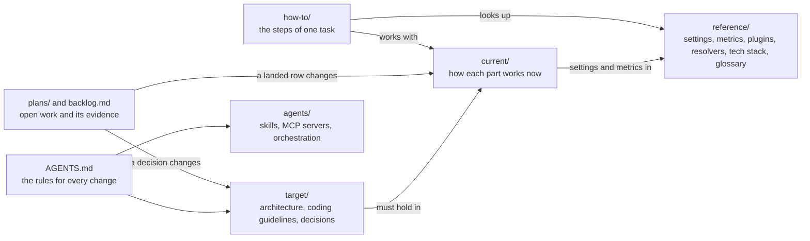

# Scavengarr documentation

> **Purpose:** The one index of the documentation: the map, the state, one line per document with its status, and the documentation rules.
> **Status:** reference
> **As of:** 867eed7a

The one index of the documentation: one line per document with its status.

## The map



`AGENTS.md` points to the `target` documents and the agent tooling.
The `target` documents say what must hold, and the `current` documents describe the code that holds it.
A row of the backlog or a plan changes a `current` document when it lands, and a decision record changes a `target` document.
The `how-to` guides work with the `current` documents and look up the `reference` tables.

## The state

The current docs cover every part of the code: the architecture and its request flows, the Stremio addon, the plugins and their domains, the hoster resolvers, the browser and its challenges, Torznab and CrawlJobs, link validation and observability; [`current/known-issues.md`](current/known-issues.md) holds the open defects.
Open in the hoster resolvers and the browser: the production proof that Filemoon's captcha pass stays warm, read from the maintainer's use.
Open in the production diagnostics: [`how-to/operations.md`](how-to/operations.md)'s `scripts/prodctl.py` moves from Portainer, which answers no more, to Komodo's read requests.
Open in the observability: the stall watchdog of [`add-stall-watchdog`](../openspec/changes/add-stall-watchdog/proposal.md), which names a hang's cause in the log, with its exit switch off until its readings.
The plugins have no open row; their ideas wait in the backlog for their trigger.
The rows behind each item are in [`backlog.md`](backlog.md), and the row that opens or closes an area's work updates this paragraph in the same commit.

## Start here

Agents read [`AGENTS.md`](../AGENTS.md) first: it holds the rules for every change.
To learn how a part works now, read its `current` document; to learn what must hold, read the `target` documents and the decision records.
The `plan` documents are work in progress, not a description of the code, and the history is in git.
Every new or moved document adds its own line here, and every document follows the rules at the end of this file.

| Status | Meaning |
|---|---|
| current | How the code works now; changes only with the code. |
| target | What must hold; changes only by a decision record. |
| how-to | The steps of one task. |
| reference | Lookup tables, generated where a script can produce them. |
| plan | Open work and its evidence. |

## What Scavengarr does

One line per feature, with the document that describes it.

| Feature | What it does | Described in |
|---|---|---|
| Python plugins | Each site is one Python file on `HttpxPluginBase` or `PlaywrightPluginBase`, with shared bases for sites on one backend. | [Plugins](current/plugins.md#base-classes) |
| Multi-stage scraping | A plugin runs the search page, the detail pages and the links itself, with bounded concurrency. | [Plugins](current/plugins.md#search-stages) |
| Per-plugin overrides | `plugins.overrides` sets a plugin's timeout, concurrency, result cap and whether it runs. | [Configuration](reference/configuration.md#plugins) |
| Plugin domains | The domain check finds a reachable domain, follows site moves and reads official domain lists. | [Plugin domains](current/plugin-domains.md) |
| Plugin scores and probes | Background probes keep a weighted average of each plugin's health and search quality. | [Plugins](current/plugins.md#scores-and-probes) |
| Torznab and Newznab API | `caps` and `search` serve Prowlarr and the Arr apps. | [Torznab API](reference/torznab-api.md) |
| Prowlarr integration | Prowlarr finds the indexers, Sonarr and Radarr search through it, and JDownloader takes the grabs. | [Connect Prowlarr](how-to/connect-prowlarr.md) |
| CrawlJobs | A grab is one `.crawljob` file with the validated links of a release, for JDownloader. | [Torznab and CrawlJobs](current/torznab-and-crawljobs.md#the-crawljob) |
| Link validation | Download links are checked in parallel with `HEAD`, then `GET` where needed. | [Link validation](current/link-validation.md) |
| Stremio addon | The manifest, the catalogs and the streams answer IMDb and `kitsu:` ids, with TMDB titles in each plugin's languages. | [Stremio addon](current/stremio-addon.md) |
| Search cache and answer budget | Searches are cached per title, and a request answers at its budget with the results known by then. | [Stremio addon](current/stremio-addon.md#the-search-cache) |
| Stream ranking | Streams are ranked by a weighted score, and each hoster and language keeps its best-ranked stream. | [Stremio addon](current/stremio-addon.md#ranking) |
| HLS and file proxy | Streams bound to headers or to the resolving address play through Scavengarr's own proxy. | [Stremio addon](current/stremio-addon.md#hls-proxy) |
| Hoster resolvers | Individual, generic DDL and XFS resolvers turn a hoster link into a stream or a checked download. | [Hoster resolvers](current/hoster-resolvers.md), [resolver list](reference/resolvers.md) |
| Circuit breakers | A plugin per category, or a hoster, is skipped after repeated failures until it recovers. | [Stremio addon](current/stremio-addon.md#circuit-breakers), [Hoster resolvers](current/hoster-resolvers.md#the-circuit-breaker) |
| Shared browser and stealth pool | One Chromium serves the browser plugins and the captures, with a stealth context for protected pages. | [Browser and challenges](current/browser-and-challenges.md) |
| Concurrency pool | httpx and browser slots are shared fairly across concurrent Stremio requests. | [Architecture](current/architecture.md#infrastructure) |
| Auto-tune | Concurrency limits follow the container's CPU and memory at startup. | [Configuration](reference/configuration.md#auto-tune) |
| HTTP rate limits and retries | Every outbound request goes through per-domain token buckets, and a 429 or 503 is retried with backoff. | [Architecture](current/architecture.md#cross-cutting-runtime) |
| API rate limit | `http.api_rate_limit_rpm` limits the requests per client address. | [Torznab API](reference/torznab-api.md#rate-limiting) |
| Configuration | CLI arguments, the environment, YAML and the defaults set typed settings, in that precedence. | [Configuration](reference/configuration.md) |
| Structured logging | structlog writes JSON or console lines, and every request's lines carry its `request_id`. | [Observability](current/observability.md#request-id) |
| Metrics and tracing | The core's stages are Prometheus metrics, and OpenTelemetry traces on demand. | [Observability](current/observability.md), [Metrics](reference/metrics.md) |
| Health endpoints | `/api/v1/healthz` reports the build; `/api/v1/readyz`, the image's healthcheck, answers once the startup has finished and turns 503 when the cache backend and the DNS have both failed for 5 min. | [Torznab API](reference/torznab-api.md#application-health), [Readiness](current/observability.md#readiness) |
| Graceful shutdown | In-flight requests get up to 5 s, then the background work ends before the cache closes. | [Architecture](current/architecture.md#shutdown) |
| Tests | Unit, integration and end-to-end tests run on every commit, live tests against the sites on demand. | [Contributing](../CONTRIBUTING.md#running-tests) |

## Repository root

| Document | Status | What it holds |
|---|---|---|
| [`README.md`](../README.md) | current | What Scavengarr is, the quick start and the configuration overview. |
| [`AGENTS.md`](../AGENTS.md) | target | The rules for every change, for agents and developers alike. |
| [`CONTRIBUTING.md`](../CONTRIBUTING.md) | how-to | The dev setup, the project layout, the tests and the contribution workflow. |
| [`CHANGELOG.md`](../CHANGELOG.md) | reference | The release history and the open defects. |

## Architecture

| Document | Status | What it holds |
|---|---|---|
| [`current/architecture.md`](current/architecture.md) | current | The module map, the request flows, the composition order and the shutdown sequence. |
| [`target/architecture.md`](target/architecture.md) | target | The dependency rule, the layer contracts and the invariants. |
| [`target/decisions/0001-dependency-rule.md`](target/decisions/0001-dependency-rule.md) | target | Source code depends inward only. |
| [`target/decisions/0002-anime-ids-from-the-kitsu-addon.md`](target/decisions/0002-anime-ids-from-the-kitsu-addon.md) | target | Anime ids come from the Anime Kitsu addon, with Fribb's list as the fallback. |
| [`target/decisions/0003-answer-budget-beside-the-plugin-timeout.md`](target/decisions/0003-answer-budget-beside-the-plugin-timeout.md) | target | The answer budget bounds the answer, not the plugins. |
| [`target/decisions/0004-episode-placement-by-number-first.md`](target/decisions/0004-episode-placement-by-number-first.md) | target | A located episode is placed by its number first. |
| [`target/decisions/0005-read-ahead-of-three-segments.md`](target/decisions/0005-read-ahead-of-three-segments.md) | target | The HLS proxy reads three segments ahead. |
| [`target/decisions/0006-direct-streams-proxied.md`](target/decisions/0006-direct-streams-proxied.md) | target | Address-bound direct files go through Scavengarr's proxy. |
| [`target/decisions/0007-plugin-timeout-of-30-s.md`](target/decisions/0007-plugin-timeout-of-30-s.md) | target | A plugin's search gets 30 s, and the answer waits for its target. |
| [`target/decisions/0008-dead-site-plugins-stay-enabled.md`](target/decisions/0008-dead-site-plugins-stay-enabled.md) | target | A plugin whose site is down stays enabled. |
| [`target/decisions/0009-pass-keeper-demand-bound.md`](target/decisions/0009-pass-keeper-demand-bound.md) | target | Filemoon's captcha pass is kept only while there is demand. |
| [`target/decisions/0010-adaptive-page-budget.md`](target/decisions/0010-adaptive-page-budget.md) | target | Browser pages go by their work's claim, and their count adapts. |
| [`target/decisions/0011-own-scripts-only-captures.md`](target/decisions/0011-own-scripts-only-captures.md) | target | Captures that opt in load only their page's own scripts. |
| [`target/decisions/0012-challenge-outside-the-breaker.md`](target/decisions/0012-challenge-outside-the-breaker.md) | target | A challenge is an outcome of its own, outside the circuit breaker. |
| [`target/decisions/0013-mirror-groups.md`](target/decisions/0013-mirror-groups.md) | target | Mirror sites form a group, and a Stremio request asks one of them. |
| [`target/decisions/0014-resolver-state-snapshot.md`](target/decisions/0014-resolver-state-snapshot.md) | target | The resolver registry's state outlives a restart as one snapshot. |
| [`target/decisions/0015-privacy-rule.md`](target/decisions/0015-privacy-rule.md) | target | Docs and commit texts tell nothing about what the maintainer watches. |
| [`target/decisions/_template.md`](target/decisions/_template.md) | target | The template of a decision record. |

## Features

| Document | Status | What it holds |
|---|---|---|
| [`current/stremio-addon.md`](current/stremio-addon.md) | current | The Stremio addon: the endpoints, anime ids, titles, the search cache, matching, ranking and the proxies. |
| [`how-to/stremio-deployment.md`](how-to/stremio-deployment.md) | how-to | Deploying the addon with a streaming server, a VPN container and AIOStreams. |
| [`current/browser-and-challenges.md`](current/browser-and-challenges.md) | current | The shared browser, the stealth pool, the page gate, the clearance store and capture state, and challenges. |
| [`current/plugins.md`](current/plugins.md) | current | How plugins are discovered, loaded and called: the contract, the base classes, the search stages, episodes, selection and scores. |
| [`current/plugin-domains.md`](current/plugin-domains.md) | current | The domain check, site moves, official domain lists and mirror groups. |
| [`how-to/new-plugin.md`](how-to/new-plugin.md) | how-to | Writing a new plugin, from the site analysis to the regenerated plugin list. |
| [`current/hoster-resolvers.md`](current/hoster-resolvers.md) | current | How a hoster link becomes a stream: the dispatch, the playback headers, the CDN checks, the captures, the outcomes, the breaker, the caches and Filemoon's pass keeper. |
| [`how-to/new-resolver.md`](how-to/new-resolver.md) | how-to | Adding or repairing a hoster resolver, from the unresolved hosters to the regenerated resolver list. |
| [`current/torznab-and-crawljobs.md`](current/torznab-and-crawljobs.md) | current | How a Torznab search becomes a feed, and a CrawlJob's life from the search to the grab. |
| [`current/link-validation.md`](current/link-validation.md) | current | The HEAD then GET check of download links, its host skip and its cache. |
| [`current/observability.md`](current/observability.md) | current | What the core records and where: the stages, the request id, the plugin record, Prometheus, Grafana, the alerts and tracing on demand. |
| [`reference/metrics.md`](reference/metrics.md) | reference | Every metric with its labels, buckets and values, and the stats endpoints; the table generated by `scripts/generate_metrics_doc.py`. |
| [`how-to/operations.md`](how-to/operations.md) | how-to | Reading production with `scripts/prodctl.py`: logs, metrics, the digest, the post-deploy check and the probes. |
| [`how-to/performance-measurement.md`](how-to/performance-measurement.md) | how-to | Measuring stream requests, a playback under load and the title set before and after a change. |
| [`current/known-issues.md`](current/known-issues.md) | current | The open defects, one line each, with where each is tracked. |
| [`reference/configuration.md`](reference/configuration.md) | reference | Every setting with its environment variable, the precedence of CLI, environment, YAML and defaults. |
| [`reference/torznab-api.md`](reference/torznab-api.md) | reference | The Torznab and download endpoints, their parameters, XML and errors. |
| [`how-to/deploy.md`](how-to/deploy.md) | how-to | Running the container image: tags, Compose profiles, Redis, a VPN container, a reverse proxy, the build identity. |
| [`how-to/connect-prowlarr.md`](how-to/connect-prowlarr.md) | how-to | Connecting Prowlarr, Sonarr, Radarr and JDownloader to Scavengarr. |

## Reference and guidelines

| Document | Status | What it holds |
|---|---|---|
| [`reference/plugins.md`](reference/plugins.md) | reference | The plugin list, generated by `scripts/generate_plugin_list.py`. |
| [`reference/resolvers.md`](reference/resolvers.md) | reference | The resolver list with every resolver's domains, generated by `scripts/generate_resolver_list.py`. |
| [`reference/tech-stack.md`](reference/tech-stack.md) | reference | Every dependency with its purpose and the reason for it, the tools beside the Python packages and the alternatives not used. |
| [`reference/glossary.md`](reference/glossary.md) | reference | The terms of this codebase in one sentence each, with the document that holds them. |
| [`target/coding-guidelines.md`](target/coding-guidelines.md) | target | The rules the code follows for the event loop, shared resources, concurrency, scraping, browser pages, caching, retries and logging. |

## Agent tooling

| Document | Status | What it holds |
|---|---|---|
| [`how-to/dev-container.md`](how-to/dev-container.md) | how-to | Setting up and working in the dev container: git access, its tools, checks in a worktree, the editor, the Claude Code hooks and the production diagnostics. |
| [`agents/skills.md`](agents/skills.md) | reference | The Claude Code skills of the dev container and their sources. |
| [`agents/mcp-servers.md`](agents/mcp-servers.md) | reference | The MCP servers of `.mcp.json` and what installs them. |

## Plans

Open plans stay in `docs/plans/`; a closed plan is deleted once its outcome is in its successor document ([History](#history)).

| Document | Status | What it holds |
|---|---|---|
| [`backlog.md`](backlog.md) | plan | The open rows of the work queue and the ideas not yet taken up; a coder's hashes and Mr. Fable's acceptance go on the row's line |
| [`agents/orchestration.md`](agents/orchestration.md) | reference | The three sessions' roles, working rules, worktrees, production access and the maintainer's standing decisions |
| [`plans/challenge-reactions.md`](plans/challenge-reactions.md) | plan (open) | What Scavengarr does once a page shows a challenge or a captcha. |
| [`plans/stremio-latency.md`](plans/stremio-latency.md) | plan (open) | The Stremio response time and playable streams, with its open investigation. |

## History

The git history holds every earlier state of the docs, the closed plans and the old backlog included; no folder keeps them.
A closed plan or record is deleted with the row that closes it, after the numbers a decision or a current doc rests on are carried into that document.

| Command | What it shows |
|---|---|
| `git log --oneline -- <path>` | The commits that changed a document. |
| `git log --diff-filter=D --name-only --oneline -- docs` | The deleted documents, each under the commit that deleted it. |
| `git show <commit>^:<path>` | A deleted document as it was before that commit. |

## Documentation rules

Every document under `docs/` starts with its title and a status block:

```markdown
# <Title>

> **Purpose:** <one sentence: what the document is for>
> **Status:** current | target | how-to | reference | plan
> **As of:** <short hash of the staging commit the text describes>
```

A `current` document's purpose line is the first sentence of its Purpose section, and a decision record's says what it records.
A generated reference file names its generator in its purpose line and carries no further status lines; a reference file with generated tables names the generator there too and keeps them.

Sections in a fixed order per kind:

| Kind | Sections |
|---|---|
| `current/` | Purpose · How it works (with a Mermaid diagram where a flow or state machine exists) · Configuration (a link into `reference/configuration.md`, no copied tables) · Observability (a link into `reference/metrics.md`) · Limits · Target (the open rows and specs, as links) · References (modules, specs) |
| `target/` | Rule · Rationale · Consequences · Exceptions · References |
| `target/decisions/` | Context · Decision · Consequences · Alternatives (the options not taken and why, or that none is on record) · Status (accepted, superseded by NNNN) · References (the modules, specs and current docs that implement it) |
| `how-to/` | Goal · Prerequisites · Steps · Verify · Troubleshooting |
| `reference/` | generated tables where possible; otherwise the lookup tables with one line per entry |

Style, the same for every document:

- English; present tense for current behaviour; "must" for rules; "will" only in Target sections.
- The privacy rule (AGENTS.md §1): no clock times or dates of observations, no request ids, no titles or ids of the maintainer's requests, no LAN, ISP, VPN or device names; durations, counts and build hashes are the evidence.
- No backlog ids ("row 106", "finding 11", "N1", "R2") and no dated asides outside `docs/backlog.md` and `docs/plans/`: a current doc states the behaviour, the git history states where it came from.
- One sentence per line in paragraphs (semantic line breaks: small diffs, exact edits); a table cell holds at most one sentence, longer content becomes a paragraph or a list under the table.
- Headings to H3; one H1; paths, settings and symbols in backticks; a current doc with a flow or state machine has at least one Mermaid diagram, and the diagram and the prose say the same thing; no ASCII boxes.
- Fixed terms: the production host, the dev container, the maintainer, a request, a search, a capture, a pass, a challenge, a mirror group, the answer budget, the plugin timeout; "CrawlJob" for the entity, `.crawljob` for the file.
- No hand-kept counts (plugins, resolvers, tests, versions): the generated reference files carry the counts, and a version example reads `<version>`.

Diagrams per current doc, each a Mermaid fence:

| Doc | Diagrams |
|---|---|
| `current/architecture.md` | the Torznab search and the Stremio stream request as sequence diagrams; the composition order and the shutdown sequence (both halves: the app's drain and Uvicorn's wait) as flowcharts |
| `target/architecture.md` | the layer graph with the allowed edges only, matching the rule table |
| `current/stremio-addon.md` | the search cache entry's states (missing, fresh, stale, partial, refreshing) as a state diagram; the answer budget against the plugin timeout as a sequence; the `kitsu:` id translation as a flowchart |
| `current/hoster-resolvers.md` | a link's outcome states (stream, dead, challenge with its cooldown steps, breaker open) as a state diagram; the dispatch (client-bound, address-bound → `/play` or `/proxy/<id>/file`) as a flowchart |
| `current/browser-and-challenges.md` | the page gate as a flowchart; the capture state's life cycle (restore, use, save, expire) as a state diagram |
| `current/plugins.md` | the search stages as a sequence; the plugin selection for a Stremio request (score, mirror group, reachability) as a flowchart |
| `current/plugin-domains.md` | the domain decision (configured domains, official list and marker, redirect, recheck) as a flowchart |
| `current/torznab-and-crawljobs.md` | request to XML as a sequence; the CrawlJob life cycle as a state diagram |
| `current/link-validation.md` | HEAD then GET as a flowchart |
