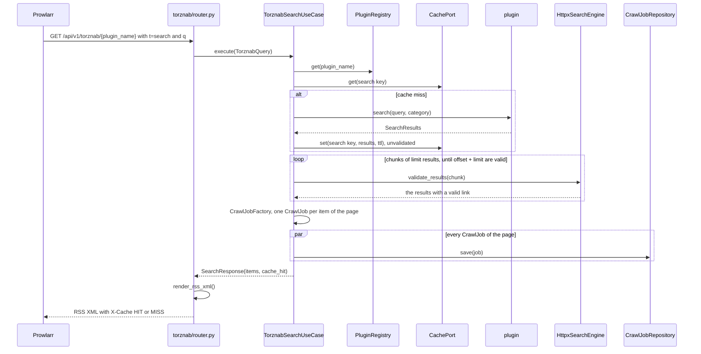
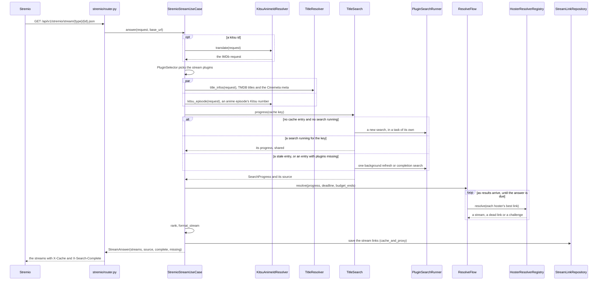
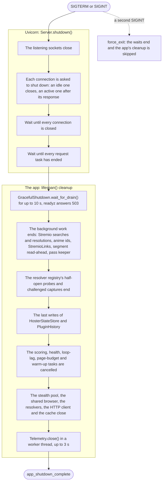

# Architecture

> **Status:** current
> **As of:** 5b4303e4

## Purpose

This document maps the modules of `src/scavengarr/` to their layers, follows a Torznab search and a Stremio stream request through them, and gives the order in which the app starts and stops.
The rules the layers must keep are in [`docs/target/architecture.md`](../target/architecture.md); the decisions behind them are in [`docs/target/decisions/`](../target/decisions/).
Paths below are relative to `src/scavengarr/` unless they start at the repository root.

## How it works

### Layers

The code lives in four layers: `domain/`, `application/`, `infrastructure/` and `interfaces/`.
The domain defines entities and `Protocol` ports, the application orchestrates them in use cases, infrastructure implements the ports, and the interfaces layer turns HTTP requests into use case calls.
Infrastructure never imports application: the two meet in the domain's ports and in the composition root (`interfaces/composition.py`), which builds every adapter and hands it to the use cases.
The Torznab use cases are built per request in their router from the app state; the Stremio use cases are built once in the composition root.
The site plugins live outside the package in `plugins/`, one module per site, and are infrastructure adapters loaded at runtime (how they work: [`docs/current/plugins.md`](plugins.md); the list: [`docs/reference/plugins.md`](../reference/plugins.md)).

### Domain

Entities, value objects and the plugin contract:

| Path | Holds | Key symbols |
|---|---|---|
| `domain/entities/torznab.py` | The Torznab query, item, capabilities and indexer info, with the Torznab errors. | `TorznabQuery`, `TorznabItem`, `TorznabCaps`, `TorznabIndexInfo`, `TorznabError` |
| `domain/entities/crawljob.py` | The frozen CrawlJob entity with its expiry and its `.crawljob` format. | `CrawlJob`, `BooleanStatus`, `Priority`, `CrawlJobResolveError` |
| `domain/entities/stremio.py` | The Stremio types, the catalog's record of a series and the partial-title rule. | `StremioStreamRequest`, `StremioStream`, `StremioMetaPreview`, `RankedStream`, `StreamQuality`, `StreamLanguage`, `TitleMatchInfo`, `TitleMatches`, `SeriesMeta`, `EpisodeMeta`, `EpisodeRef`, `CachedStreamLink`, `ResolvedStream`, `is_partial_title` |
| `domain/entities/scoring.py` | The plugin scoring types. | `ProbeResult`, `EwmaState`, `PluginScoreSnapshot` |
| `domain/plugins/base.py` | The plugin contract and its optional capabilities. | `SearchResult`, `PluginProtocol`, `PluginProvides`, `GrabResolvingPlugin`, `locates_episodes`, `result_key`, `PluginUnreachableError` |
| `domain/plugins/exceptions.py` | The plugin errors. | `PluginError`, `PluginLoadError`, `PluginNotFoundError` |

The ports, all `Protocol` classes:

| Port | Module | Kind | Members |
|---|---|---|---|
| `CachePort` | `domain/ports/cache.py` | async | `get`, `set`, `delete`, `exists`, `clear`, `aclose`, async context manager |
| `SearchEnginePort` | `domain/ports/search_engine.py` | async | `validate_results` |
| `PluginRegistryPort` | `domain/ports/plugin_registry.py` | sync | `discover`, `list_names`, `get`, `get_by_provides`, `get_languages`, `get_mode` |
| `CrawlJobRepository` | `domain/ports/crawljob_repository.py` | async | `save`, `get` |
| `StreamLinkRepository` | `domain/ports/stream_link_repository.py` | async | `save`, `get` |
| `HosterResolverPort` | `domain/ports/hoster_resolver.py` | async | `name`, `resolve` |
| `ClientBoundResolverPort` | `domain/ports/hoster_resolver.py` | async | `bound_headers`, `resolve_for_client` |
| `PluginScoreStorePort` | `domain/ports/plugin_score_store.py` | async | `get_snapshot`, `put_snapshot`, `list_snapshots`, `get_last_run`, `set_last_run` |
| `TmdbClientPort` | `domain/ports/tmdb.py` | async | `find_by_imdb_id`, `get_title_and_year`, `get_title_by_tmdb_id`, `trending_movies`, `trending_tv`, `search_movies`, `search_tv` |
| `AnimeIdResolverPort` | `domain/ports/anime_ids.py` | async | `translate`, `kitsu_episode`, `has_whole_series_entry`, `aclose`; `NO_ANIME_IDS` |
| `SeriesMetaPort` | `domain/ports/series_meta.py` | async | `lookup`; `NO_SERIES_META` |
| `PluginHistoryPort` | `domain/ports/plugin_history.py` | sync | `count` of a `PluginCounter`, the `Literal` that names every counter (`challenges_unsolved` among them); `NO_PLUGIN_HISTORY`; a search's `ChallengeFlag` with `challenge_flag`, `mark_challenge`, `settle_challenge` |
| `ConcurrencyPoolPort` | `domain/ports/concurrency.py` | async context manager | `request()`, which gives a `ConcurrencyBudgetPort` |
| `ConcurrencyBudgetPort` | `domain/ports/concurrency.py` | async context manager | `acquire_httpx()`, `acquire_pw()` |
| `BrowserFetcherPort` | `domain/ports/browser_fetcher.py` | async | `fetch_text`, `resolve_redirect`, `click_through`, `session`; the work's `PageClaim` in `page_claim` |
| `TelemetryPort` | `domain/ports/telemetry.py` | sync | `stage()`, `count()`, `record()`; `NO_TELEMETRY` |

The domain exceptions:

- `TorznabError` and its subclasses `TorznabBadRequest`, `TorznabUnsupportedAction`, `TorznabPluginNotFound` and `TorznabExternalError`.
- `PluginError` and its subclasses `PluginLoadError` (a plugin file that fails to import or breaks the contract) and `PluginNotFoundError` (a name the registry does not know).
- `CrawlJobResolveError`: the grab-time links of a CrawlJob could not be resolved.
- `PluginUnreachableError`: no domain of a plugin's site answered.

The interfaces layer maps them to HTTP status codes; the Torznab table is in [`docs/reference/torznab-api.md`](../reference/torznab-api.md).

### Application

The use cases and the factory:

| Path | Key symbols | What it does |
|---|---|---|
| `application/use_cases/torznab_search.py` | `TorznabSearchUseCase`, `SearchResponse` | The Torznab search: cache, plugin search, link validation up to the requested page, one CrawlJob per item. |
| `application/use_cases/torznab_caps.py` | `TorznabCapsUseCase` | A plugin's Torznab capabilities. |
| `application/use_cases/torznab_indexers.py` | `TorznabIndexersUseCase` | The loaded plugins with their version and mode, sorted by name. |
| `application/use_cases/crawljob_resolve.py` | `CrawlJobResolveUseCase` | A grabbed CrawlJob's links, resolved through its `GrabResolvingPlugin`. |
| `application/use_cases/stremio_stream.py` | `StremioStreamUseCase` | A Stremio request's streams, best first. |
| `application/use_cases/stremio_links.py` | `StremioLinks` | The stored stream links behind `/play` and the proxy, resolved again when stale or refused by the CDN. |
| `application/use_cases/stremio_catalog.py` | `StremioCatalogUseCase` | The TMDB trending and search catalogs. |
| `application/factories/crawljob_factory.py` | `CrawlJobFactory` | A `SearchResult` turned into a CrawlJob. |

The helpers of the Stremio use case:

| Path | Key symbols | What it does |
|---|---|---|
| `application/stremio/title_resolution.py` | `TitleResolver` | The request's title per language, the plugins' languages and the title match of the results. |
| `application/stremio/plugin_selection.py` | `PluginSelector` | The stream plugins, or the best scored of them with an exploration slot. |
| `application/stremio/title_search.py` | `TitleSearch`, `answer_budget_s` | One search per title: shared while it runs, cached, refreshed and completed one title at a time. |
| `application/stremio/plugin_search.py` | `PluginSearchRunner` | The fan-out over the plugins with their slots, plugin timeout, circuit breaker, health and mirror groups. |
| `application/stremio/search_progress.py` | `SearchProgress` | A running search's title-matching results, shared by the requests that wait on it. |
| `application/stremio/search_cache.py` | `SearchCache`, `CachedSearch` | The title-filtered results per title, with the plugins still missing. |
| `application/stremio/resolution.py` | `HosterResolution`, `ResolveFlow` | One request's resolutions, and when its answer is due. |
| `application/stremio/answer.py` | `rank_streams`, `with_measurements`, `cache_and_proxy` | The answer's streams, ranked, merged with what the resolutions found, served through `/play` or the proxy. |
| `application/stremio/queries.py` | `build_search_queries`, `build_lang_group_queries` | The search queries and the multi-language title references. |
| `application/stremio/stream_builder.py` | `format_stream`, `deduplicate_by_hoster`, `build_stream_from_resolved` | The Stremio stream objects with their behaviour hints and links. |

`StremioStreamUseCase` gets the infrastructure functions it needs as injected callables: `convert_fn` (`convert_search_results`), `filter_fn` (`filter_by_title_match`), `episode_filter_fn` (`filter_by_episode`), `resolve_fn` (`HosterResolverRegistry.resolve`), `cached_resolution_fn` (`HosterResolverRegistry.cached`) and `browser_warmup_fn` (`SharedBrowserPool.warmup`).

### Infrastructure

Anime ids, the browser and the anti-bot handling:

| Path | Key symbols | What it does |
|---|---|---|
| `infrastructure/anime/resolver.py` | `KitsuAnimeIdResolver` | `kitsu:` requests translated into IMDb requests, and IMDb anime episodes numbered as Kitsu counts them. |
| `infrastructure/anime/kitsu_addon.py` | `KitsuAddonClient` | The Anime Kitsu addon's record of a title: its IMDb id and the episode placement. |
| `infrastructure/anime/id_lists.py` | `AnimeIdLists` | Fribb's anime-lists, the fallback when the addon gives nothing. |
| `infrastructure/browser/shared_browser.py` | `SharedBrowserPool` | One Chromium for the Playwright plugins and the stealth pool. |
| `infrastructure/browser/stealth_pool.py` | `StealthPool`, `CapturedMedia` | The Patchright stealth context: pages behind Cloudflare, and the capture of a player's stream request. |
| `infrastructure/browser/page_gate.py` | `PageGate`, `PageBusy`, `ChallengeMark` | Who gets the stealth browser's next page, by the work's `PageClaim`, and a resolution's challenge mark and clock (`work_clock`). |
| `infrastructure/browser/page_budget.py` | `PageBudget` | How many stealth pages may run at once, adapted every few seconds. |
| `infrastructure/browser/clearance_store.py` | `ClearanceStore` | Challenge cookies and the capture hosters' state across restarts. |
| `infrastructure/browser/solver_fetcher.py` | `SolverFetcher`, `ChainedBrowserFetcher` | The optional external solver (Byparr, FlareSolverr) as a browser fetcher, chained with the stealth pool. |
| `infrastructure/browser/turnstile.py` | `solve_cloudflare`, `pass_turnstile_widget` | Cloudflare challenge pages, the interactive Turnstile included. |
| `infrastructure/browser/cloudflare.py` | `is_cloudflare_challenge` | The Cloudflare view on the shared challenge detector. |
| `infrastructure/browser/hardening.py` | `block_heavy_resources` | The launch flags and blocked resources that keep Chromium light. |
| `infrastructure/browser/display.py` | `resolve_headless` | Headful or headless Chromium. |
| `infrastructure/captcha/detect.py` | `detect_challenge`, `challenge_frame` | Bot challenges and captchas in a response, classified. |
| `infrastructure/captcha/altcha.py` | `solve_altcha` | ALTCHA challenges solved in-process. |

Cache, HTTP, configuration, logging and persistence:

| Path | Key symbols | What it does |
|---|---|---|
| `infrastructure/cache/cache_factory.py` | `create_cache` | The `CachePort` backend the configuration names. |
| `infrastructure/cache/diskcache_adapter.py` | `DiskcacheAdapter` | SQLite through diskcache, its disk I/O in worker threads. |
| `infrastructure/cache/redis_adapter.py` | `RedisAdapter` | Redis through `redis.asyncio`. |
| `infrastructure/common/private_address_guard.py` | `PrivateAddressGuard`, `GuardedTransport`, `GuardedNetworkBackend` | Requests to scraped URLs kept out of the local network. |
| `infrastructure/common/asyncio_network.py` | `AsyncioNetworkBackend` | The httpcore network backend on asyncio streams. |
| `infrastructure/common/retry_transport.py` | `RetryTransport` | Per-domain rate limiting and the retry of 429 and 503 answers. |
| `infrastructure/common/rate_limiter.py` | `DomainRateLimiter`, `TokenBucket` | The per-domain token buckets. |
| `infrastructure/common/parsers.py` | `parse_size_to_bytes` | Size strings as bytes. |
| `infrastructure/config/schema.py` | `AppConfig`, `StremioConfig`, `CacheConfig`, `PluginOverride`, `EnvOverrides` | The Pydantic settings with their validation. |
| `infrastructure/config/load.py` | `load_config`, `changed_values` | The layered load, and the settings away from their defaults. |
| `infrastructure/config/defaults.py` | `DEFAULT_CONFIG` | The defaults. |
| `infrastructure/logging/setup.py` | `configure_logging` | structlog over stdlib logging, written from a queue. |
| `infrastructure/persistence/crawljob_cache.py` | `CacheCrawlJobRepository` | CrawlJobs in the cache backend. |
| `infrastructure/persistence/stream_link_cache.py` | `CacheStreamLinkRepository` | Stream links in the cache backend. |
| `infrastructure/persistence/plugin_score_cache.py` | `CachePluginScoreStore` | Plugin scores in the cache backend. |

Hoster resolvers:

| Path | Key symbols | What it does |
|---|---|---|
| `infrastructure/hoster_resolvers/registry.py` | `HosterResolverRegistry` | The dispatch of a hoster URL to its resolver, with the outcome cache, the hoster breaker and the playback check. |
| `infrastructure/hoster_resolvers/state_store.py` | `HosterStateStore` | The registry's outcomes, redirects, last lookups and open breakers across restarts. |
| `infrastructure/hoster_resolvers/challenge_cooldown.py` | `ChallengeCooldown` | How long a hoster's links wait after a challenge. |
| `infrastructure/hoster_resolvers/pass_keeper.py` | `PassKeeper` | Filemoon's captcha pass, kept by one capture once it has gone. |
| `infrastructure/hoster_resolvers/_browser.py` | `capture_stream` | The capture of a player's stream in the stealth browser, shared by the capture resolvers. |
| `infrastructure/hoster_resolvers/_verify.py` | `verify_video_url`, `check_playable` | The checks that a resolved video URL answers and plays. |
| `infrastructure/hoster_resolvers/_video_extract.py` | `extract_video_url`, `unpack_p_a_c_k` | The video URL extraction of the XFS players. |
| `infrastructure/hoster_resolvers/_domain.py` | `extract_domain` | A URL's second-level domain: the hoster's name, and a CDN's in logs. |
| `infrastructure/hoster_resolvers/_voe_domains.py` | `VOE_DOMAINS` | VOE's rotating mirror domains. |
| `infrastructure/hoster_resolvers/xfs.py` | `XFSResolver`, `XFSConfig`, `create_all_xfs_resolvers` | The XFileSharingPro hosters, one config constant each. |
| `infrastructure/hoster_resolvers/generic_ddl.py` | `GenericDDLResolver`, `GenericDDLConfig`, `create_all_ddl_resolvers` | The generic direct-download hosters, one config constant each. |

The other modules of `infrastructure/hoster_resolvers/` hold one dedicated resolver each; the list is in [`docs/reference/resolvers.md`](../reference/resolvers.md).

Plugins, scoring and the Stremio processing:

| Path | Key symbols | What it does |
|---|---|---|
| `infrastructure/plugins/registry.py` | `PluginRegistry` | The plugin files discovered, loaded on first use and kept in memory. |
| `infrastructure/plugins/loader.py` | `load_python_plugin` | One plugin file imported and checked against the contract. |
| `infrastructure/plugins/httpx_base.py` | `HttpxPluginBase` | The base of the httpx plugins: the shared client, the domain check and the browser fallback. |
| `infrastructure/plugins/playwright_base.py` | `PlaywrightPluginBase` | The base of the Playwright plugins on the shared browser. |
| `infrastructure/plugins/data_api.py` | `DataApiPluginBase` | The shared base of the sites on one "/data" JSON API. |
| `infrastructure/plugins/xenforo.py` | `XenForoPluginBase` | The shared base of the XenForo download forums. |
| `infrastructure/plugins/categories.py` | `served_category`, `filter_by_category`, `stream_category` | The Torznab category helpers. |
| `infrastructure/plugins/relevance.py` | `relevant_hits` | The search hits worth a detail page. |
| `infrastructure/plugins/dom.py` | `parse_page`, `PageParser` | The selectolax helpers; a page from 32 KiB parses in a worker thread. |
| `infrastructure/plugins/episode_index.py` | `episode_index`, `locate`, `EpisodeRow` | The episode index of a site that numbers a series by seasons of its own, and a request's episode placed on it. |
| `infrastructure/plugins/episodes.py` | `episode_label`, `filter_episodes` | The episode labels of series links (`<season>x<episode> <label>`). |
| `infrastructure/plugins/domain_list.py` | `read_domain_list`, `listed_hosts`, `serves_site` | A site's official list of its own domains. |
| `infrastructure/plugins/health_monitor.py` | `PluginHealthMonitor` | The periodic reachability checks of the Stremio plugins' sites. |
| `infrastructure/plugins/history.py` | `PluginHistory` | The plugins' long-term record in the cache backend. |
| `infrastructure/plugins/forum_links.py` | `is_link_container`, `hoster_from_url` | The download links in forum posts and their hosters. |
| `infrastructure/plugins/devideosrc.py` | `fetch_links`, `find_player` | The devideosrc embed API behind several streaming sites. |
| `infrastructure/plugins/clicknload.py` | `decrypt_cnl` | Click'n'Load link packages, decrypted. |
| `infrastructure/plugins/constants.py` | `search_max_results`, `DEFAULT_MAX_CONCURRENT` | The per-search result limit and the plugin defaults. |
| `infrastructure/plugins/context_vars.py` | `request_browser_context` | The per-request browser context of the Playwright plugins. |
| `infrastructure/scoring/scheduler.py` | `ScoringScheduler` | The background health and search probe cycles. |
| `infrastructure/scoring/health_prober.py` | `HealthProber` | The health probe of a plugin's base URL. |
| `infrastructure/scoring/search_prober.py` | `MiniSearchProber` | The mini-search probe. |
| `infrastructure/scoring/query_pool.py` | `QueryPoolBuilder` | The probe queries. |
| `infrastructure/scoring/ewma.py` | `ewma_update`, `compute_final_score` | The EWMA scoring functions. |
| `infrastructure/stremio/cinemeta.py` | `CinemetaClient` | Cinemeta's record of a title (name, start year, genres, episodes), the `SeriesMetaPort` adapter. |
| `infrastructure/stremio/stream_converter.py` | `convert_search_results` | Search results converted into ranked streams. |
| `infrastructure/stremio/stream_sorter.py` | `StreamSorter` | The ranking of the streams. |
| `infrastructure/stremio/title_matcher.py` | `score_title_match`, `filter_by_title_match` | The title match of the results. |
| `infrastructure/stremio/release_parser.py` | `parse_quality`, `parse_language` | Quality and language from a release name. |
| `infrastructure/stremio/release_guess.py` | `guess_release` | guessit's parse of a release name, once per name. |
| `infrastructure/stremio/episode_filter.py` | `filter_by_episode` | The season and episode filter of series results. |
| `infrastructure/stremio/hls_proxy.py` | `rewrite_manifest`, `stream_hls_segment`, `SegmentReadAhead`, `stream_file` | The HLS and file proxy: manifests rewritten, segments read ahead, byte ranges passed through. |

Metadata, Torznab, validation, telemetry and the runtime services:

| Path | Key symbols | What it does |
|---|---|---|
| `infrastructure/tmdb/client.py` | `HttpxTmdbClient` | The TMDB API client with its cache. |
| `infrastructure/tmdb/imdb_fallback.py` | `ImdbFallbackClient` | Titles without a TMDB key, from IMDb's suggestions and Wikidata. |
| `infrastructure/torznab/search_engine.py` | `HttpxSearchEngine` | The link validation of plugin results, the `SearchEnginePort` adapter. |
| `infrastructure/torznab/presenter.py` | `render_rss_xml`, `render_caps_xml` | The Torznab XML. |
| `infrastructure/validation/http_link_validator.py` | `HttpLinkValidator` | `HEAD` then `GET`, bounded and cached. |
| `infrastructure/telemetry/metrics.py` | `Telemetry` | The `TelemetryPort` adapter on prometheus-client. |
| `infrastructure/telemetry/tracing.py` | `Tracing`, `otlp_tracing` | The stages as OpenTelemetry spans, loaded only with an endpoint. |
| `infrastructure/telemetry/collectors.py` | `BreakerCollector`, `BrowserPagesCollector`, `ContainerCollector` | Metrics read when Prometheus scrapes. |
| `infrastructure/telemetry/loop_lag.py` | `monitor_loop_lag` | The event-loop lag monitor. |
| `infrastructure/circuit_breaker.py` | `PluginCircuitBreaker` | The circuit breaker of plugins and hosters: closed, open, half-open. |
| `infrastructure/concurrency.py` | `ConcurrencyPool`, `RequestBudget` | The global fair-share httpx and Playwright slots. |
| `infrastructure/graceful_shutdown.py` | `GracefulShutdown` | The readiness flag and the drain of in-flight requests. |
| `infrastructure/resource_detector.py` | `detect_resources`, `ResourceSampler` | The container's CPU and memory (cgroup v2 or v1), its load and its free memory. |
| `infrastructure/version.py` | `APP_VERSION`, `APP_USER_AGENT`, `build_identity` | The version from the package metadata, and the build's commit. |

### Interfaces

| Path | Key symbols or routes | What it does |
|---|---|---|
| `interfaces/app.py` | `create_app`, `/api/v1/healthz`, `/api/v1/readyz`, `/metrics` | The FastAPI app with its middleware, routers and health routes. |
| `interfaces/app_state.py` | `AppState` | The typed container of the wired objects. |
| `interfaces/composition.py` | `lifespan`, `build_http_client` | The composition root. |
| `interfaces/cli/__main__.py` | `start` | The process entry point. |
| `interfaces/api/middleware.py` | `RateLimitMiddleware` | The inbound rate limit per client address, a sliding window. |
| `interfaces/api/torznab/router.py` | `/api/v1/torznab/indexers`, `/api/v1/torznab/{plugin_name}`, `/api/v1/torznab/{plugin_name}/health` | The Torznab endpoints. |
| `interfaces/api/download/router.py` | `/api/v1/download/{job_id}`, `/api/v1/download/{job_id}/info` | The `.crawljob` download, its grab-time links resolved first. |
| `interfaces/api/stremio/router.py` | `/api/v1/stremio/manifest.json`, the catalogs, `stream`, `play/{stream_id}`, `proxy/{stream_id}/{path}`, `health` | The Stremio addon. |
| `interfaces/api/stats/router.py` | `/api/v1/stats/plugin-scores`, `/api/v1/stats/metrics`, `/api/v1/stats/plugins` | The statistics endpoints. |

`create_app()` creates the app, its `AppState` and `GracefulShutdown`, the rate limit when `api_rate_limit_rpm` is above 0, and the request-logging middleware that binds `request_id` and counts the requests in flight.
It creates no resource: `lifespan()` does.

### The Torznab search

The router answers `t=caps` from `TorznabCapsUseCase`, and `t=search` without `q` with an empty feed or, with `extended=1`, a reachability probe of the plugin's site.
It reads the first value of `cat` only.
The use case caches the plugin's results unvalidated under a key of plugin, query and category, for `cache.search_ttl_seconds` or the plugin's own `cache_ttl`.
It validates the results in chunks of `limit`, in order, until `offset + limit` valid ones exist, so a request validates only as far as its page needs.
It saves the page's CrawlJobs in parallel and drops an item whose job was not saved, which would answer the grab with 404.
In production an upstream or unexpected error answers HTTP 200 with an empty feed, because Prowlarr counts any other status as an indexer failure and may disable the indexer.
The grab of an item requests `/api/v1/download/{job_id}`, which resolves the job's grab-time links when its plugin is a `GrabResolvingPlugin` and serves the `.crawljob` file (details: [`docs/current/torznab-and-crawljobs.md`](torznab-and-crawljobs.md)).

### The Stremio stream request

A `kitsu:` id becomes the IMDb request first, its episode placed as IMDb counts it, through the Anime Kitsu addon with Fribb's list as the fallback.
The use case picks the stream plugins (all of them, or with scored selection on the best scored ones) and looks up the titles per language, the Cinemeta meta and an anime episode's Kitsu number at once.
From these it builds the episode reference that the plugins which locate episodes receive.
`TitleSearch` answers from the cache entry for the title, joins the search running for it, or starts one; the source is `cache`, `stale`, `joined` or `search`.
A request that joins a search after its answer budget does not wait for it and answers as `cache`.
`ResolveFlow` resolves each hoster's best link while the results arrive.
The answer is due when `stremio.resolve_target_count` hosters have a video, or when the search is done or past its answer budget and no resolution runs, at the latest at `stremio.stream_deadline_seconds` after the request's start.
A search from the cache answers at once with the outcomes the resolver has cached, when one of them is a video, and resolves its other links in the background.
The answer's streams go out as `/play` or proxy links, their stream links saved in the cache backend.
Results that arrive after the answer budget stay out of the answer: they reach the cache entry and resolve in the background for the next request.

### The Stremio search timing

`application/stremio/plugin_search.py` runs the search:

- Before the fan-out, the plugins whose site failed its health check are left out, and a mirror group keeps one member: the best scored with a closed breaker, the next one as its standby.
- Each plugin of each query waits for a slot of the request's budget: `acquire_pw()` for a Playwright plugin, `acquire_httpx()` otherwise.
- The plugin timeout (`stremio.plugin_timeout_seconds`) runs from the moment the plugin holds its slot.
- A plugin whose circuit breaker is open returns at once with no results and no search.
- The answer budget cuts no plugin: a plugin that returns after it counts as `late`, and its results reach the cache entry and the next request.
- A plugin that waits for its slot when the answer budget passes runs when it gets the slot.
- Every timeout is a circuit breaker failure and counts as `timeouts` in the plugin history.
- An error and an unreachable site are breaker failures too; a search with results is a success; an empty answer is neither.
- A member of a mirror group that gives nothing hands the query to its standby.

The answer budget (`answer_budget_s()` of `application/stremio/title_search.py`) is `stremio.answer_budget_seconds` when set, else the plugin timeout, and never more than the plugin timeout.
It counts from the request's start, and for a stale entry's refresh from the refresh's start.
At the answer budget the entry goes into the cache with the plugins still running named as missing, and again after each of them and at the end.

### Composition

`lifespan()` in `interfaces/composition.py` builds the app's objects in this order:

```mermaid
flowchart TD
    begin(["lifespan() starts"]) --> tel["Telemetry and the event-loop lag monitor, concurrency auto-tuned"]
    tel --> cache["Cache backend opened, cleared in the dev environment"]
    cache --> http["Shared HTTP client, given to the httpx plugins with the cache"]
    http --> plugins["Plugin registry discovered, per-plugin overrides applied"]
    plugins --> engine["Search engine for the link validation"]
    engine --> crawl["CrawlJob repository and factory"]
    crawl --> tmdb["TMDB client, or the IMDb fallback without a key"]
    tmdb --> browser["Shared browser, clearance store, page gate and page budget, stealth pool"]
    browser --> fetcher["Browser fallback of the httpx plugins"]
    fetcher --> registry["Hoster resolver registry with its own breaker"]
    registry --> links["Stream link repository, StremioLinks, segment read-ahead"]
    links --> scoring["Plugin scoring, when enabled"]
    scoring --> pw["Shared browser given to the Playwright plugins"]
    pw --> pool["Concurrency pool"]
    pool --> breaker["Plugin circuit breaker"]
    breaker --> state["HosterStateStore restored, then its write task"]
    state --> history["PluginHistory restored, then its write task"]
    history --> health["Plugin health monitor, unless its interval is 0"]
    health --> anime["Anime id resolver and Cinemeta client"]
    anime --> ucs["Stremio stream and catalog use cases"]
    ucs --> ready["mark_ready(), readyz answers 200"]
    ready --> bg["Background tasks: browser warm-up, pass keeper, anime id list"]
    bg --> serve(["The app serves requests"])
```

The cache comes first because most components keep their state in it.
`HosterStateStore` and `PluginHistory` restore their snapshots before the app reports ready, so the first request finds the resolver outcomes and breakers of the run before.
The browser warm-up, the pass keeper and the anime id list load run in the background: readiness does not wait for them.

### Shutdown

A stop runs in two halves: Uvicorn's wait, then the app's cleanup in `lifespan()`.

Uvicorn waits without a time limit: the CLI sets no `timeout_graceful_shutdown`.
Only after every connection has closed and every request task has ended does it send the lifespan shutdown event.
The app then marks itself shutting down, so `/api/v1/readyz` answers 503, and waits up to 10 s for the requests it still counts in flight.
The background work ends before the resources it uses: the searches and resolutions before the browser, the HTTP client and the cache.
The snapshots are written last before the cache closes, and the telemetry closes after everything else so the last spans still go out.
In the container, `docker/entrypoint.sh` ends with `exec python -m scavengarr.interfaces.cli`, so the stop signal reaches the app; `docker-compose.yml` runs it with `init: true`.

### Cross-cutting runtime

- Every outbound HTTP request of the app goes through one shared `httpx.AsyncClient` (`build_http_client()`): `RetryTransport` (per-domain rate limit, retry of 429 and 503) over `GuardedTransport`.
- `PrivateAddressGuard` refuses every request and redirect hop to a non-public address (blind SSRF): IP literals at once, host names after a DNS lookup cached for 60 s; only the solver sidecar's host is allowed.
- `GuardedNetworkBackend` connects to the addresses of that lookup, IPv4 first, the next address 250 ms later or as soon as one fails, so a second lookup cannot rebind them; TLS still verifies the host name.
- The connections are asyncio streams (`AsyncioNetworkBackend`), whose TLS runs in the event loop (uvloop) instead of in Python.
- Browser navigation does not go through this client.
- `DiskcacheAdapter` runs its disk I/O in worker threads under a semaphore (`cache.max_concurrent`), and its writes one at a time, since SQLite has one writer; `RedisAdapter` uses `redis.asyncio` under the same semaphore, both pickling values.
- `PluginRegistry.discover()` indexes the plugin files without running them; the first lookup imports every file once and skips a file that fails to import, with a log line.
- `load_python_plugin()` requires a module-level `plugin` with a `search` attribute and a non-empty `name`, and raises `PluginLoadError` otherwise.
- `configure_logging()` routes structlog and stdlib logging through a `QueueHandler` to a background `QueueListener`: DEBUG to WARNING go to stdout, ERROR and above to stderr, as JSON in production and for the console in dev and test unless `log_format` says otherwise.
- `load_config()` merges the defaults, the YAML file, the environment (`EnvOverrides`, after a `--dotenv` file loaded without overriding the real environment) and the CLI overrides, in that order, then validates the result as `AppConfig`; it has no side effects on the file system.
- The CLI (`start()`) parses its arguments, picks the config file (`--config`, else `SCAVENGARR_CONFIG` when that file exists), loads the configuration, configures the logging, reads `HOST` and `PORT` after the configuration so a `--dotenv` file can set them, and runs `uvicorn.run(create_app(config))` with Uvicorn's own access log off.

### Tests per layer

- Domain tests need no mocks: entities and value objects are plain data.
- Application tests replace the ports with mocks; the pattern per port is in `AGENTS.md` §6.
- Infrastructure tests feed the adapters controlled input: `respx` for HTTP, the sites' saved pages for the plugin parsers, a mocked `CachePort` for the repositories.
- `tests/integration/` covers the configuration precedence, the CrawlJob life cycle with a real cache and the link validation with mocked HTTP.
- `tests/e2e/` runs the whole app through `TestClient`, Torznab and Stremio, without external sites.

## Configuration

Every setting with its default and environment variable: [`docs/reference/configuration.md`](../reference/configuration.md).
The settings that shape the flows above are `stremio.plugin_timeout_seconds`, `stremio.answer_budget_seconds`, `stremio.stream_deadline_seconds`, `stremio.resolve_target_count`, `stremio.max_concurrent_plugins`, `stremio.max_concurrent_playwright`, `cache.backend` and `cache.search_ttl_seconds`.

## Observability

The core records its steps through `TelemetryPort` as stages: `stremio_request`, `stremio_phase`, `plugin_search`, `hoster_resolve`, `hoster_challenge_completion`, `hoster_pass_keep`, `hls_proxy`, `hls_readahead`, `browser_page_wait` and `browser_page`.
Their metrics, labels and endpoints: [`docs/reference/metrics.md`](../reference/metrics.md).
The start logs `config_effective` and `app_startup_complete` with the build identity; the stop logs `app_shutdown_complete`.

## Limits

- No test checks the imports between the layers: a breach of the dependency rule shows up in a review only.
- In a normal stop the app's drain finds no request in flight: Uvicorn has already waited for every connection and request task.
- `/api/v1/readyz` answers 503 only once the listening sockets are closed, so a client learns of a stop from the closed port, not from the probe.
- An open response holds the stop for as long as it runs, a file played through `/proxy/<id>/file` included, since Uvicorn waits without a limit.
- When the container runtime kills the process before the wait ends (`docker-compose.yml` sets no `stop_grace_period`, so Docker's default of 10 s applies), the app's cleanup does not run: the next start restores the last periodic snapshots, the resolver state's of up to 30 s before and the plugin history's of up to a minute before.
- A second SIGINT skips the app's cleanup in the same way.

## Target

No open change targets the architecture itself.
The docs overhaul will move the remaining feature docs into `docs/current/`, `docs/how-to/` and `docs/reference/`, with the links of this document: [`docs/plans/docs-overhaul.md`](../plans/docs-overhaul.md).

## References

- [`docs/target/architecture.md`](../target/architecture.md): the dependency rule, the layer contracts and the invariants.
- [`docs/target/decisions/`](../target/decisions/): the decision records.
- `src/scavengarr/interfaces/composition.py`, `src/scavengarr/interfaces/app.py` and `src/scavengarr/interfaces/cli/__main__.py`: the composition root, the app factory and the entry point.
- `src/scavengarr/application/stremio/plugin_search.py`, `src/scavengarr/application/stremio/title_search.py` and `src/scavengarr/application/stremio/resolution.py`: the Stremio search and resolution timing.
- `src/scavengarr/infrastructure/graceful_shutdown.py`: the drain; Uvicorn's `Server.shutdown()` in the installed package: its wait.
- [`docs/archive/refactor/clean-architecture-migration.md`](../archive/refactor/clean-architecture-migration.md): the migration to the four layers.
