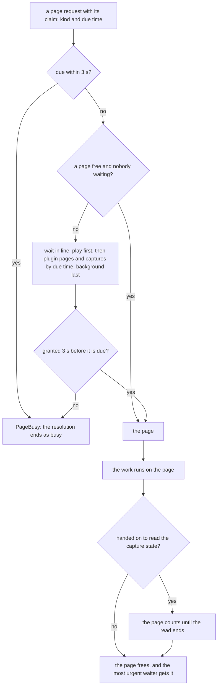
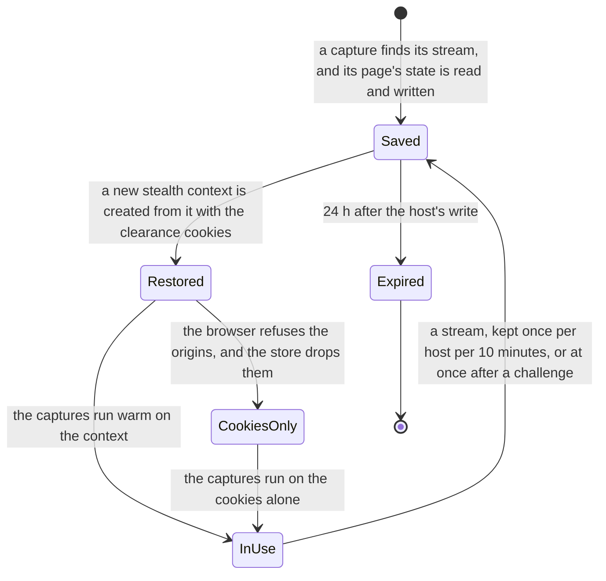
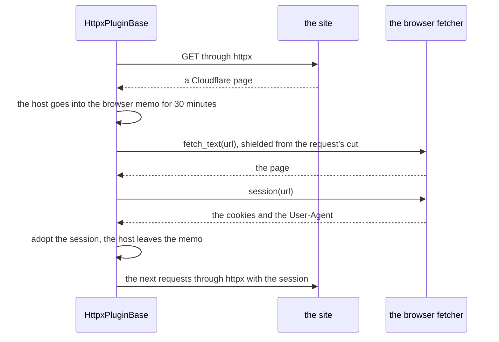

# Browser and challenges

> **Status:** current
> **As of:** 19b7e2c8

## Purpose

Scavengarr runs one headful Chromium for the work plain HTTP cannot do: the Playwright plugins, the plugin pages behind Cloudflare, the hoster captures and the link-outs.
This document describes the shared browser, the stealth pool and its captures, the page gate and its budget, the clearance store and the capture state, a challenge's outcome and cooldown, and the browser fallback of httpx plugins with its session adoption.
Which resolvers capture their streams is in [Hoster resolvers](../features/hoster-resolvers.md#browser-capture), and Filemoon's pass keeper in [its decision](../target/decisions/0009-pass-keeper-demand-bound.md).

## How it works

### The shared browser

`SharedBrowserPool` (`infrastructure/browser/shared_browser.py`) runs one Chromium process, driven through Patchright, for all browser work.
Each Playwright plugin gets its own `BrowserContext` on it, and the stealth pool one more.
Concurrent `warmup()` calls share one launch.
Every operation holds a lease (`lease()`), so the browser does not restart under it.
After 200 pages (`_RECYCLE_AFTER_PAGES`) the last operation to end starts a restart in a task of its own, which closes Chromium and launches the new one (`shared_browser_recycled`).
The restart is skipped while a page opened without a lease is still open, and one that fails or takes longer than 30 s leaves the launch to the next `warmup()` (`shared_browser_restart_failed`).
An operation that arrives during a restart waits for it with its resolve clock stopped.
The contexts on the old browser notice that it is closed and start over, from the kept clearance cookies and capture states.

Chromium runs headful when `DISPLAY` is set, as in the image with its virtual display, and headless with a warning otherwise (`infrastructure/browser/display.py`).
Cloudflare's interactive Turnstile rejects every headless browser, while a headful Patchright Chromium passes it.
`infrastructure/browser/hardening.py` keeps Chromium light: `--renderer-process-limit=2`, and contexts that block images, fonts, stylesheets, media, text tracks and service workers.
An anti-bot check's beacons load even as a blocked type.

### The stealth pool

`StealthPool` (`infrastructure/browser/stealth_pool.py`) is one Patchright context on the shared browser for the work that has to look like a person's browser.
It implements `BrowserFetcherPort` (`domain/ports/browser_fetcher.py`):

- `fetch_text()` loads a page for an httpx plugin, solves a Cloudflare challenge first and returns the rendered page, or the raw body of a JSON answer.
- `session()` hands the context's cookies and User-Agent for a site to an httpx plugin ([The browser fallback of httpx plugins](#the-browser-fallback-of-httpx-plugins)).
- `resolve_redirect()` and `click_through()` follow a plugin's link-outs ([Plugins](plugins.md#link-outs-and-the-sto-gate)).
- `capture_media()` captures a hoster player's stream ([Captures](#captures)).

A page load answered with 429, 502, 503 or 504 is tried again after 2, 5 and 10 s (`_RETRY_STATUSES`).
A URL that answers the page load with another error is asked once more by an in-page fetch, since an API may serve only the requests of its site's own pages.
A page's timeout is `stremio.probe_stealth_timeout_seconds`.
Once the app reports ready, its start launches the shared browser and creates the context in the background (`StealthPool.warmup()`, `stealth_pool_started`), so the first capture after a restart does not spend its resolve bound on the launch.
Readiness does not wait for it, and a failed warm-up logs `browser_warmup_failed` and leaves the launch to the first capture.

### Captures

Some players create the stream URL only while they run, behind a challenge of their own.
`capture_media()` lets the player do it in the stealth context and returns the stream request it makes (`CapturedMedia`: the URL and its `Referer`):

1. It opens the embed page and solves a Cloudflare challenge when one shows.
2. It waits 3 s for a player that starts itself (`_MEDIA_AUTOPLAY_WAIT_S`), or the resolver's shorter wait for a player that takes its first click at once (`autoplay_wait`).
3. It clicks the player up to 3 times, 5 s apart.
4. It returns the first request for a `.m3u8`, `.mpd`, `.mp4` or `master.txt` URL, or the video element's request for a CDN URL without an extension.

- The click goes to the page's centre, since an embed page is the player, or to the centre of the element a resolver names (`player=`, a CSS selector) for a player in a frame below a header.
- The capture's page loads stylesheets and fonts, since without them the play button is not where the click lands; only media downloads are aborted, their URL known by then.
- Popups opened by ad scripts are closed.
- A capture with `own_scripts_only` runs the scripts of the page's and its frames' sites only, a site being a host's last two labels ([the decision](../target/decisions/0011-own-scripts-only-captures.md)).
- A foreign script is aborted as the client's block (`net::ERR_BLOCKED_BY_CLIENT`) and logged at debug level with its site (`stealth_capture_script_blocked`).
- Cloudflare's interstitial loads its scripts from the page's own host and its challenge in a frame of its own, so the rule leaves it alone, and a Turnstile widget from `challenges.cloudflare.com` always passes (`_CHALLENGE_HOST`).
- A page that shows a dead-file notice ("Video not found", "File is no longer available", "No such file", "has been removed") in its title or visible text ends the capture early: checked after the Cloudflare step and after every click.
- Seek-preview playlists are not the stream: URLs that contain `thumbnail`, `sprite` or `preview` are ignored.

`capture_stream()` (`infrastructure/hoster_resolvers/_browser.py`) turns a capture into a `ResolvedStream` for the resolvers, and without a stealth pool it returns `None`.

### The page gate

A stealth page costs about 200 MB and much CPU, so `PageGate` (`infrastructure/browser/page_gate.py`) decides how many pages run and who gets the next one.
The work's claim (`page_claim`, a `PageClaim`) names what the page is for (`play`, `plugin`, `capture` or `background`) and when the work is due.
The next free page goes to playback, then to the earliest due work, a search's plugin pages before the captures of its answer, and to background work only while nobody else waits.
A running page is never taken away.
Work without a claim (Torznab searches, the scoring probes) counts as its kind, is due after its own timeout and waits until a page is free.

- Work that cannot start 3 s before it is due (`_MIN_WORK_S`) gets no page (`PageBusy`), and the registry reports the resolution as `busy`, neither cached nor counted by the breaker.
- The timeout of a resolution (`work_clock`) stops while it waits for a page or for the browser.
- A page handed on past its work's block (`Hold.hand_on()`) counts against the limit until it is ended.
- The wait and the work are recorded by kind (`browser_page_wait` with the outcome `busy` for a refused page, `browser_page`).

`PageBudget` (`infrastructure/browser/page_budget.py`) changes the gate's limit every 5 s, by the first rule that holds ([the decision](../target/decisions/0010-adaptive-page-budget.md)):

| Rule | Change |
|---|---|
| Less free memory than one page (200 MB) | One page less. |
| CPU busy at 90 % or more in two samples in a row, 10 s after the last change | One page less. |
| A page request waited 1 s or more, CPU busy at 70 % or less, room for two pages, 30 s after the last change | One page more, up to the ceiling. |
| Two minutes without a wait and without a change | The start value again, upward only with room for two pages. |

The limit starts at 2 or the ceiling when that is lower, and the ceiling is `stremio.max_concurrent_playwright`, auto-tuned from the container's CPUs and memory.
A lower limit takes no running page away, and each change logs `browser_pages_changed` with its reason, the CPU and the free memory.

### The clearance store and the capture state

A solved challenge leaves its pass in the browser: clearance cookies, and a player's own state in its host's cookies, localStorage and IndexedDB.
Browser contexts live in memory, so `ClearanceStore` (`infrastructure/browser/clearance_store.py`) keeps both in the cache backend and puts them into every new context.

The clearance cookies are Cloudflare's `cf_clearance`, DDoS-Guard's `__ddg*` and the HostAdmin WAF's `ha-waf-*` (`browser:clearance_cookies`).
`remember()` stores them after a page got past its challenge, merged with the stored ones, each with the time it was saved.
They are kept until they expire, at most 24 h, and a cookie with less than 60 s left is not restored.
`restore()` puts them into the Playwright plugins' contexts, and the stealth context gets them at its creation.
They stay valid only for the same browser and address, and a stale one merely costs a new challenge.

The capture state (`browser:capture_state:v1`) is kept per host after a capture found its stream (`keep_capture_state()`):

- It holds the cookies of the page's host and of its frames' hosts at that moment, their parent domains' included, and their origins' localStorage and IndexedDB.
- It is read from the capture's own page after the stream went out, in the background and within 0.5 s (`collect_capture_state()`), and no other origin is visited.
- Until the read ends, the page keeps its place at the page gate and the browser's lease, so it counts against the page limit and the browser does not restart under it.
- A frame whose read fails or takes longer than 0.4 s leaves out its own host only (`capture_state_save_failed`), which keeps its earlier entry and is read again at its next stream.
- An IndexedDB database is kept whole or not at all: one with a record plain JSON cannot hold stays out, since a new context cannot always take it back.
- A host is kept at most once per 10 minutes, and at once when the capture's page met a challenge on its way to the stream, since its state then holds a new pass.
- A host's entry lasts at most 24 h, and nothing above 512 KiB per host is kept (`capture_state_too_large`).
- The store writes it in the background (`capture_state_saved` with the read's `duration_ms`).

Each new stealth context (the start, a recycle, a relaunch) is created from the capture state and the clearance cookies, the newer of the two winning per cookie (`creation_state()`), since localStorage and IndexedDB can be set only at a context's creation.
A hoster that passed its challenge once thus runs warm after a restart.
Once the context exists, `capture_state_restored` names the hosts and the number of origins, and `clearance_restored` the clearance cookies' domains.
A creation the browser refuses (`capture_state_restore_failed`) falls back to the cookies alone, and the store drops the kept origins (`capture_state_origins_dropped`) so that later contexts do not fail the same way.
A browser that refuses the cookies too gets a plain context.
The logs name hosts and counts, never values.

### Challenges

`detect_challenge()` (`infrastructure/captcha/detect.py`) classifies a response once for every plugin, resolver and prober: `cloudflare_page`, `ddos_guard`, `turnstile`, `recaptcha`, `hcaptcha` or `altcha`.
A page block (the whole response is a challenge) wins over an embedded widget (a normal page with a captcha form).
In a browser, the frame a captcha provider shows its challenge in names the kind (`challenge_frame()`).

What gets a page past its challenge:

- `solve_cloudflare()` (`infrastructure/browser/turnstile.py`) clicks a managed challenge's "Verify you are human" checkbox inside its `challenges.cloudflare.com` frame, through the frame's closed shadow root, 3 s after the page shows it and again every 8 s.
- `pass_turnstile_widget()` waits for an embedded Turnstile widget's token and submits its form; it serves the plugins' click-throughs.
- An ALTCHA widget is a proof of work, which `solve_altcha()` (`infrastructure/captcha/altcha.py`) computes off the event loop, in its v2 and its classic format.
- A plugin solves its site's own image captcha where the images allow it: animeloads picks the odd one of its "odd one out" images by their pixels when an item is grabbed.
- Any other image or audio captcha is not solved, and the work gives up cleanly.

A plugin base marks the search's `ChallengeFlag` when a page shows a challenge (`mark_challenge()`, once per search) and settles it with whether the plugin got past (`settle_challenge()`).
The plugins' long-term record counts both (`challenges`, `challenges_unsolved`).

A capture marks the hoster resolution it runs in (`challenge_mark`, a `ChallengeMark`: the first challenge's kind, and `open` while one stands) when its page shows:

- Cloudflare's interstitial (`solve_cloudflare()`), or an embedded Turnstile widget (`pass_turnstile_widget()`);
- a captcha provider's frame (`challenge_frame()`): Cloudflare's challenge platform, hCaptcha, or reCAPTCHA by its checkbox frame;
- a request the resolver names as its hoster's own captcha (`challenge_requests`).

An invisible reCAPTCHA shows nothing to pass and counts as none, and so does its puzzle frame, which loads hidden with every widget.
A page that got past its challenge passes the mark (`mark_resolution_passed()`): an interstitial that cleared, a widget whose token came and whose form went out, and a page that shows the hoster's offline notice.
A later challenge on the page marks it again.
The hoster's own captcha and a provider frame in front of the player give no pass signal before the stream, so they stand until a stream ends them.
A resolver whose player loads a widget that does not gate the stream passes `passive_widget=True`, and the providers' frames mark nothing for it.

A resolution whose pages showed a challenge and found no stream in time ends as `challenge`, which the hoster's circuit breaker does not count ([the decision](../target/decisions/0012-challenge-outside-the-breaker.md)).
A page past its challenge gives its verdict instead, so no stream there is a dead link.
After a `challenge` the hoster's links wait out a cooldown (`ChallengeCooldown` in `infrastructure/hoster_resolvers/challenge_cooldown.py`): 1, 5, 15 and then 30 minutes, longer after each further challenge.
The hoster's next stream ends the cooldown and resets its steps, and a capture that ran on past its challenge and still found no stream steps it up at once.
The cooldown lives in memory only, since a restart starts the browser cold and a kept cooldown would only delay the capture that warms it.
A link the cooldown skips logs `hoster_resolve_challenge_cooldown`, and a refresh at play time passes the cooldown, which only an open breaker refuses.
A capture that the resolve bound cut after its challenge runs on in the background for up to 20 s, one per hoster, and caches its stream for the next request.

### The browser fallback of httpx plugins

An httpx plugin whose site answers with a Cloudflare page loads the same URL through the browser (`HttpxPluginBase._fetch_text()` in `infrastructure/plugins/httpx_base.py`).
The composition root chains the fetchers (`build_browser_fetcher()` in `interfaces/composition.py`): the own stealth browser first (`playwright.browser_fallback`), then an optional Byparr or FlareSolverr sidecar (`playwright.solver_url`), which speaks the FlareSolverr v1 API (`SolverFetcher`).
`ChainedBrowserFetcher` (`infrastructure/browser/solver_fetcher.py`) tries them in order and remembers per host which one served it.
Another challenge than a Cloudflare page, or one without a fetcher, marks the search's challenge as unsolved, and the fetch answers nothing.

- While a host is in the browser memo (`_CF_BLOCK_MEMO_S`), its requests go straight to the browser, so parallel requests do not try httpx meanwhile.
- The solve runs as a task of its own and goes on when the request that started it is cut, so the next request gets the session (`{name}_browser_fallback`).
- The adoption puts the browser's cookies into the plugin's client, sends the browser's User-Agent to that host and takes the host out of the memo (`{name}_browser_session_adopted`).
- A challenge within 5 minutes of an adopted session (`_SESSION_TRUST_S`) shows that the site binds its clearance to the browser: the page is fetched through the browser without a new adoption (`{name}_browser_session_rejected`), and the host stays in the memo.
- A failed solve logs `{name}_browser_solve_failed`, and the start logs the configured chain (`browser_fallback_configured`).

The Playwright plugins solve their pages' Cloudflare challenges themselves (`PlaywrightPluginBase` in `infrastructure/plugins/playwright_base.py`): their contexts start with the stored clearance cookies, and a page that got past its challenge stores its cookies again.
A plugin whose links need a captcha at download time resolves them when its CrawlJob is grabbed, not during the search ([Grab-time resolution](torznab-and-crawljobs.md#grab-time-resolution)).

## Configuration

The browser's settings are the `playwright:` section of [the configuration reference](../reference/configuration.md#playwright): `playwright.browser_fallback` and `playwright.solver_url`.
The page ceiling is `stremio.max_concurrent_playwright` and the page timeout `stremio.probe_stealth_timeout_seconds` ([Stremio](../reference/configuration.md#stremio)).
The resolve bound of a capture is `http.timeout_resolve_seconds` ([HTTP](../reference/configuration.md#http)).

## Observability

The stealth browser's page gate records `browser_page_wait` and `browser_page` by kind, and the hoster resolutions their outcomes, `challenge` and `busy` among them ([Metrics](../reference/metrics.md#metric-table)).
The plugins' long-term record counts the searches with a challenge and those with one the plugin did not get past ([The plugin record](observability.md#the-plugin-record)).
`scripts/probes/capture_state.py` lists the kept capture states and clearance cookies by name, length and lifetime, never a value.
`scripts/probes/capture_timing.py` times a capture's page load, clicks, challenges and stream with a Chromium and a profile of its own.

## Limits

- An image or audio captcha other than a site's own that a plugin solves is not solved, and a site or hoster behind one gives nothing.
- A hoster that refuses the address Scavengarr's traffic leaves from gives no stream from any browser state.
- An invisible reCAPTCHA that escalates to a visible puzzle shows no checkbox frame and marks nothing, so a capture without a stream behind it counts as a dead link instead of `challenge`.
- The capture state is read from the capture's own page only, so a player's later writes on another origin are missed.
- A site that binds its clearance to the browser costs a browser page for every request while its host stays in the memo.
- The solver sidecar's adapter is not checked against a running sidecar.
- How long a kept capture state stays good for each hoster is not measured.

## Target

- The open production checks of [`openspec/changes/react-to-challenges/`](../../openspec/changes/react-to-challenges/tasks.md) and [`openspec/changes/keep-capture-state/`](../../openspec/changes/keep-capture-state/tasks.md) will compare the challenged hosters' outcomes with the baseline of [the challenge plan](../plans/challenge-reactions.md).
- The plan's options still open (captures that pass widgets, fixes on the plugins' side, an HTTP client that impersonates a browser) wait for those numbers.
- How long a kept capture state lasts and when Filemoon's captcha shows in a cold capture are open in [the backlog](../archive/backlog-2026-10.md).

## References

- Browser: `src/scavengarr/infrastructure/browser/shared_browser.py`, `src/scavengarr/infrastructure/browser/stealth_pool.py`, `src/scavengarr/infrastructure/browser/page_gate.py`, `src/scavengarr/infrastructure/browser/page_budget.py`, `src/scavengarr/infrastructure/browser/clearance_store.py`, `src/scavengarr/infrastructure/browser/turnstile.py`, `src/scavengarr/infrastructure/browser/solver_fetcher.py`, `src/scavengarr/infrastructure/browser/hardening.py`, `src/scavengarr/infrastructure/browser/display.py`.
- Challenges: `src/scavengarr/infrastructure/captcha/detect.py`, `src/scavengarr/infrastructure/captcha/altcha.py`, `src/scavengarr/infrastructure/hoster_resolvers/challenge_cooldown.py`, `src/scavengarr/infrastructure/hoster_resolvers/_browser.py`.
- Ports and plugins: `src/scavengarr/domain/ports/browser_fetcher.py`, `src/scavengarr/infrastructure/plugins/httpx_base.py`, `src/scavengarr/infrastructure/plugins/playwright_base.py`.
- Decisions: [`0009-pass-keeper-demand-bound.md`](../target/decisions/0009-pass-keeper-demand-bound.md), [`0010-adaptive-page-budget.md`](../target/decisions/0010-adaptive-page-budget.md), [`0011-own-scripts-only-captures.md`](../target/decisions/0011-own-scripts-only-captures.md), [`0012-challenge-outside-the-breaker.md`](../target/decisions/0012-challenge-outside-the-breaker.md).
- History: [`docs/archive/plans/playwright-engine.md`](../archive/plans/playwright-engine.md), [`docs/archive/plans/antibot-patchright.md`](../archive/plans/antibot-patchright.md), [`docs/archive/plans/captcha-solving.md`](../archive/plans/captcha-solving.md), [`docs/archive/plans/cloudflare-solvers.md`](../archive/plans/cloudflare-solvers.md), [`docs/archive/plans/browser-page-budget.md`](../archive/plans/browser-page-budget.md), [`docs/plans/challenge-reactions.md`](../plans/challenge-reactions.md).
