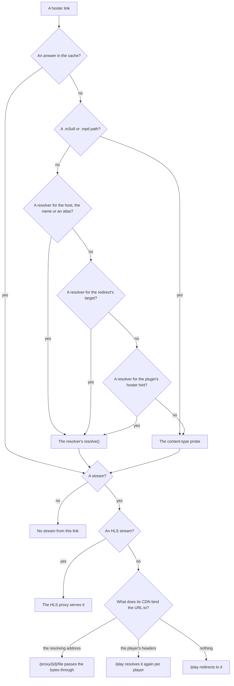
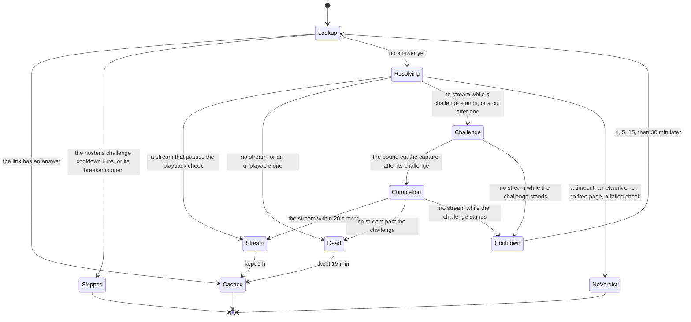
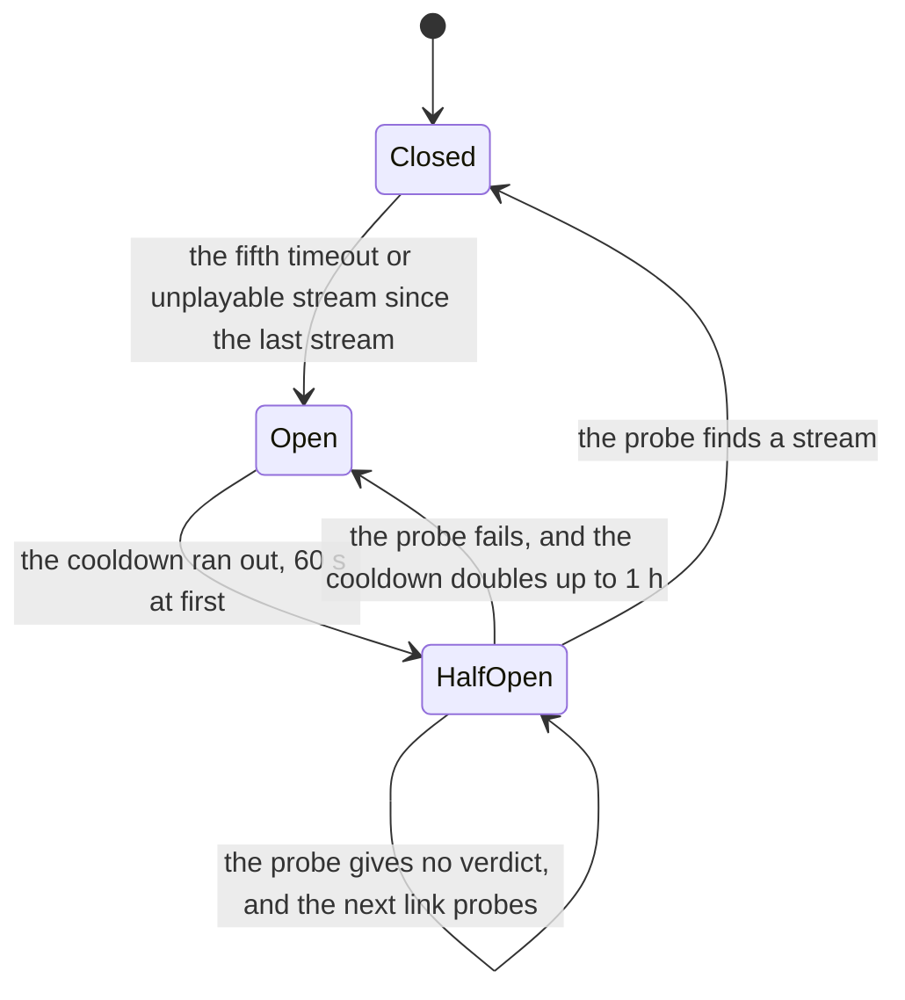

# Hoster resolvers

> **Purpose:** A hoster resolver checks a hoster link of a plugin's result, the embed page of a streaming hoster or the file page of a direct-download hoster, and for a streaming hoster turns it into a playable video URL with the headers its CDN wants.
> **Status:** current
> **As of:** 9d2fc4c7

## Purpose

A hoster resolver checks a hoster link of a plugin's result, the embed page of a streaming hoster or the file page of a direct-download hoster, and for a streaming hoster turns it into a playable video URL with the headers its CDN wants.
`HosterResolverRegistry` dispatches each link to its resolver, judges and caches the answer, and keeps a hoster that keeps failing out of the way.

Every registered resolver with its domains is in [the resolver list](../reference/resolvers.md), and adding one is in [Add a hoster resolver](../how-to/new-resolver.md).
The stealth browser's captures and challenges are in [Browser and challenges](browser-and-challenges.md), and how a Stremio request uses the streams in [the Stremio addon](stremio-addon.md#resolution).

## How it works

### Resolvers

Every resolver implements `HosterResolverPort` (`domain/ports/hoster_resolver.py`): a `name` and `resolve(url)`, which returns a `ResolvedStream` or `None` for a link that is offline, deleted or cannot be extracted.
`ResolvedStream` (`domain/entities/stremio.py`) holds the video URL, the headers its CDN needs, whether it is HLS, the quality, the size, whether its CDN binds it to the resolving address, and the time of its resolution (`resolved_at`).

A resolver answers in one of three ways:

- A video-extracting resolver returns the direct `.mp4` or `.m3u8` URL with its playback headers.
- A validate-only resolver checks the page and returns the link itself, which the Stremio addon drops, since it is no video (`is_direct_video_url()` in `application/stremio/stream_builder.py`).
- A direct-download resolver checks the file and returns its canonical URL with `StreamQuality.UNKNOWN`, for the Torznab search's link validation.

`build_hoster_resolvers()` in `interfaces/composition.py` creates them, the individual resolvers first, then one `GenericDDLResolver` per `GenericDDLConfig` and one `XFSResolver` per `XFSConfig`.

### Dispatch

`HosterResolverRegistry.resolve(url, hoster)` (`infrastructure/hoster_resolvers/registry.py`) finds the resolver for a link, `hoster` being the plugin's hint:

1. It strips surrounding whitespace from the URL, since scraped links sometimes end in a newline.
2. A cached answer for the URL answers at once, unless the lookup asks for a `refresh`.
3. A streaming playlist (a path that ends in `.m3u8` or `.mpd`) goes to the content-type probe, since the resolver of its domain expects an embed page.
4. Otherwise it takes the resolver for the URL: a full host name a resolver claims (`supported_hosts`) first, then the second-level domain as a resolver's `name`, then as one of its aliases (`supported_domains`).
5. Without one it follows the URL's redirects with a `HEAD` request and dispatches the final URL again.
6. Without one still it takes the resolver of the plugin's hoster hint, which covers rotating mirror domains.
7. Without any resolver it probes the URL's content type: a `HEAD` answer below 400 with a `video/*` or `application/vnd.apple.mpegurl` type becomes a stream of the resolver `direct`.

`extract_domain()` (`infrastructure/hoster_resolvers/_domain.py`) gives the second-level domain: `voe` for `https://www.voe.sx/e/abc`.
A link that reaches the probe for want of a resolver logs `hoster_without_resolver` with its hoster name, never its URL, and is counted per hoster (`unresolved_hosts()`, at most 1,000 names).
`GET /api/v1/stats/metrics` lists the 20 most frequent under `unresolved_hosters`, which says which resolver to build next; the counts start at zero with every start.

A domain two resolvers claim stays with the first one registered and logs `hoster_domain_conflict`, and the shipped resolvers claim no domain twice.
A claimed host wins over its second-level name: `moflix-stream` belongs to VidHide, while the host `moflix-stream.link` runs Filemoon's Byse player and belongs to `filemoon`, and `strmup` claims `kinoger.pw` while `kinoger.ru` links redirect to VOE mirrors.
`canonical_hoster(name)` returns the resolver's name for a hoster label or a second-level domain (`filelions` gives `vidhide`), so the mirror domains of a hoster share one hoster name in the Stremio streams.

The resolved stream then takes the way its CDN allows ([the Stremio addon](stremio-addon.md#the-streams)):

### Playback headers

A video-extracting resolver sets the headers its CDN needs in `ResolvedStream.headers`, and the Stremio addon sends them with every request to the CDN.

| Resolver | Headers |
|---|---|
| VOE, SuperVideo | `Referer`: the embed URL |
| Filemoon | `Referer`: the legacy page after its redirects, or the captured stream request's for the Byse player |
| Streamtape | `Referer`: the answering host |
| DoodStream | `Referer`: the player's base URL |
| XFS video hosters, Mixdrop | `Referer`: the embed URL after its redirects |
| Veev | `Referer`, `User-Agent` and, for a player's resolution, `Accept-Language` |
| Vinovo | `Referer` and `User-Agent` |
| StreamUp, Vidsonic, UPN Share, RPM Share | `Origin` and `Referer` of the player host |
| FireStream, Playmate, gxplayer, fsst | none, since their URLs are signed or public |
| A capture (Vixeo, and Filemoon, XFS, DoodStream and SuperVideo when they capture) | `Referer` of the captured request, else the embed URL |

### Bound CDNs

Some CDNs bind a video URL to more than its headers, so the URL plays for one client only.

A CDN that binds the URL to request headers the player sends itself cannot be served by `proxyHeaders`, since Stremio's streaming server passes the player's other headers on.
veevcdn binds the `User-Agent` and the `Accept-Language`: another value, or an `Accept-Language` the resolution did not send, gets 403.
Such a resolver implements `ClientBoundResolverPort`: `bound_headers` names the bound headers in lower case, and `resolve_for_client(url, headers)` resolves with a player's values.
The registry offers both (`bound_headers(url)`, `resolve_for_client(url, hoster, headers)`), the second uncached, with the circuit breaker and the resolve bound of `resolve()`, and `/play` uses them.

A CDN that plays the URL only for the address that resolved it answers another address with an error: `error_wrong_ip` from DoodStream's, 403 from MixDrop's and Vinovo's, 410 from fsst's.
Such a resolver sets `address_bound = True`, the registry stamps it on the stream where it classifies the answer, and the Stremio addon sends the file through `/api/v1/stremio/proxy/{stream_id}/file`, a byte-range pass-through, instead of `/play`.

### CDN checks

Two checks look at a resolved URL before a player gets it, both in `infrastructure/hoster_resolvers/_verify.py`.

`verify_video_url()` is a resolver's own check, used by the XFS video path, VOE and Streamtape:

- It sends a `HEAD` request with the playback headers (8 s, redirects followed).
- `200` or `206` with a content type other than `text/html` counts as reachable.
- A CDN that does not allow `HEAD` (405) is asked for the first bytes instead, which must not be HTML either, by content type or by a body that starts with `<`.
- A dead file that a CDN serves as an error page with 200 is thus dead for the resolver, which returns `None`.
- It filters out CDN tokens bound to another address, such as Lulustream's tokens bound to Cloudflare's edge.
- Its log lines name the CDN's domain, never the URL: `<hoster>_video_head_failed`, `<hoster>_video_not_media` and `<hoster>_video_verify_error`.

`check_playable()` is the registry's playback check of every resolver's stream while `stremio.verify_streams` is on, the default:

- It sends a streamed `GET` with the playback headers, the player's browser `User-Agent` unless the resolver set one, and `Range: bytes=0-4095` (6 s, redirects followed), and reads at most the first 4 KiB.
- A status from 400, an HTML answer (`Content-Type: text/html` or a body that starts with `<`), or an HLS stream whose body does not start with `#EXTM3U` makes the stream unplayable.
- An unplayable stream logs `hoster_resolve_unplayable` and is cached as a dead link.
- A failed check request (a timeout, a reset) is no verdict: it logs `hoster_resolve_check_error`, and the link is neither cached nor counted.
- A resolver without a check of its own sets `needs_playback_check = True` (SuperVideo), and the registry checks its streams with `stremio.verify_streams` off too.
- The content-type probe's answers are not checked again, since the probe has looked at the response already.

A playable stream keeps what the checked bytes tell, without another request (`PlaybackCheck`):

- The largest `RESOLUTION` of an HLS master playlist's variants gives the quality class (`quality_from_resolution()`, by width or height, whichever gives the higher class), when the resolver named no quality or a lower one.
- The total of a `Content-Range: bytes a-b/total` answer becomes `ResolvedStream.size_bytes`.
- A variant past the 4 KiB, a media playlist and an answer without `Content-Range` measure nothing.

The Stremio answer shows and ranks the streams by them ([Ranking](stremio-addon.md#ranking)).

### Browser captures

Some players create the stream URL only while they run, so the resolver lets the stealth browser run the player and takes the stream request it makes ([Captures](browser-and-challenges.md#captures)).
`capture_stream()` (`infrastructure/hoster_resolvers/_browser.py`) turns a capture into a `ResolvedStream`, with `is_hls` from `.m3u8` and the captured request's `Referer`, and returns `None` without a stealth pool.

| Resolver | When it captures |
|---|---|
| Filemoon | Byse player pages, or an embed page that does not answer 200, unless the details API reports the video gone |
| XFS video hosters | A Cloudflare challenge on the embed page, or a captcha play button in front of the player instead of a video |
| DoodStream | A Cloudflare challenge, since every mirror redirects to a challenged host |
| SuperVideo | A Cloudflare challenge |
| Vixeo | Always, since its player builds the signed URL at runtime |

A resolver tunes its capture through `capture_stream()`:

- `player=` names the element to click, a CSS selector: Filemoon's watch page `/d/<id>` shows the player in a frame below a header.
- `own_scripts_only=True` runs only the scripts of the page's and its frames' sites (Filemoon and Vixeo), since a foreign ad tag turned every click into a popup ([the decision](../target/decisions/0011-own-scripts-only-captures.md)).
- `challenge_requests` names the requests of the hoster's own captcha, which mark the resolution's challenge: Filemoon names the Byse player's `captcha` and `captcha/verify`, which a cold context requests and a warm one skips, and each of them holds the capture's next click and its end until 16 s after it ([Captures](browser-and-challenges.md#captures)).
- `passive_widget=True` tells the capture that the player's captcha widget does not gate the stream, so the providers' frames mark nothing: DoodStream's player loads an invisible Turnstile on every capture and does not wait for it.
- `autoplay_wait` shortens the wait before the first click for a player that does not start itself and takes that click at once: Vixeo waits 0.5 s, the others the 3 s for a player that starts itself.

Filemoon asks the details API (`/api/videos/<id>/embed/details`) first: a 404 means the video is gone, and no browser starts.
A video whose owner allows embedding only on its own sites (403 `embedding … not allowed`, logged as `filemoon_embedding_blocked`) is captured from the hoster's watch page, which plays it in a player frame of a second host.
A Byse capture that starts without the player's captcha pass in the kept capture state (`ClearanceStore.creation_state()`, which [the pass keeper](#filemoons-pass-keeper) reads; a pass with less than 30 s left counts as none) is marked as challenged from its start (`hoster_captcha`).
The player asks such a context for its captcha before the stream: in 54 h of one build's logs on the production host, cold captures found their stream 17.4 to 31.5 s in, past the 10 s bound, and 12 of 17 were cut without a challenge mark, as breaker failures.
Marked from the start, a cut capture ends as `challenge` and runs on in the background ([Outcomes](#outcomes)); without the kept state or the browser the pages alone mark it, and a video the details API reports gone starts no capture.

### Outcomes

Each attempt ends with one outcome, recorded on the stage `hoster_resolve` with the resolver's name:

| Outcome | What happened | Cached | The breaker |
|---|---|---|---|
| `stream` | The resolver's stream passed the playback check. | 1 h | resets |
| `dead` | The resolver found no stream. | 15 min | neither |
| `unplayable` | The playback check refused the stream. | 15 min | counts |
| `http_error`, `error` | An HTTP error or an exception reached the registry. | 15 min | neither |
| `challenge` | The pages showed a challenge, and no stream came while it stood or before the bound cut. | no | neither |
| `timeout` | The resolve bound cut the attempt before any challenge. | no | counts |
| `network_error` | A transport error reached the registry. | no | neither |
| `check_error` | The playback check's request failed. | no | neither |
| `busy` | A capture got no stealth browser page before its request was due. | no | neither |
| `cut` | The request ended the attempt, since its answer went out. | no | neither |

A lookup that runs no attempt counts as `cached`, `breaker_open`, `challenge_cooldown` (its hoster's challenge cooldown runs) or `joined` (it waited for a capture that runs on).
Most resolvers catch `httpx.HTTPError` themselves and return `None`, so a network error inside them is cached as a dead link.

The resolver gets the resolve bound in total (`http.timeout_resolve_seconds`), or a lookup's own bound (`resolve(bound=)`), and the playback check runs after it.
The clock stops while a capture waits for a stealth browser page or for the shared browser's restart: the registry publishes its `asyncio.timeout` as `work_clock`, which the page gate and `SharedBrowserPool.lease()` pause.

A resolution whose pages showed a challenge ends as `challenge` and starts the hoster's challenge cooldown while the challenge stands (`hoster_resolve_challenge` with the `kind`, `passed` and `cooldown_s`; [Challenges](browser-and-challenges.md#challenges)).
A page past its challenge gives its verdict, so `None` there is a dead link.
The cooldown is checked before the breaker, so a skipped link never takes a half-open probe's place, and a refresh at play time (`resolve(refresh=True)`, after the CDN refused a stored stream) passes the cooldown.
`hoster_resolve_success` names the challenge a cold capture passed on its way to the stream (`challenge`, `None` for a warm one; `hoster_captcha` for every Filemoon capture that started without a kept pass) and the attempt's time from its start (`duration_ms`), the wait for a page and the playback check included.

A capture that the bound cut after its challenge runs on in the background instead of being cancelled (`_complete()`):

- The attempt answers `challenge` at the cut, and the capture keeps the one browser page it holds for up to 20 s more (`_COMPLETION_S`).
- Its stream is judged like any resolution's, cached under its link and counted as the hoster's stream: it ends the challenge cooldown and closes a half-open breaker.
- Without a stream while its challenge stands, nothing is cached or counted, and the hoster's next cooldown step starts at once (`hoster_challenge_unsolved`).
- No stream past its challenge is a dead link, cached as one.
- One completion runs per hoster, and the completions leave one of the stealth browser's pages free, so a capture cut while they hold the rest is cancelled at the cut.
- A request for a link whose capture runs on joins it instead of starting a second capture (`hoster_resolve_joined`), waits at most the resolve bound and answers the stream the completion cached.
- Only cached resolutions complete: a player's own resolution (`resolve_for_client()`) and a request's own cut (the answer went out) cancel the capture.
- Each completion is the stage `hoster_challenge_completion` from the cut, and `aclose()` cancels the completions at shutdown.

### The circuit breaker

The registry keeps one `PluginCircuitBreaker` per resolver name, so the mirror domains of a hoster share it.

- A timeout and an unplayable stream count as failures, and a stream resets the count.
- A dead link, a failed request, a `challenge`, a capture without a page and a cut neither count nor reset it, since they say nothing about the hoster.
- Most cuts come from the answer going out once enough other hosters have a video, so counting them would open the breakers of healthy hosters.
- While the breaker is open, the hoster's links are skipped (`hoster_resolve_circuit_open`) and not cached as dead.
- The half-open probe runs to its end even when its request is cut (a task shielded from the request), and `aclose()` ends it at shutdown.
- A probe that finds a stream closes the breaker and leaves the stream in the cache for the next request.
- A probe without a verdict frees its place (`PluginCircuitBreaker.release`), so the next link probes.

### Caches and state across restarts

- The result cache keeps a stream for 1 h and a dead link for 15 min, keyed by URL, and a stream keeps the time of its resolution when it comes from the cache.
- `cached(url)` reads an entry without resolving, which the Stremio answers from the search cache use, and `resolve(url, refresh=True)` resolves past it.
- The redirect cache keeps a link's redirect target for 1 h.
- Each cache holds at most 10,000 entries, and the expired ones are evicted every 1,000 `resolve()` calls.
- The registry records when a lookup last asked for each resolver's link (`demand_age()`), its cache hits included, unless the lookup passes `demand=False`.

`HosterStateStore` (`infrastructure/hoster_resolvers/state_store.py`) keeps the unexpired results and redirects, each resolver's demand and the circuit breakers that are not closed, the hoster's and the plugins', as one snapshot in the cache backend (`hoster_state:v1`, 24 h; [the decision](../target/decisions/0014-resolver-state-snapshot.md)):

- It writes the snapshot every 30 s when something changed and at shutdown, after the half-open probes end and before the cache closes; each write logs `hoster_state_saved` with the resolutions, redirects and breakers.
- It restores the snapshot at the start, before the app reports ready, with every lifetime and cooldown shortened by the downtime; a clock set back counts as no downtime.
- An entry that ran out meanwhile stays out, and a breaker whose cooldown ran out comes back open with its probe due, so a failed probe still doubles the cooldown.
- A snapshot of another version or one that cannot be read is deleted (`hoster_state_discarded`), and the start goes on without it.
- `GET /api/v1/stats/metrics` shows what the start restored (`hoster_state`).
- `cleanup()` calls `cleanup()` on every resolver that has one, at shutdown.

### Filemoon's pass keeper

The Byse player (Filemoon) asks a cold browser context for its captcha before the stream and keeps the pass it gives in the localStorage item `byse:captcha-clearance:embed` on its player host, for 30 min after the captcha.
A capture with the pass does not renew it, and the first capture after the expiry meets the captcha again, which on the production host ran past the resolve bound.
`PassKeeper` (`infrastructure/hoster_resolvers/pass_keeper.py`) keeps the pass for the next request ([the decision](../target/decisions/0009-pass-keeper-demand-bound.md)):

1. It reads the pass's expiry from the kept capture state (`pass_expiry()` in `filemoon.py`, over `ClearanceStore.creation_state()`).
2. 30 s after the expiry it resolves the link of the newest cached Filemoon stream again (`last_stream("filemoon")`, then `resolve(link, refresh=True, demand=False, bound=45)`), past the cache and the challenge cooldown, while an open breaker still refuses it.
3. The captcha falls to that capture, and its new pass is kept for the next request's capture.

- Its capture has a bound of its own, 45 s (`_BOUND_S`), since the captcha comes with the player's first click 3 s after the page has loaded, a cold page load can take most of the request's bound, and the production host's cold Byse streams came 22.7 to 43.7 s after the resolution's start: the capture ends inside its bound, so its `hoster_pass_keep` line says whether the pass came.
- Its capture starts after the pass has gone, so the resolver marks it as challenged from its start: a cut ends as `challenge` (a cooldown step while the challenge stands, no breaker failure) and runs on as the registry's completion, which keeps the pass when it finds the stream.
- Its page claim is `background`, served last, and it starts only while one of the stealth browser's pages stays free beside its own.
- One capture per pass: a capture that brings no new pass ends the keeping until a request's capture brings one, and without a cached Filemoon stream nothing is captured.
- Without a kept pass (a first start, a lost cache, a capture that brought none) it has nothing to keep and looks again every 5 min: the next request's capture starts marked, so a cut one runs on as the completion, and its cached stream and kept pass start the keeping.
- It keeps the pass only while a request looked up a Filemoon link within the last 48 h (`_DEMAND_S`), and the keeper's own stream counts when a request takes it from the cache.
- Past 48 h it idles, once per pass, and the next request's lookup starts it again; the bound leaves at most 96 captures after the last request.
- It looks again at most every 5 min, and every 30 s while no page is free.

### Shared video extraction

`extract_video_url()` in `infrastructure/hoster_resolvers/_video_extract.py` serves the XFS resolver, and Filemoon and Mixdrop use its unpacker helpers (`unpack_p_a_c_k()`, `extract_hls_from_unpacked()`, `unpacked_scripts()`).
Its strategies, in order:

1. Streamwish's `"hls2":"https://…"` JSON key.
2. Dean Edwards' packed JavaScript (`eval(function(p,a,c,k,e,d)…)`), unpacked in bases up to 62 and searched for the player's `"hls2"` URL, then for JWPlayer's `sources` or `file` with an HLS or MP4 URL.
3. JWPlayer's `sources: [{file: "…"}]` directly in the page, thumbnail and track URLs skipped.
4. Any quoted `.m3u8` URL in the page, thumbnail and track URLs skipped.

### Generic DDL and XFS resolvers

`GenericDDLResolver` (`infrastructure/hoster_resolvers/generic_ddl.py`) checks a direct-download hoster's file page, each hoster a `GenericDDLConfig` (`name`, `domains`, `file_id_re`, `offline_markers`, `file_id_source`, `min_file_id_len`):

- It sends a `GET` and counts a non-200 answer, an offline marker and a redirect to an error page as offline, and otherwise returns the original URL.
- `is_error_redirect()` (`_verify.py`) recognizes an error page by a path segment or query key `404`, `error` or `errors`, never by a substring, since "The.Terror.S01E01.mkv" is a file.
- The file id patterns accept a file name or parameters after the id (`/view/<id>/Movie.mkv`, `?<id>&af=…`), as JDownloader's do.
- An offline marker is a notice (`"404 Not Found"`, `"<title>404"`), never a string a live page can contain.

`XFSResolver` (`infrastructure/hoster_resolvers/xfs.py`) handles the XFileSharingPro hosters, each an `XFSConfig` (`name`, `domains`, `file_id_re`, `offline_markers`, `is_video_hoster`, `needs_captcha`, `extra_domains`):

- A file hoster's page is checked for its offline markers, as a generic DDL hoster's is.
- A video hoster's `/e/{file_id}` page is checked for its markers and error redirects, its video URL extracted and checked with `verify_video_url()`, with the URL of the page the player came from as the CDN's `Referer`.
- An XFS splash form (`<form id="F1" action="/dl">`) is posted (`op=embed&file_code=<id>&auto=1`) to `/dl` of the host that served the page, since a rotating mirror redirects the embed URL to another host.
- A mirror whose `/e/` page answers 404 is asked for the link's own URL: moflix-stream.click (VidHide) serves its player under its `/embed/<id>` and `/v/<id>` links.
- A hoster with `needs_captcha` sits behind an anti-bot script or a captcha and gives no stream.

## Configuration

- The resolve bound is `http.timeout_resolve_seconds` ([HTTP](../reference/configuration.md#http)).
- The playback check of every stream is `stremio.verify_streams` ([Stremio](../reference/configuration.md#stremio)).
- The snapshot lives in the cache backend ([Cache](../reference/configuration.md#cache)).
- The stealth browser's settings are in [Browser and challenges](browser-and-challenges.md#configuration).

## Observability

- The stages `hoster_resolve`, `hoster_challenge_completion` and `hoster_pass_keep` with their outcomes are in [the metrics reference](../reference/metrics.md#hoster-resolutions).
- `GET /api/v1/stats/metrics` lists the hosters without a resolver (`unresolved_hosters`) and what the start restored (`hoster_state`).
- The log lines name the hoster and, for a CDN, its domain: `hoster_resolve_success`, `hoster_resolve_failed`, `hoster_resolve_unplayable`, `hoster_resolve_timeout`, `hoster_resolve_challenge`, `hoster_resolve_circuit_open`, `hoster_without_resolver`.
- The pass keeper logs `hoster_pass_keep` (`stream`, `gone_s`, `duration_ms`), `hoster_pass_keep_skipped` (`reason=no_link`, or `reason=idle` with `demand_h`) and `hoster_pass_keep_error`.
- `scripts/probes/resolver_urls.py` collects hoster page URLs for the live resolver tests (`tests/live/test_resolver_live.py`), `scripts/probes/header_binding.py` tells which CDNs need a resolution's playback headers, and `scripts/probes/capture_timing.py` times a capture resolver's page load, clicks, challenges and stream ([Operations](../how-to/operations.md)).

## Limits

- SuperVideo's CDN answers a client that runs no JavaScript with a "Loading..." page whose script redirects to a tokenized URL, so its streams fail the playback check, and its breaker pauses it until a probe finds a playlist again.
- Vidmoly's embed page is a script redirect that sends a client without JavaScript, and on networks that block ad domains even the stealth browser, to an ad tracker, so no stream is reachable then.
- GoFile refuses guest lookups (401 `error-notPremium`), so GoFile links do not resolve (`gofile_guest_access_refused`).
- UPN Share and RPM Share are resolved by the flow of the player's own script and of three other implementations, since no live file was at hand to check against.
- A network error inside a resolver that catches `httpx.HTTPError` hides the link for 15 min as a dead one.
- A request's capture between the expiry of Filemoon's pass and the keeper's capture still meets the captcha, and the keeper follows the latest pass of the kept player hosts only.

## Target

- The pass keeper's check on the production host is open in [the backlog](../backlog.md).
- The open production checks of [`openspec/changes/react-to-challenges/`](../../openspec/changes/react-to-challenges/tasks.md) cover the challenged hosters' outcomes.

## References

- Port and entity: `src/scavengarr/domain/ports/hoster_resolver.py`, `src/scavengarr/domain/entities/stremio.py`.
- Registry and its state: `src/scavengarr/infrastructure/hoster_resolvers/registry.py`, `src/scavengarr/infrastructure/hoster_resolvers/state_store.py`, `src/scavengarr/infrastructure/hoster_resolvers/challenge_cooldown.py`, `src/scavengarr/infrastructure/hoster_resolvers/pass_keeper.py`.
- Shared helpers: `src/scavengarr/infrastructure/hoster_resolvers/_domain.py`, `src/scavengarr/infrastructure/hoster_resolvers/_verify.py`, `src/scavengarr/infrastructure/hoster_resolvers/_browser.py`, `src/scavengarr/infrastructure/hoster_resolvers/_video_extract.py`.
- Generic resolvers: `src/scavengarr/infrastructure/hoster_resolvers/xfs.py`, `src/scavengarr/infrastructure/hoster_resolvers/generic_ddl.py`.
- Wiring: `src/scavengarr/interfaces/composition.py` (`build_hoster_resolvers()`).
- Tests: `tests/unit/infrastructure/test_hoster_registry.py`, `tests/unit/infrastructure/test_check_playable.py`, `tests/unit/infrastructure/test_verify_video_url.py`, `tests/unit/infrastructure/test_xfs_resolver.py`, `tests/unit/infrastructure/test_generic_ddl_resolver.py`, `tests/live/test_resolver_live.py`.
- Specs: [`openspec/specs/hoster-resolution-persistence/spec.md`](../../openspec/specs/hoster-resolution-persistence/spec.md).
- Decisions: [0009](../target/decisions/0009-pass-keeper-demand-bound.md), [0011](../target/decisions/0011-own-scripts-only-captures.md), [0012](../target/decisions/0012-challenge-outside-the-breaker.md), [0014](../target/decisions/0014-resolver-state-snapshot.md).
- The open challenge work: [`docs/plans/challenge-reactions.md`](../plans/challenge-reactions.md).
