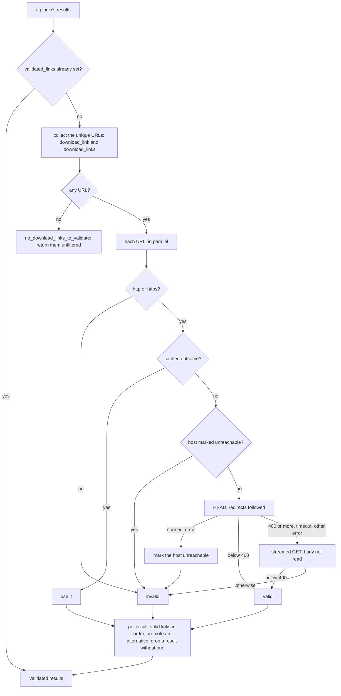

# Link validation

> **Status:** current
> **As of:** bdd3f0c4

## Purpose

Sites often list dead, expired or blocked download URLs.
Before a Torznab page is answered, and as each plugin's results arrive in a Stremio search, their download links are checked in parallel; dead links go, a dead primary link gives way to a live alternative, and a result without a live link is dropped.

## How it works

### Where it runs

Both callers pass a plugin's results through `HttpxSearchEngine.validate_results()`, behind the domain's `SearchEnginePort`; plugins never call it themselves, and the validator, `HttpLinkValidator`, is an infrastructure detail of the engine.

- `TorznabSearchUseCase` validates the results in order, `limit` at a time, until `offset + limit` valid ones exist; an exception becomes `TorznabExternalError` (502 in `dev` and `test`, an empty feed with 200 in `prod`).
- A later Torznab page checks the cached results' links again, and the validator's result cache answers the ones checked before.
- `PluginSearchRunner` validates each plugin's results of a Stremio search after its episode filter.

### The pipeline

1. A result whose plugin filled `validated_links` passes unchecked: plugins behind an anti-bot wall (animeloads behind DDoS-Guard) do so, since a check through httpx would fail for them.
1. The other results' URLs (`download_link` and every `download_links` entry, a dict with a `link` key or a plain string) go into one `validate_batch()` call.
1. Without a single URL, `no_download_links_to_validate` is logged and the results are returned unfiltered.
1. `validate_batch()` checks each unique URL once, in order, and marks a string without `http://` or `https://` invalid without a request; all of them run through `asyncio.gather`, bounded by the semaphores.
1. Each result keeps its valid links in a fixed order: the primary `download_link` when valid, then the `download_links` entries in their order, duplicates skipped.
1. A dead primary link gives way to the first valid alternative, so the Torznab `<guid>` names a working link (`alternative_link_promoted`).
1. A result without a valid link, or with an empty `download_link`, is dropped; the answer lists the unchecked results first, then the validated ones.

The valid links become the CrawlJob's links ([Torznab and CrawlJobs](torznab-and-crawljobs.md#the-crawljob)).

### HEAD, then GET

`HEAD` comes first because it downloads no body.
A status of 400 or more, a read timeout or another error falls back to a `GET` that is streamed: only the status is read and the body, possibly the whole file, never is.
Both follow redirects with the validator's timeout, and a status below 400 counts as valid.

| Hoster | HEAD | GET | Outcome |
|---|---|---|---|
| Most hosters | 200 | not sent | Valid, on the fast path. |
| HEAD refused (veev.to, savefiles.com) | 403 | 200 | Valid through the fallback. |
| Dead or expired link | 404 | 404 | Invalid. |
| Slow host | timeout | timeout | Invalid. |
| Host down (refused, connect timeout) | fails | not sent | Invalid, and the host is skipped for a while. |

The check reads the status only: a hoster's "file not found" page served with 200 passes.

### Concurrency

- At most `validation_max_concurrent` URLs are checked at once, HEAD and the fallback GET under one slot; per host at most 4 (`_MAX_CONCURRENT_PER_HOST`).
- The shared HTTP client adds its per-site rate limit and its 429/503 retries, so many links on one hoster take longer.
- For N unchecked URLs, concurrency C and timeout T the batch takes from about `ceil(N/C)` HEAD round trips (every HEAD succeeds) to about `ceil(N/C) * 2T` (every URL needs the GET and times out).
- In Torznab, N is the links of one chunk of `limit` results.

### Unreachable hosts

When a HEAD cannot even connect (`ConnectError`, `ConnectTimeout`), no GET follows: the host and the URL are skipped for 60 s (`_UNREACHABLE_HOST_MIN_TTL`), doubling with every further connection failure up to 15 minutes (`_UNREACHABLE_HOST_MAX_TTL`), and the host's first answer resets it.
Search results carry hundreds of links on dead hosters, and one connection attempt per link would send bursts that home routers take for a port scan and answer by blocking the machine, every other request included.
The short start keeps a passing network fault from hiding live hosters for long.

### Result cache

The outcomes are cached in memory per process, not in the cache backend; a cache hit skips the semaphores and the network.

| Outcome | Kept |
|---|---|
| Valid | 6 hours (`_CACHE_TTL_VALID`) |
| Invalid | 15 minutes (`_CACHE_TTL_INVALID`) |

Every 1,000 validations (`_PRUNE_INTERVAL`) the expired outcomes and host marks are dropped; otherwise an expired entry is replaced only when its URL comes again.

## Configuration

`validate_download_links` (`false` returns every result unchanged), `validation_timeout_seconds` and `validation_max_concurrent` are settings of the [configuration reference](../reference/configuration.md), each with its environment variable.
With `stremio.auto_tune_all`, the default, startup overwrites `validation_max_concurrent` from the CPU count ([auto-tune](../reference/configuration.md#auto-tune)).

## Observability

| Event | Level | Fields |
|---|---|---|
| `search_engine_initialized` | INFO | `validate_links`, `validation_timeout`, `validation_concurrency` |
| `batch_validation_started` | INFO | `total`, `unique`, `duplicates_skipped` |
| `batch_validation_completed` | INFO | `total`, `unique`, `valid`, `invalid` |
| `links_filtered` | INFO | `total`, `valid`, `invalid`, `pre_validated`; only when a result was dropped |
| `alternative_link_promoted` | INFO | `title`, `failed`, `promoted` |
| `link_host_unreachable` | INFO | `host`, `url`, `skip_s` |
| `link_validation_timeout`, `link_validation_http_error`, `link_validation_unexpected_error` | WARNING | `url`, `timeout` or `error` |
| `no_download_links_to_validate` | WARNING | none |
| `link_head_result`, `link_get_fallback_result` | DEBUG | `url`, `status_code`, `valid` |
| `link_head_timeout`, `link_head_http_error`, `link_head_failed`, `link_head_connect_failed` | DEBUG | `url`, `error` |
| `link_host_unreachable_skipped` | DEBUG | `url`, `host` |

Metrics are described in [Observability](../features/observability.md).

## Limits

- A hoster's "file not found" page served with 200 counts as valid.
- The outcomes live in memory: a restart checks every link again.
- An exception inside the validator never propagates; every failure counts as an invalid link.

## Target

- Validation sends `HEAD` with redirects first, a `GET` only when needed, with short timeouts and bounded parallelism, as `AGENTS.md` (section 3) requires.

## References

- `src/scavengarr/infrastructure/validation/http_link_validator.py` (`HttpLinkValidator`), `src/scavengarr/infrastructure/torznab/search_engine.py` (`HttpxSearchEngine`).
- `src/scavengarr/domain/ports/search_engine.py` (`SearchEnginePort`).
- `src/scavengarr/application/use_cases/torznab_search.py`, `src/scavengarr/application/stremio/plugin_search.py` (the callers), `src/scavengarr/interfaces/composition.py` (the wiring, auto-tune).
- Tests: `tests/unit/infrastructure/test_link_validator.py`, `tests/unit/infrastructure/test_search_engine.py`.
