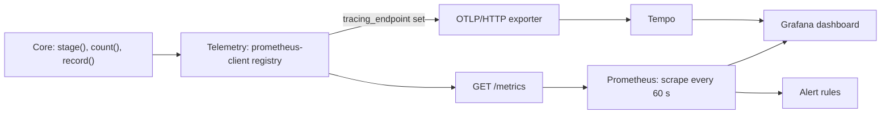

# Observability

> **Purpose:** Scavengarr records the steps of its core as Prometheus metrics: every Stremio stream request, its phases, every plugin search of a Stremio request, every hoster resolution, every stealth browser page and every HLS proxy request.
> **Status:** current
> **As of:** 54ee500c

## Purpose

Scavengarr records the steps of its core as Prometheus metrics: every Stremio stream request, its phases, every plugin search of a Stremio request, every hoster resolution, every stealth browser page and every HLS proxy request.
The metrics come from real use, so a change of the answer policy, a timeout or a breaker can be judged the next day without a test run.
A request id ties the log lines of one request together, and on demand the same steps go to Tempo as traces.
The plugins' long-term record keeps what the metrics lose at a restart: the evidence for keeping, disabling or removing a plugin whose site died.

Spec: `openspec/specs/observability/spec.md`.

## How it works



### Recording

The core records through one port, `TelemetryPort` (`domain/ports/telemetry.py`); `Telemetry` (`infrastructure/telemetry/`) implements it with prometheus-client and a registry of its own.

- `stage(name, **labels)` times a step as a `with` block.
- When the stage ends, its duration goes into the histogram `scavengarr_<stage>_seconds{labels}` and its outcome into the counter `scavengarr_<stage>_total{labels, outcome}`.
- The code sets the outcome (`stage.outcome = "hits"`); otherwise it is `ok`, `cut` for a cancellation (a deadline, an answer that is due, shutdown), `timeout` for a `TimeoutError` and `error` for any other exception.
- Exceptions always propagate, and `stage.label(...)` sets a label known only later.
- `count(name, outcome, **labels)` counts an outcome without a run, such as a plugin skipped by its open breaker or a resolution from the cache.
- `record(name, value, **labels)` records a value that is not a duration: streams per answer, bytes, the state of a readiness check.

The composition root builds it with `create_telemetry(config.telemetry.tracing_endpoint)` and closes it at shutdown.
Nine places record: `StremioStreamUseCase` (its search and resolve phases through `TitleSearch` and `ResolveFlow`), `PluginSearchRunner`, `HosterResolverRegistry`, Filemoon's pass keeper (`PassKeeper`), the stealth browser's page gate (`PageGate`), the HLS proxy route with its read-ahead (`SegmentReadAhead`), the event-loop monitor and the readiness probe (`NetworkProbe`).
Plugins and resolvers contain no metrics code, so a new one is recorded without changes.
A component without a wired port gets `NO_TELEMETRY`, which records nothing, as in most tests.

Durations and outcomes are separate families on purpose: a histogram per outcome would multiply the series.
Label values come only from fixed sets, never titles, IMDb ids, URLs, domains or stream ids.
The breakers, the browser pages and the container's CPU and memory are read at scrape time (`infrastructure/telemetry/collectors.py`), so they cost nothing between scrapes.
Every family with its labels, buckets and values: [Metrics](../reference/metrics.md).

### Prometheus

A scrape job in `prometheus.yml` reads the app:

```yaml
scrape_configs:
  - job_name: scavengarr
    scrape_interval: 60s
    static_configs:
      - targets: ["scavengarr:7979"]
```

The target is the host or container where Prometheus reaches port 7979.
When Scavengarr shares the network of a VPN container (`network_mode: service:<vpn>`), the target is that container's name.
The interval stays at 60 s: the metrics cost what the scrapes cost ([Cost](#cost)), and 15 s would cost four times as much.

### Grafana

`docker/grafana-dashboard.json` is the dashboard (Dashboards, New, Import, with the Prometheus data source).
Its panels:

- **Stremio answers:** answers in the range, version, why answers went out (target, done, budget, deadline, cached), search state (cache, stale, search, joined), streams per answer, answer time by search state (p50, p95) and phase times (p95).
- **Plugins:** search time per plugin (p95), outcomes per plugin as a table, results per plugin.
- **Hoster resolutions:** outcomes per resolver, resolve time per resolver (p95), the breakers that are open now.
- **HLS proxy:** throughput, time to first byte (p95), answers by status.
- **Resources:** CPU of the container, of Python and of the rest (Chromium), memory, event-loop lag (p99).

Range panels count over the selected time range: a day or a week judges a change.
Traffic is low (a few requests per hour), so the time series use 1-hour windows for answer times.

### Alerts

`docker/prometheus-alerts.yml` holds six alert rules, mounted into the Prometheus container and named in `prometheus.yml`:

```yaml
rule_files:
  - /etc/prometheus/scavengarr-alerts.yml
```

Prometheus evaluates the rules and lists the firing alerts under Alerts; a notification (mail, push) needs an Alertmanager (`alerting:` in `prometheus.yml`).
Only `ScavengarrDown` names the scrape job (`job="scavengarr"` as in [Prometheus](#prometheus)); a job of another name needs it renamed there.
promtool, which ships with Prometheus, checks the file after a change:

```bash
promtool check rules docker/prometheus-alerts.yml
# without a local Prometheus:
docker run --rm --entrypoint promtool -v ./docker:/rules prom/prometheus check rules /rules/prometheus-alerts.yml
```

`tests/unit/infrastructure/test_alert_rules.py` checks that every family the rules query is one the app exports, so a renamed metric fails the tests instead of silencing its alert.

| Alert | Fires when | Look at |
|---|---|---|
| `ScavengarrDown` (critical) | Prometheus has not scraped the target for 5 min, or the target is gone. | `prodctl.py ps`, `prodctl.py logs --since 30m` |
| `ScavengarrPluginWithoutYield` | A plugin was searched in the last 24 h without one hit while at least five plugins had hits (for 1 h): a dead site, a changed layout, a block. | the plugin's outcomes (Plugins panels), `prodctl.py logs --grep <plugin>`, its live smoke test |
| `ScavengarrSlowFirstAnswers` | Half of the last hour's answers that waited for a new search (at least 3) took longer than 20 s (for 15 min). | answer and phase times (Stremio answers panels), the reasons of `stremio_resolve_complete` |
| `ScavengarrHosterBreakerOpen` | A hoster's breaker has not closed for 6 h (open or half-open). | `prodctl.py logs --grep hoster_resolve`, the resolver's live smoke test |
| `ScavengarrEventLoopLag` | The event loop's lag p99 is above 100 ms for 15 min: CPU work on the loop delays every timeout. | CPU panels, `scripts/stremio_profile.py --py-spy` |
| `ScavengarrNoStreams` | More than half of the last hour's Stremio requests (at least 3) ended `empty` (for 15 min); requests that ended `no_title`, `no_plugins`, `error` or `cut` count only in the denominator. | search state and plugin outcomes |

### Readiness

Production's container once lost its network namespace for 33 h (the VPN container it shares was recreated without it) and stayed healthy all the while: `/api/v1/healthz` answers over loopback whatever fails outside.
`/api/v1/readyz` therefore asks `NetworkProbe` (`infrastructure/network_probe.py`) too, and the image's `HEALTHCHECK` asks `/api/v1/readyz`; `healthz` stays the liveness check ([Application health](../reference/torznab-api.md#application-health)).

- The probe pings the cache backend (`CachePort.ping()`) and resolves the fully qualified public name `example.com.` concurrently, each check within 3 s, at most once every 30 s; a request in between gets the last probe's verdict. It runs only when asked: the image's healthcheck asks every 30 s, and without a caller the gauge has no sample.
- The network counts as lost once both checks have failed for longer than 5 min; `/api/v1/readyz` then answers 503 with `"reason": "network"`. A single miss changes nothing, and neither does one check failing alone (a Redis restart, a DNS hiccup).
- Every probe sets `scavengarr_network_ok{check="cache"}` and `scavengarr_network_ok{check="dns"}` to 1 or 0; no alert rule reads it, the post-deploy check does ([Operations](../how-to/operations.md#5-check-a-deploy)).
- The loss logs `network_lost` once (error, with `seconds`, `probes` and `dns_error`), its end `network_recovered` (`seconds`, `probes`); a failed Redis ping counts toward the cache's `redis_unavailable` and `redis_recovered` lines.
- Docker marks the container unhealthy after three failed checks and restarts nothing by itself.

### Queries

```promql
# p95 answer time by search state
histogram_quantile(0.95, sum by (le, source) (rate(scavengarr_stremio_request_seconds_bucket[1d])))

# Why answers went out (target, done, budget, deadline, cached)
sum by (outcome) (increase(scavengarr_stremio_phase_total{phase="resolve"}[1d]))

# p95 search time and outcomes per plugin
histogram_quantile(0.95, sum by (le, plugin) (rate(scavengarr_plugin_search_seconds_bucket[1d])))
sum by (plugin, outcome) (increase(scavengarr_plugin_search_total[1d]))

# Outcomes per resolver
sum by (resolver, outcome) (increase(scavengarr_hoster_resolve_total[1d]))

# Background completions of challenged captures per resolver
sum by (resolver, outcome) (increase(scavengarr_hoster_challenge_completion_total[1d]))

# Filemoon's pass keeper: its captures and what kept it from one
sum by (outcome) (increase(scavengarr_hoster_pass_keep_total[1d]))

# Chromium and the rest of the container, in cores
rate(scavengarr_container_cpu_seconds_total[5m]) - rate(process_cpu_seconds_total[5m])

# HLS proxy throughput
sum(rate(scavengarr_hls_proxy_bytes_total[5m]))

# p90 wait for a stealth browser page, by what it is for
histogram_quantile(0.9, sum by (le, kind) (rate(scavengarr_browser_page_wait_seconds_bucket[1h])))

# Readiness checks that failed at a scrape of the last day (0) or never (1)
min_over_time(scavengarr_network_ok[1d])
```

### Request id

Every HTTP request gets a 12-hex-digit `request_id` in the structlog context.
All its log lines carry it, and so do the lines of the tasks it starts (the shared search, background resolutions), which copy the context.
The response has it as the `X-Request-ID` header.
The id is generated: a client's own `X-Request-ID` is ignored as untrusted input in the logs.

Each request ends with one `http_request` line: method, path, query, status, duration and client address.
The query keeps its values only for Torznab's own parameters on Torznab paths (`t`, `q`, `cat`, `extended`, `offset`, `limit`); every other value is logged as `***`.
Prowlarr sends its `apikey`, and proxied HLS paths carry the CDN's tokens and the client's address (`i=`, the VPN's exit address in production), also under the names `t` and `q`.
uvicorn's own access log is off (`access_log=False`): it repeated each request with its query unmasked.
A playback the shutdown bound cancels logs Uvicorn's cancel line as a warning and no `Exception in ASGI application`; the stop's last lines are written before the process ends ([Shutdown](architecture.md#shutdown)).

Log lines name a CDN by its second-level domain (`cdn=dropcdn`, `extract_domain()`), never by its URL: the path and the query of a video URL carry tokens and the client's address.
That holds for the HLS proxy's CDN errors (`hls_proxy_cdn_error`, `hls_proxy_network_error`), a body the CDN cut (`hls_proxy_file_cut`, `hls_proxy_segment_cut`) and its resumes (`hls_proxy_file_resumed`, `hls_proxy_segment_resumed` with `how=range` or `how=restart`), the fetches ahead (`hls_readahead_retried`, `hls_readahead_failed`), `/play`'s redirect (`stremio_play_resolved`), the playback check (`playback_check_failed`) and the resolvers' results.
Third-party records show URLs by their origin only (`_shorten_urls` in `infrastructure/logging/setup.py`).
httpx's line for each outgoing request, written at `logging.level: DEBUG` only, reads `HTTP Request: GET https://cdn.example.net "HTTP/1.1 200 OK"`, and the same holds for URLs in their tracebacks.

### The plugin record

The metrics restart with the process, and the scoring snapshots age out in weeks; whether a plugin whose site died stays, is disabled by default or is removed needs months.
`PluginHistory` (`infrastructure/plugins/history.py`) counts per plugin and UTC day; the counters are listed in [Metrics](../reference/metrics.md#the-plugin-record).

- `PluginSearchRunner` counts the searches, results, timeouts, dropped results, challenges and the searches that found no domain.
- A timeout is the plugin timeout or a `TimeoutError` the plugin raised, and a search that found no domain one whose plugin raised `PluginUnreachableError`, from its domain check or from its search page: the httpx base raises both for the search page (`_fetch_search_page()`, [Plugins](plugins.md#failures-of-the-site)), so a slow or unreachable site is no search without results.
- A challenge counts once per search however many pages showed one: the runner sets a `ChallengeFlag` (`domain/ports/plugin_history.py`) and the plugin bases mark it.
- The httpx base marks a challenge it saw in `_fetch_text` or `_safe_fetch`; the host then goes into the browser memo, and a later page served straight from the memo is no new sighting.
- The Playwright base marks a navigation that landed on a challenge page before `solve_cloudflare`.
- The bases settle each challenge through `settle_challenge()`: it counts as unsolved when the browser fallback returned no page or failed, a link-out resolution (`_resolve_redirect`) did not get past it, no browser tried, `solve_cloudflare` gave up, or the search ended with it open.
- A dead link-out behind a passed challenge counts as solved (the fetcher's `Redirect.passed`).
- `PluginHealthMonitor` checks every plugin's site once per `stremio.plugin_health_interval_seconds` (30 min).
- An unreachable site is checked again 5 min after the check that found it down, then at doubling pauses up to the interval, so a dead site costs one check per interval and a returning one is back within one pause.

The record is one value `plugin_history:v1` in the cache backend (diskcache or Redis; a year's TTL renewed with every write).
It is written every minute when it changed and at shutdown, with the days older than 180 dropped; each write logs `plugin_history_saved` with the plugins and days.
The start restores it and logs `plugin_history_restored` with the plugins and days, or `plugin_history_discarded` with a `reason` for another version or an unreadable record; `plugin_history_restore_failed` and `plugin_history_save_failed` report failures.
`GET /api/v1/stats/plugins` reports it, and the production digest prints the same per plugin ([Operations](../how-to/operations.md)).
The record is evidence, not a rule: the lifecycle decision for a dead site stays the maintainer's.

### Tracing on demand

Traces show one request as a tree: the request, its phases, each plugin search and each hoster resolution, with durations and outcomes.
They cost a backend that runs around the clock, so they are off by default and meant for looking into a problem.

1. Start Tempo: `docker compose --profile tracing up -d tempo` (`docker/tempo.yaml`: OTLP/HTTP on 4318, query API on 3200, traces kept 3 days, 512 MB memory limit).
2. Set `telemetry.tracing_endpoint` (or `SCAVENGARR_TELEMETRY_TRACING_ENDPOINT`) to `http://tempo:4318` and restart Scavengarr. Behind a VPN container, publish Tempo's port 4318 (`- "4318:4318"`) and use the host's IP: name lookups would go through the VPN.
3. Add Tempo to Grafana as a data source (`http://<host>:3200`) and search with TraceQL, for example `{ name = "stremio_request" && duration > 10s }` or `{ span.request_id = "a1b2c3d4e5f6" }` with the id from a log line.

Every stage but the HLS proxy and its read-ahead (a span per segment would bury the requests) is a span named after the stage and its subject: `stremio_request`, `stremio_phase search`, `plugin_search kinoger`, `hoster_resolve voe`, `browser_page_wait capture`.
Spans carry the stage's labels, its outcome and a few details (IMDb id, content type); an error sets the span's status to the exception type, not its message.
They never carry URLs (stream URLs hold tokens) or titles, and the root span carries the `request_id`.
Spans go out in batches every 5 s from a background thread; at shutdown the rest gets at most 3 s, also when the endpoint does not answer, and what has not gone out by then is dropped.

Without an endpoint the trace SDK, the exporter and protobuf are not loaded and no export thread runs.
FastAPI's own OpenTelemetry integration (switched on by `OTEL_EXPORTER_OTLP_ENDPOINT`) is separate, and Scavengarr does not use it.

### Cost

`tests/benchmark/test_telemetry_overhead.py` measures it on x86 (run manually: `poetry run pytest tests/benchmark/test_telemetry_overhead.py -s`); the production host is about 3 to 4 times slower.

| Operation | Cost |
|---|---|
| One stage | 5.6 µs; a first stream request records about 60, about 1 ms on the production host. |
| One count | 2.2 µs |
| One stage with tracing on | 32 µs |
| One scrape of 672 series (20 plugins, 12 resolvers) | 4.4 ms, about 15 ms on the production host: at 60 s about 20 s of CPU per day. |

The benchmark fails above 50 µs per stage or 20 ms per scrape.
Nothing runs between scrapes except the event-loop timer.
Tracing, when on, adds a span per stage (about 60 to 100 per first stream request) and Tempo's 0.2 to 0.7 GB of memory while it runs.
The OpenTelemetry packages add about 5 MB to the image; installed, they cost about 2 MB of memory even with tracing off, as redis-py loads the SDK's metric types when they are there.

## Configuration

`/metrics` needs no setting; tracing needs `telemetry.tracing_endpoint` ([Configuration](../reference/configuration.md#telemetry)).

## Observability

Every family with its labels, buckets and values: [Metrics](../reference/metrics.md).
Reading production's metrics, logs and records: [Operations](../how-to/operations.md).

## Limits

- The counters restart with the container, and `increase()` sees no growth in a series that appeared with its first count, so a plugin whose only hit in 24 h came right after a restart counts as without yield.
- A plugin for content its users rarely ask for (an anime site on a day without anime) alerts too; a matcher such as `plugin!~"fireani|aniworld"` in all three `scavengarr_plugin_search_total` selectors of the rule leaves it out.
- The rule's first selector counts every outcome, so a plugin that was only skipped, unreachable or behind an open breaker counts as asked.
- Label combinations exist only once they occurred, so the series grow with the plugins and resolvers in use.
- Torznab searches are not recorded as plugin searches; only their stealth browser pages count (`browser_page` with `kind="plugin"`).
- The readiness probe reports a lost network only when both checks fail: a DNS that fails while the cache backend answers keeps the 200, and with the diskcache backend, whose check needs no network, only the startup and the shutdown answer 503.

## Target

- Plugins and hoster resolvers must not record metrics, and label values must come from fixed sets ([Architecture rules](../target/architecture.md#invariants)).

## References

- `src/scavengarr/domain/ports/telemetry.py`: the port and `NO_TELEMETRY`.
- `src/scavengarr/infrastructure/telemetry/`: `Telemetry`, the scrape-time collectors and the tracing.
- `src/scavengarr/infrastructure/plugins/history.py`: the plugin record.
- `src/scavengarr/infrastructure/network_probe.py`: the readiness probe.
- `docker/grafana-dashboard.json`, `docker/prometheus-alerts.yml`, `docker/tempo.yaml`: the dashboard, the alert rules and Tempo.
- [Metrics](../reference/metrics.md), [Operations](../how-to/operations.md), [Architecture](architecture.md).
