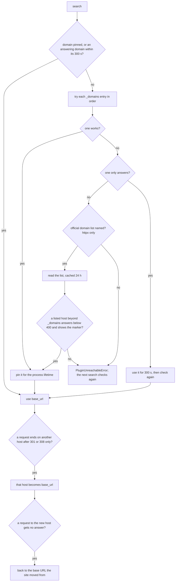

# Plugin domains

> **Status:** current
> **As of:** 5b4303e4

## Purpose

Sites move between domains, keep mirrors and get blocked by name.
A plugin lists its genuine domains in `_domains`, in fallback order, and the plugin base picks the one that serves the site.
This document describes that domain check, the site moves the httpx base follows, the official domain lists some sites publish, and the mirror groups of sites that front one database.

## How it works

### The domain check

A plugin's `search()` calls `await self._verify_domain()` first.
A plugin with one domain and no official list skips the check and uses `https://{_domains[0]}`.
Otherwise the base tries each domain in order, with a 5 s timeout (`DEFAULT_DOMAIN_CHECK_TIMEOUT`):

- A domain that works is pinned: `base_url` is set to it for the process lifetime, unless a site move replaces it.
- Without a working domain, the first one that only answers serves the searches of the next 300 s (`ANSWERING_DOMAIN_RECHECK_S` of `infrastructure/plugins/constants.py`) and is checked again then, so a transient error at check time pins nothing.
- Without an answering domain, the httpx base reads the site's official domain list, where the plugin names one.
- When nothing answers, the base logs `<plugin>_no_domain_reachable` and raises `PluginUnreachableError`; `base_url` stays as it was, and the next search checks again.

What counts as working and as answering depends on the base:

| Base | Works | Only answers |
|---|---|---|
| `HttpxPluginBase` | A `HEAD` with the plugin's User-Agent gets a status below 400. | A status below 500, or a challenge read from the headers (`detect_challenge_headers()`). |
| `PlaywrightPluginBase` | A navigation of the plugin's page ends below 400, or on a challenge solved in time. | A plain error page (4xx without a challenge page). |

The httpx base takes the final URL after redirects as `base_url`, so a bare domain that redirects to `www.` gives the right base.
The Playwright base sets `https://{domain}` without following redirects.
A challenge page the browser did not solve does not count for the Playwright base, whose browser is its only way past it; the httpx base's browser fallback solves a challenge per page later.

A Stremio search whose domain check raises `PluginUnreachableError` marks the plugin unreachable in the health monitor at once, until its next check finds the site answering; a Torznab search logs the error and answers without the plugin.

### Site moves

The httpx base follows a site that moves on.
When a request of `_fetch_text()` or `_safe_fetch()` to the base host ends on another host after permanent redirects only (301 or 308) and with a status below 400, that host replaces `base_url` (`<plugin>_site_moved`), without a change to the plugin.
Temporary redirects (302, 307), redirects that stay on the host and moves that end on an error page change nothing.
The move lasts until a restart or until a request to the new host gets no answer (a timeout, a connect or DNS error).
Then `base_url` goes back to the one the site moved from (`<plugin>_site_move_undone`), whose redirect leads to the site's newest host.

### Official domain lists

Some sites publish the list of their current addresses on a host of its own.
A plugin of such a site names it in `domain_list_url` and adds `domain_marker`, a CSS selector of an element that only the site's own landing page shows (such as its link to the list), since parked and for-sale domains answer below 400 too.
aniworld, filmo and sto do so.

`infrastructure/plugins/domain_list.py` reads the list:

- The list is read through the plugin's client, so the shared client's guard refuses LAN targets.
- The hosts come from the page and from up to 3 scripts it loads from the list's own host: a host counts when it appears as a `url:` or `href:` value or in an `<a href>`.
- IP literals are dropped, and at most 20 hosts are kept.
- The hosts are cached as `<plugin>:domain_list:v1` for 24 h; a list that fails to load or names no host is cached as empty for 1 h, with one `plugin_domain_list_failed` warning.
- Without the app's cache the list is skipped.

Each listed host beyond `_domains` is fetched in turn.
The first one that answers below 400 and shows the marker is pinned like a `_domains` entry and logged as `plugin_domain_list_host` with the plugin and the host.
The production digest names such a host, so the maintainer decides whether it goes into `_domains`.
The Playwright base reads no lists.

### Plugins with a fallback of their own

A plugin may replace the check.
boerse does not call `_verify_domain()`: it logs in on each of its domains in turn and takes the first where the login succeeds as `base_url`.
When no domain answers it raises `PluginUnreachableError` like the bases; when domains answer but no login succeeds, a `RuntimeError`.
An override of `_wait_for_cloudflare()` must call the base implementation and add its own condition after it.

### Mirror groups

Sites that front one database (the same ids, titles and links in other themes) share a `mirror_group`.
Each keeps its own `_domains` and its own domain check.
A Stremio request asks one member of the group, chosen by plugin score, breaker and reachability, as [Plugins](plugins.md#plugin-selection-for-a-stremio-request) describes; Torznab keeps every member as an indexer of its own.

### The health endpoint

`GET /api/v1/torznab/<plugin>/health` checks the plugin's current `base_url` (`HEAD`, a ranged `GET` on 405 or 501, 5 s) and reports `reachable`, `status_code` and `error`.
Any HTTP answer counts as reachable; only a network error reports `false`.

## Configuration

The domain check has no settings: the timeouts and the recheck interval are constants of `infrastructure/plugins/constants.py`.
A plugin's domains are code (`_domains`, `domain_list_url`, `domain_marker`); the per-plugin overrides of [the configuration reference](../reference/configuration.md#plugins) can disable a plugin whose site is gone.

## Observability

The domain check logs `<plugin>_domain_found`, `<plugin>_domain_answers` and `<plugin>_no_domain_reachable`, the site moves `<plugin>_site_moved` and `<plugin>_site_move_undone`, and the domain lists `plugin_domain_list_host` and `plugin_domain_list_failed`.
The plugins' long-term record counts the site checks that found the site down (`unreachable`) and the searches that found no domain (`unreachable_searches`) per plugin and day; see [Observability](observability.md#the-plugin-record).

## Limits

- A pinned domain is not checked again after later request errors; only a restart, a site move or an answering-only domain's recheck changes it.
- The Playwright base follows no redirects and no site moves.
- A list linked only from a deeper page of the site, or published by a Playwright site, is not read.

## Target

- Plugins whose site died stay enabled and report themselves unreachable; the maintainer decides from their long-term record whether to keep, disable or remove them.
- The open domain work is listed in the backlog: [the open rows](../backlog.md).

## References

- `src/scavengarr/infrastructure/plugins/httpx_base.py` (`_verify_domain()`, `_listed_domain()`, `_follow_site_move()`, `_undo_site_move()`).
- `src/scavengarr/infrastructure/plugins/playwright_base.py` (`_verify_domain()`).
- `src/scavengarr/infrastructure/plugins/domain_list.py`, `src/scavengarr/infrastructure/plugins/constants.py`.
- `src/scavengarr/infrastructure/captcha/detect.py` (`detect_challenge_headers()`).
- `src/scavengarr/interfaces/api/torznab/router.py` (the health endpoint).
- `plugins/boerse.py` (the login fallback).
- History: [`docs/archive/plans/plugin-domains.md`](../archive/plans/plugin-domains.md) (the domain readings and the official lists), [`docs/archive/plans/filmo-plugin.md`](../archive/plans/filmo-plugin.md).
