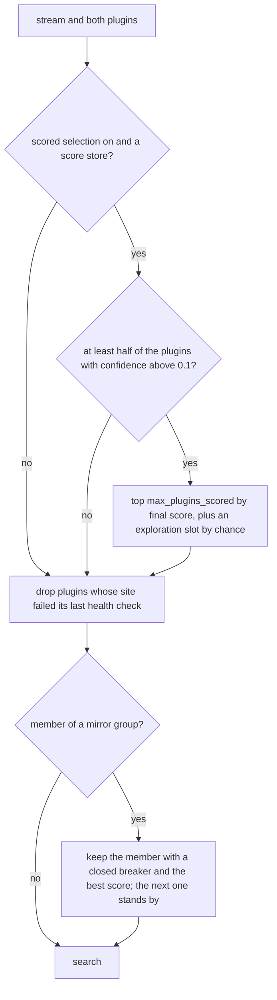

# Plugins

> **Purpose:** A plugin knows how to search one site and returns normalised `SearchResult` objects.
> **Status:** current
> **As of:** 9d2fc4c7

## Purpose

A plugin knows how to search one site and returns normalised `SearchResult` objects.
This document describes how plugins are loaded and called, the contract every plugin follows, the base classes that carry the shared work, and how plugins are scored and selected for a Stremio request.
How a plugin finds a working domain is in [Plugin domains](plugin-domains.md); how to write one is in [Adding a plugin](../how-to/new-plugin.md); the list of plugins is generated into [the plugin reference](../reference/plugins.md).

## How it works

### Discovery and loading

Every plugin is one `.py` file in the plugin directory (`./plugins` by default) that exports a module-level `plugin` instance.
`PluginRegistry.discover()` indexes the files in name order without importing them.
The first other registry call imports every discovered file once through `load_python_plugin()` and caches the instances with their `provides`, `mode` and `languages`.
The startup wiring makes that call, so every plugin is imported before the first request, and `list_names()`, `get()` and `get_by_provides()` only read the cache.

A module must export `plugin` with a non-empty `name` and a `search` method; otherwise the loader raises `PluginLoadError`.
A file that fails to import is logged as `plugin_load_failed` and skipped, and the other plugins keep working.
Of two files with the same plugin name the first in name order wins, and the later one is logged as `plugin_name_duplicate`.
`registry.get()` of an unknown name raises `PluginNotFoundError`, which the Torznab router answers as a "plugin not found" error.

At startup the composition root applies the per-plugin overrides of the configuration (`plugins.overrides.<name>`).
`enabled: false` removes the plugin from the registry; `timeout` (httpx plugins only), `max_concurrent` and `max_results` set `_timeout`, `_max_concurrent` and `_max_results`.
An unknown plugin name is logged as `plugin_override_unknown`, and a `timeout` on a Playwright plugin as `plugin_timeout_override_unsupported`.
Then the Playwright plugins receive the shared browser pool, and the httpx plugins the shared HTTP client and the app's cache.

### The plugin contract

`PluginProtocol` (`domain/plugins/base.py`) is what the core calls:

```python
class PluginProtocol(Protocol):
    name: str
    provides: PluginProvides  # "stream", "download" or "both"

    async def search(
        self,
        query: str,
        category: int | None = None,
        season: int | None = None,
        episode: int | None = None,
    ) -> list[SearchResult]: ...
```

`name` is the identifier in the Torznab URL (`/api/v1/torznab/<name>`).
`provides` says what the site offers: streaming hoster links (`stream`), download links (`download`) or both; the base classes default to `download`, and only `stream` and `both` plugins feed the Stremio addon.
`languages` names the content languages (default `["de"]`); `default_language` is its first entry.

Two capabilities are optional:

- A plugin that places a series episode on the site's own season pages sets `locates_episodes = True` and takes `episode_ref: EpisodeRef | None = None` as a keyword of `search()`; the Stremio search passes the reference to such plugins only (see [Episodes](#episodes)).
- A plugin whose links sit behind a captcha or a download quota implements `GrabResolvingPlugin` (`resolve_download(url) -> list[str]`): its results keep page URLs, and the links are resolved when an Arr app grabs the result (`plugins/nox.py`, `plugins/animeloads.py`).

Every plugin must:

- label each result with the category the site gives it, never with the requested one, and answer a request through `served_category()` and `filter_by_category()` (see [Categories and relevance](#categories-and-relevance));
- page through the site's results up to `effective_max_results` items;
- fetch detail pages with bounded concurrency (`_new_semaphore()`), and only for the relevant hits;
- list genuine domains only in `_domains`;
- return a partial result with a warning when an optional field is missing, and skip an item without its required fields instead of aborting the search.

### Results and metadata

`search()` returns `SearchResult` objects (`domain/plugins/base.py`).
Only `title` and `download_link` are required.
`download_links` lists every link of the result as `{"hoster": ..., "link": ...}` dicts, with an optional `"label"` for the episode a link belongs to.
`source_url` is the detail page the result came from, and `category` its Torznab category (default 2000).
A plugin that sets `validated_links` itself skips the link validation.
`metadata["archive_password"]` becomes the `.crawljob`'s `extractPasswords`.

The metadata the title matcher reads follows one convention across plugins:

- `metadata["year"]` is an `int`, the start year only (a series' first year, never an episode's);
- `metadata["genres"]` is one comma-joined string;
- `metadata["imdb_id"]` is set where the site names the id.

A plugin that cannot read a year leaves it out; nothing is guessed.

### Base classes

Every plugin inherits from `HttpxPluginBase` (`infrastructure/plugins/httpx_base.py`) or `PlaywrightPluginBase` (`infrastructure/plugins/playwright_base.py`).
The httpx base serves static HTML and JSON APIs, sites behind a Cloudflare challenge included; the Playwright base serves sites that need JavaScript or a login in the browser.
Sites on the same backend share a base of their own: `DataApiPluginBase` (`data_api.py`) for the "/data" JSON API, and `XenForoPluginBase` (`xenforo.py`) for XenForo download forums with login, CSRF token and forum-node categories.

Both bases share these class attributes:

| Attribute | Default | Purpose |
|---|---|---|
| `name` | `""` | The plugin identifier; must be set. |
| `provides` | `"download"` | What the site offers. |
| `languages` | `["de"]` | The content languages. |
| `_domains` | `[]` | The domains in fallback order; must be set. |
| `_max_concurrent` | `5` | The size of `_new_semaphore()`. |
| `_max_results` | `1000` | The upper bound for pagination. |
| `cache_ttl` | `None` | The Torznab search cache TTL in seconds; `None` takes the global default. |

Shared helpers:

- `base_url` starts as `https://{_domains[0]}` and is set by the domain check (see [Plugin domains](plugin-domains.md)).
- `effective_max_results` is `min(search_max_results, _max_results)`: Stremio searches and scoring probes lower it through the `search_max_results` context variable.
- `_new_semaphore()` bounds parallel requests or pages.
- `isolated_search()` is the entry point of the Stremio search.

`HttpxPluginBase` adds:

- `_timeout` (default 15 s) and `_user_agent` for every request;
- one app-wide HTTP client with per-domain rate limiting and retries of 429 and 503 (`RetryTransport`), injected by the composition root;
- `_fetch_text()`, a GET that loads the URL through the browser when the site answers with a Cloudflare challenge, and then goes on in httpx with the browser's session (its cookies and User-Agent);
- `_fetch_search_page()`, the search page's GET in the raising mode of `_fetch_text()` (see [Failures of the site](#failures-of-the-site));
- `_safe_fetch()` and `_safe_parse_json()`, which log and return `None` instead of raising;
- `_resolve_redirect()`, `_resolve_own_links()` and `_resolve_result_links()`, which replace link-outs on the plugin's own host by their off-site targets;
- `mirror_group`, for sites that front one database (see [Plugin selection](#plugin-selection-for-a-stremio-request));
- `domain_list_url` and `domain_marker`, for a site that publishes an official list of its addresses;
- the app's cache (`set_cache()`), for what a plugin keeps across requests under a key of its own.

A host on which the browser had to pass a challenge skips plain httpx while the browser works on it.
A challenge less than 5 minutes after httpx took over a session (`_SESSION_TRUST_S`) means the site binds its clearance to the browser; that host then goes straight to the browser for 30 minutes.
The browser's solve runs on when the request that started it ends, so the next request gets the session.

`PlaywrightPluginBase` adds:

- the shared Chromium of the browser pool, held with `lease()` for each operation;
- `isolated_search()`, which runs each search in a fresh `BrowserContext` (or behind a lock on the persistent context with `_serialize_search = True`) and closes it afterwards;
- `_new_page()`, `_navigate_and_wait()` and `_fetch_page_html()`, which pass a Cloudflare challenge on the way (`_wait_for_cloudflare()`);
- resource blocking of images, fonts, stylesheets and media in each new context (`_block_resources`);
- the `ClearanceStore`, which restores stored clearance cookies into every new context and keeps them across restarts;
- `_prepare_context()`, a hook that hands a logged-in session to the per-request context.

### Search stages

There is no generic stage engine: each plugin runs its stages inside `search()`.
A typical search fetches the result pages, keeps the relevant hits, fetches their detail pages in parallel and builds one result per detail page.
A JSON API that answers with links needs one stage; a site with redirect or embed pages needs more.
Link validation runs after the plugin, outside it.

```mermaid
sequenceDiagram
    participant Core as Use case
    participant Plugin
    participant Site
    Core->>Plugin: search(query, category, season, episode)
    Plugin->>Plugin: served_category(); [] when the site lacks the category
    Plugin->>Site: domain check (first search)
    loop result pages until effective_max_results
        Plugin->>Site: search page
        Site-->>Plugin: hits
    end
    Plugin->>Plugin: relevant_hits()
    par bounded by _new_semaphore()
        Plugin->>Site: detail page
        Site-->>Plugin: title, links, size, year, genres
    end
    Plugin->>Plugin: label categories, filter_by_category()
    Plugin-->>Core: list[SearchResult]
    Core->>Core: link validation; for Stremio first the episode filter, then the title match
```

Torznab does not de-duplicate results after the plugin, so a plugin that can return a result twice de-duplicates it itself.
The Stremio search drops a result found again (`result_key()`: plugin, title, release and links).

### Failures of the site

A failure of the site on the first search page is a failure of the search, so that the plugin record does not count a slow or unreachable site as one without hits.
`HttpxPluginBase._fetch_search_page(path, params=..., context=...)` fetches that page below `base_url` in the raising mode of `_fetch_text()` (`raising=True`):

- A domain that does not answer (a 5xx without a challenge, a transport error, a connect timeout) sends the page to the domain the domain check finds then: the check runs again over every domain (`_verify_domain()`), and the page is fetched once more on the domain it chose.
- `PluginUnreachableError` follows when no domain answers the check or the page fails on the chosen domain too, and at once for a site with one domain and no domain list.
- A timeout after the connection (the answer too slow) raises `TimeoutError`; no other domain is tried.
- Every other answer is `_fetch_text()`'s: a challenge goes to the browser fallback and counts in the challenge record, and a 4xx is `None`.
- Detail pages and later result pages stay lenient (`None` with the log line): a missing one is a partial result.

jjs (the first result page) and kinox fetch their search page this way; the other plugins answer `[]` after such a failure ([Limits](#limits)).
The Stremio search counts a raised timeout under `timeouts` and `PluginUnreachableError` under `unreachable_searches` ([Observability](observability.md#the-plugin-record)), the Torznab search answers both with its error answer (`TorznabExternalError`), and the scoring probe records the timeout as `timeout`.

### Categories and relevance

`infrastructure/plugins/categories.py` answers a request:

- `served_category(requested, offered)` gives the category to match against the labels the site can give: a child the site does not tell apart becomes its parent, and a family the site lacks gives `None`, which the plugin answers with `[]` without a request.
- `filter_by_category(results, category)` keeps the matching results.
- `category_matches()` is the Torznab parent and child rule: `None` matches everything, 5000 matches 5000 to 5999, 5070 matches only 5070; it is the domain's (`domain/entities/torznab.py`), which the Torznab search filters several kinds by too.
- `stream_category(genres, is_series=...)` labels film and series sites: films 2000 whatever the genre, series 5000, anime and animation series 5070.
- `is_series_title(title)` tells episode and season-pack names from films for sites without a series label.

Site searches also list loose matches, and each hit costs a detail page.
`relevant_hits(hits, query, hit_title)` of `infrastructure/plugins/relevance.py` keeps the hits whose title contains every query word (case, accents and punctuation folded), closest first, else the site's first three (titles in another language), and every hit of an empty query.
A trailing year in parentheses is no word of a hit's title.
With `limit=SINGLE_TITLE_HITS`, which a season or episode request passes, an exact hit is fetched alone.

### Episodes

A series page that carries every episode labels each link `<season>x<episode> <label>` (`episode_label()` of `infrastructure/plugins/episodes.py`), and `filter_episodes()` keeps the links of the requested episode; links without a label drop.
The Stremio episode filter reads the same labels.

A plugin with `locates_episodes` places the request's episode on the site's own season pages instead of using the request's numbers.
The request's `EpisodeRef` (`domain/entities/stremio.py`) carries the episode's English title and air date, the request's series titles, and an absolute number with its `source`: `kitsu`, `position` (a series no Kitsu entry counts whole) or `unchecked`.
`infrastructure/plugins/episode_index.py` holds the index and the rules:

- `RowSelectors` name a season page's rows: the number cell, the German and the English title.
- `episode_index()` reads the regular seasons' pages through the plugin's fetcher and keeps the rows for 7 days in the plugin's cache; a page the site did not answer leaves the index unstored.
- `locate()` takes the row that shows the absolute number; without that row or without a number, the title decides among the rows numbered within 5 of the number.
- An `unchecked` number takes a titled row only where its title confirms it.
- On a series the site names only by a shorter form of the request's titles (`is_partial_series()`), the number counts another series, and only the title places the episode.

No matching row means no result for that series, never a page built from the request's numbers.
The plugin keeps the request's `season` and `episode` in the result's metadata and adds `site_season`, `site_episode` and `episode_located_by` (`number`, `neighbour`, `title` or `fuzzy_title`).
aniworld locates every series this way, sto its anime results; sto's other series keep the request's numbers.

On s.to an episode is a `tr.episode-row`: `th.episode-number-cell` holds the number within the season, `td.episode-title-cell` holds `strong.episode-title-ger` (the German title) and `span.episode-title-eng` (the English title).
For an anime the English span carries the absolute number (`Episode 062`) in place of a title.
aniworld's rows show it as `[Episode NNN]` at the end of the English title.

### Link-outs and the sto gate

Some sites list hoster links as link-outs on their own host (`/redirect/<hash>`, `/external/<hash>`, sto's `/r?t=<token>`).
The httpx base follows a link-out to its first off-site `Location` and drops a link that never leaves the site.
sto redirects a link-out only when it is opened from the episode page that lists it, so it sends that page as `Referer`.

When none of an episode's link-outs leaves the site, sto gates them for the session.
For a stream request the stealth browser passes the gate once (`_pass_link_gate()`, up to 60 s, as a task of its own), and the episode page is read again with the browser's session.
A failed pass is not tried again for 300 s (`_GATE_RETRY_S`), and in that time whole seasons (Torznab) do not request their link-outs at all.
A stream request drops the link-outs that stayed on the site (`sto_gated_links_dropped`), since the resolver cannot follow them from this address either; Torznab keeps them for JDownloader.

### How plugins are called

| Path | Plugins | Call |
|---|---|---|
| Torznab search | The plugin named in the URL. | `search(query, category=...)`, cached per query, then link-validated. |
| Stremio streams | The selected stream plugins (see below). | `isolated_search()` under the concurrency pool, with the plugin timeout and a circuit breaker per plugin, then the episode filter and the link validation. |
| Scoring probes | The stream plugins, in the background. | `search(query, category=...)` with a lowered result limit and a timeout. |

`isolated_search()` is a passthrough for httpx plugins; Playwright plugins run it in a per-request browser context, so concurrent Stremio requests share no page state.

### Plugin selection for a Stremio request

A Stremio request asks the `stream` and `both` plugins (`get_by_provides("stream")`).
With scored selection on, `PluginSelector` (`application/stremio/plugin_selection.py`) narrows them by their scores.
`PluginSearchRunner` (`application/stremio/plugin_search.py`) then drops the plugins whose site failed its last health check and keeps one member per mirror group.



A plugin's health comes from `PluginHealthMonitor` (`infrastructure/plugins/health_monitor.py`), which checks the stream plugins' sites periodically; a search whose domain check found no domain marks the plugin unreachable until the next check finds the site answering.

Mirror groups join sites that front one database (the same ids, titles and links in other themes): hdfilme, streamcloud and streamkiste share `mirror_group = "hdfilme"`.
The member with the best `final_score` of its `current` snapshot is asked; a score with confidence up to 0.1 counts as none, and without scores the first member is asked.
A member whose breaker is open is passed over; when no member's breaker is closed, all stay in and their breakers decide.
The next member stands by: it is asked when the chosen one gives nothing for a query, and a member that gave nothing while its standby delivered ranks behind the others.
This choice uses the scores whenever a score store exists, also with scored selection off.
Torznab keeps every member as an indexer of its own.

### Scores and probes

The scoring subsystem (`infrastructure/scoring/`) ranks the stream plugins by background probes.
`ScoringScheduler` starts 10 s after startup and ticks every 5 minutes; each tick runs the probes that are due.

- `HealthProber` sends `HEAD` to each plugin's `base_url` (a ranged `GET` on 405 or 501) once a day: a status below 400 without a page block counts as reachable, and a Cloudflare or DDoS-Guard block scores 0.
- `MiniSearchProber` searches each plugin twice a week per category (2000, 5000) and age bucket (`current`, `y1_2`, `y5_10`), with a query from the bucket's pool: it scores success, speed, the results found, the reachability of up to 3 supported hoster links and the share of supported hosters.
- `QueryPoolBuilder` builds the pools from the IMDb suggestion API, 10 prefixes per build, cached for 24 h and rotated by the ISO week; bundled lists stand in when the API answers with errors.

When IMDb cannot be reached at all (a connect error or a connect timeout), a pool build stops at that first request, logs `query_pool_unavailable` once, and gives no queries for 10 minutes; the due probes run on the first tick after that.
The builder keeps the last pool per cell in memory and answers from it while the cache gives nothing and the copy is younger than 24 h.

Each probe updates an exponentially weighted average (`EwmaState`): the health average with a half-life of 2 days, the search average with one of 2 weeks.
The `final_score` of a snapshot is `(w_health * health + w_search * search) * (0.5 + 0.5 * confidence)`, with weights 0.4 and 0.6 by default.
`confidence` grows with the number of samples; scores expire after `score_ttl_days` when probes stop.
`CachePluginScoreStore` keeps the snapshots in the cache backend under `score:<plugin>:<category>:<bucket>`.

Scored selection takes the `current` snapshots of the request's category; a missing or unreadable snapshot counts as score 0.5 with confidence 0, so a failing store leads to the cold start instead of a failed request.

## Configuration

The plugin directory, the per-plugin overrides, the plugin timeout and health check of Stremio searches, scored selection and the scoring probes are settings of the configuration reference: its sections [`plugins`](../reference/configuration.md#plugins), [`stremio`](../reference/configuration.md#stremio) and [`scoring`](../reference/configuration.md#scoring).
Plugin credentials come from `SCAVENGARR_<PLUGIN>_USERNAME` and `SCAVENGARR_<PLUGIN>_PASSWORD`.

## Observability

The core records each plugin search as a telemetry stage, and each plugin's searches, results, timeouts, challenges and site checks per day in the plugins' long-term record (`GET /api/v1/stats/plugins`); plugins record nothing themselves.
`GET /api/v1/stats/plugin-scores` lists the score snapshots, sorted by `final_score`, and answers 503 when scoring is off.
Both are described in [Observability](observability.md).

## Limits

- A site that changes its markup returns nothing until its parser is fixed; the live smoke tests (`poetry run pytest -m live`) find such plugins.
- A slow or failing site still returns nothing for most httpx plugins: only jjs and kinox fetch their search page with `_fetch_search_page()` ([Failures of the site](#failures-of-the-site)). The others' `_fetch_text()` and `_safe_fetch()` turn a timeout, a transport error and every answer from 400 up into `None` with the line `<plugin>_timeout`, `_fetch_error` or `_http_error`, and the plugin answers `[]`, which the plugin record counts as a search without results. The live smoke skips such an empty run and names the line (`tests/live/smoke_outcome.py`).
- The confidence of a score is computed when a probe updates it, so it reflects the sample count, not the age of the samples.
- A site that binds its clearance to the browser costs a browser page for every request for 30 minutes.

## Target

- The open plugin work is listed in the backlog: [the open rows](../backlog.md).
- The placement of anime episodes is specified in [`openspec/specs/stremio-anime-episodes/spec.md`](../../openspec/specs/stremio-anime-episodes/spec.md), and the episode placement by number first in [`openspec/changes/archive/2026-10-18-place-episodes-by-number-first/`](../../openspec/changes/archive/2026-10-18-place-episodes-by-number-first/proposal.md).

## References

- Contract and results: `src/scavengarr/domain/plugins/base.py`, `src/scavengarr/domain/plugins/exceptions.py`.
- Loading: `src/scavengarr/infrastructure/plugins/loader.py`, `src/scavengarr/infrastructure/plugins/registry.py`, `src/scavengarr/interfaces/composition.py`.
- Bases and helpers: `src/scavengarr/infrastructure/plugins/httpx_base.py`, `src/scavengarr/infrastructure/plugins/playwright_base.py`, `src/scavengarr/infrastructure/plugins/data_api.py`, `src/scavengarr/infrastructure/plugins/xenforo.py`, `src/scavengarr/infrastructure/plugins/categories.py`, `src/scavengarr/infrastructure/plugins/relevance.py`, `src/scavengarr/infrastructure/plugins/episodes.py`, `src/scavengarr/infrastructure/plugins/episode_index.py`.
- Selection: `src/scavengarr/application/stremio/plugin_selection.py`, `src/scavengarr/application/stremio/plugin_search.py`, `src/scavengarr/infrastructure/plugins/health_monitor.py`.
- Scoring: `src/scavengarr/infrastructure/scoring/scheduler.py`, `src/scavengarr/infrastructure/scoring/health_prober.py`, `src/scavengarr/infrastructure/scoring/search_prober.py`, `src/scavengarr/infrastructure/scoring/query_pool.py`, `src/scavengarr/infrastructure/scoring/ewma.py`, `src/scavengarr/infrastructure/persistence/plugin_score_cache.py`.
