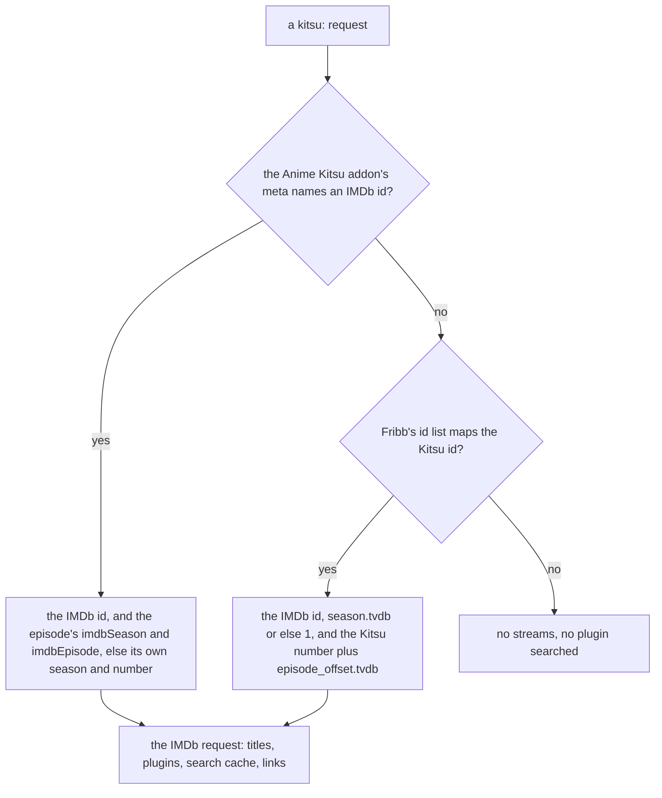
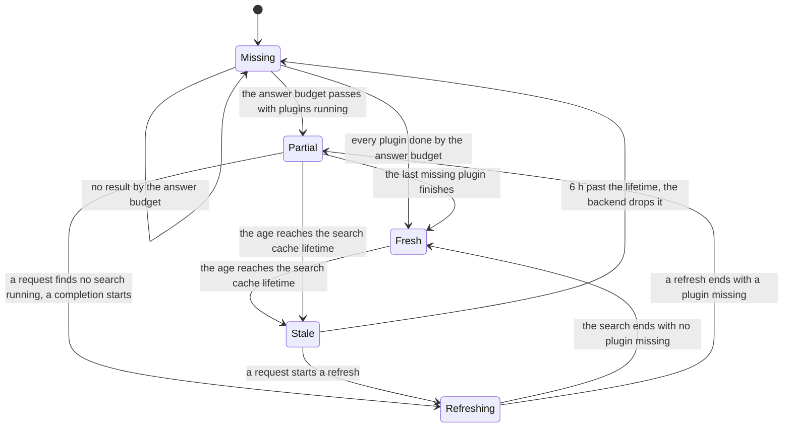
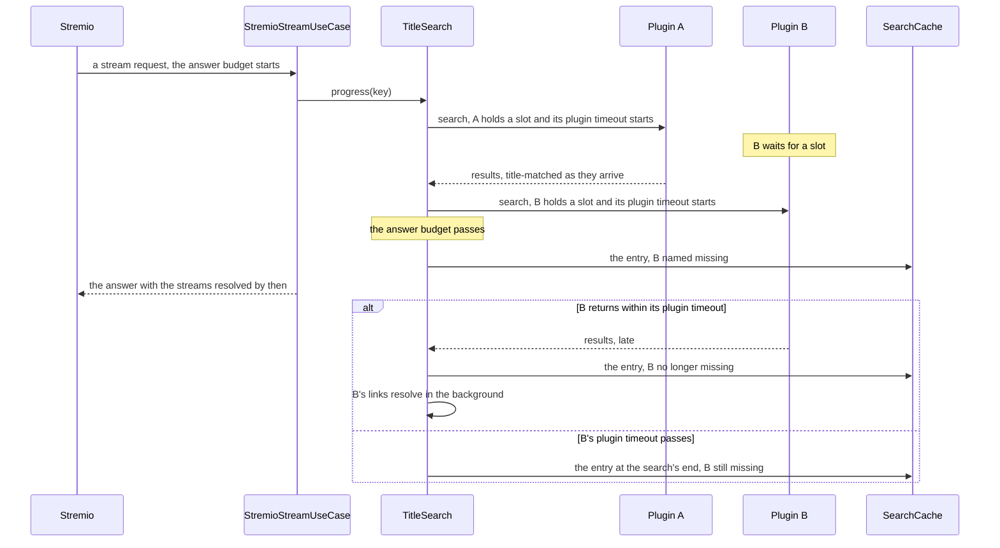

# Stremio addon

> **Purpose:** The Stremio addon answers a Stremio player's request for the streams of a movie or an episode with the links Scavengarr's plugins find, resolved by its hoster resolvers and ranked.
> **Status:** current
> **As of:** 572c1fcd

## Purpose

The Stremio addon answers a Stremio player's request for the streams of a movie or an episode with the links Scavengarr's plugins find, resolved by its hoster resolvers and ranked.
It also serves two catalogs, plays its streams through `/play` and its proxies, and reports its health.
This document describes the endpoints, how a request turns into streams (titles, matching, the search cache, ranking) and how a stream plays.
The request's sequence in full is in [the architecture](architecture.md#the-stremio-stream-request), and the plugins' slots and timeouts are in [the Stremio search timing](architecture.md#the-stremio-search-timing).
How the plugins are selected and how they place an episode is in [Plugins](plugins.md).
How a link resolves is in [Hoster resolvers](hoster-resolvers.md), and the browser pages and challenges are in [Browser and challenges](browser-and-challenges.md).
Running the addon with a streaming server of its own, behind a VPN container or behind AIOStreams is in [Deploying the Stremio addon](../how-to/stremio-deployment.md).

## How it works

### Endpoints

All routes live under `/api/v1/stremio/` (`interfaces/api/stremio/router.py`).
Every answer except the health route's carries `Access-Control-Allow-Origin: *`.

| Route | Methods | Answer |
|---|---|---|
| `manifest.json` | GET | The addon manifest. |
| `catalog/{content_type}/{catalog_id}.json` | GET | The trending titles of TMDB. |
| `catalog/{content_type}/{catalog_id}/search={query}.json` | GET | The titles a catalog search finds. |
| `stream/{content_type}/{stream_id}.json` | GET | The resolved, ranked streams of a movie or an episode. |
| `play/{stream_id}` | GET, HEAD | A 302 redirect to a file's video URL. |
| `proxy/{stream_id}/{path}` | GET, HEAD | An HLS stream's playlists and segments, or an address-bound file. |
| `health` | GET | The addon's components and their state. |

### Manifest and catalogs

The manifest names the addon `community.scavengarr`, the types `movie` and `series`, and the id prefixes `tt` (IMDb), `tmdb:` (TMDB) and `kitsu:` (the Anime Kitsu addon's catalogs).
Its resources are `catalog` and `stream`, or `stream` alone without a catalog use case.
The catalogs `scavengarr-trending-movies` and `scavengarr-trending-series` list TMDB's trending titles of the week and take a `search` extra.
Without a TMDB key the IMDB fallback has no trending lists, so the catalogs are search-only (`"isRequired": true`): Stremio then lists them in its search results instead of showing empty rows on its board.

The catalog route ignores `catalog_id` and answers TMDB's trending titles for the content type, or the titles a search finds: TMDB's search in the German locale, or IMDB Suggest without a TMDB key.
Its items carry IMDb ids, since Stremio opens an item through a meta addon for its id prefix and Cinemeta knows IMDb ids.
TMDB's lists carry no IMDb ids, so each title's comes from TMDB's `external_ids`, and a title without one is left out.
Errors and unknown types answer an empty list.

### The stream request

`stream_id` names a movie as `tt1234567`, `tmdb:12345` or `kitsu:<id>`.
It names an episode as `tt1234567:1:5` or `tmdb:12345:1:5` (season 1, episode 5), or as `kitsu:<id>:3` (episode 3 as Kitsu counts it, without a season).
`StremioStreamUseCase` (`application/use_cases/stremio_stream.py`) answers it in these steps, with the modules of `application/stremio/`:

1. A `kitsu:` id becomes the IMDb request ([Anime ids](#anime-ids)).
2. The stream plugins are selected ([Plugins](plugins.md#plugin-selection-for-a-stremio-request)).
3. The titles are looked up per language, together with the Cinemeta meta and an anime episode's Kitsu number (`title_resolution.py`, [Titles](#titles)).
4. The episode reference is built for the plugins that locate episodes ([The episode reference](#the-episode-reference)).
5. `TitleSearch` (`title_search.py`) answers from the search cache, joins the search running for the title or starts one ([The search cache](#the-search-cache)).
6. The plugins search (`plugin_search.py`), and each plugin's results pass the episode filter and the title match as they arrive ([Episode filter](#episode-filter), [Title matching](#title-matching)).
7. Each hoster's best link resolves while the results arrive (`resolution.py`, [Resolution](#resolution)).
8. The answered streams are ranked and formatted, and each gets a stored stream link (`answer.py`, `stream_builder.py`, [Ranking](#ranking), [Stream links](#stream-links)).

The answer carries the response headers `X-Cache` and `X-Search-Complete` ([The search cache](#the-search-cache)).

### Anime ids

Stremio's anime catalogs open a title as `kitsu:<id>` and an episode as `kitsu:<id>:<episode>`, the episode counted from the series' start.
The `mal:` and `anilist:` ids of the MyAnimeList and AniList catalogs are not accepted.
The use case translates a `kitsu:` request before anything else through `AnimeIdResolverPort` (`domain/ports/anime_ids.py`), which `KitsuAnimeIdResolver` (`infrastructure/anime/resolver.py`) implements.



| Source | What it gives | Cache |
|---|---|---|
| The Anime Kitsu addon's meta (`KitsuAddonClient`) | The IMDb id and, per episode, `imdbSeason` and `imdbEpisode`, the numbering Cinemeta and Torrentio use. | 30 days per title, fetched once more for an episode newer than the record. |
| Fribb's anime-lists (`AnimeIdLists`, `anime-list-full.json`) | The IMDb id, the TheTVDB season and the episode offset, which place no long-running series. | 7 days in memory and in the cache backend, a failed download tried again after an hour. |

The content type comes from the source, because the catalogs list a movie as a series too: a `kitsu:` movie is searched as a movie.
A lookup costs one addon request per title (5 s timeout, one attempt) and one list download a week (60 s timeout), nothing per episode.
The app's start loads the list in the background (`AnimeIdLists.load_in_background()`), and no lookup waits for it.

An IMDb series request gets its episode's Kitsu number too (`kitsu_episode()`), looked up beside the titles, since the sites count a long-running series as Kitsu does and Cinemeta's list may lack an episode.
The candidates are the list's series entries without a TheTVDB season for the IMDb id (`AnimeIdLists.whole_series()`).
A candidate counts when its addon record names the request's IMDb id and places its episode 1 at S1E1, so a later series that counts from its own 1 does not.
The number is the counting records' episode at the request's season and episode, when exactly one record has it.
A record that is missing or ends before the episode is asked for again at most once an hour per title, and the requests that need it meanwhile await that one fetch.
A series whose list entry carries a season or another IMDb id gets no number.

### Titles

`TitleResolver` (`application/stremio/title_resolution.py`) looks up the title and year per plugin language through TMDB's `/find` by the IMDb id, a `tmdb:` id by its TMDB id, in the language's locale.
The reference titles are the localised title and TMDB's original title where it differs.
A plugin is searched with the titles of its own languages only: the original title is no search query.
TMDB's answers are cached: a lookup for 24 h, the trending lists for 6 h, a search for 1 h and the IMDb ids of catalog items for 30 days.
Without a TMDB key `ImdbFallbackClient` (`infrastructure/tmdb/imdb_fallback.py`) takes the titles from the IMDB Suggest API and the localised ones from Wikidata (the IMDb property `P345`).

Plugins declare their `languages` (default `["de"]`), and the use case groups the plugins by identical language lists.
It looks up the titles of every language a stream plugin searches in, in parallel, and searches each group with its languages' queries (`application/stremio/queries.py`).
A group's queries are the full title and, for a title with a colon, the base title before it.
Every title info carries the request's series titles in all those languages (`series_titles`), so a partial match is judged alike in every group and the locating plugins get the same titles whichever plugins a request selects.

The use case reads the request's Cinemeta meta once (`SeriesMetaPort`, `CinemetaClient` in `infrastructure/stremio/cinemeta.py`, cached for 7 days).
Its genres tell the title match whether the title is animation, and its episode list gives the episode reference.

### The episode reference

For a series whose Cinemeta list places the episode, the use case builds an `EpisodeRef` (`domain/entities/stremio.py`) for the plugins that declare `locates_episodes`.
It carries the request's season and episode, the entry's English title and air date, the request's series titles and an absolute number with its source.
The number is a `kitsu:` request's episode number, or the Kitsu number the anime ids give an IMDb request's episode, when it lies within 5 of the entry's position among the regular seasons' numbered episodes (season 1 and up, episode 1 and up).
Otherwise it is that position: `position` where no Kitsu entry counts the series whole, `unchecked` elsewhere, since it may lie one off the sites' count.
An episode 0 entry of a regular season and a special have no position, so their number is the Kitsu number alone.
How the plugins place the episode with the reference is in [Plugins](plugins.md#episodes); every other plugin is searched with the request's numbers.

### The search cache

`SearchCache` (`application/stremio/search_cache.py`) keeps a request's title-matching search results in the cache backend (`CachePort`: diskcache or Redis).
Resolved streams are not cached with them, since stream URLs expire and some are bound to the address that resolved them.
Resolution and ranking therefore run on every request, from the resolver's own cache where it holds an outcome.

The key is `stremio:search:v3:{content_type}:{imdb_id}:{season}:{episode}:{placement}` (`search_cache_key()`):

- The content type keeps a TMDB movie and a TMDB series with the same number apart.
- The placement is the episode reference's absolute number, with a `u` before an unchecked one, or `-` without one.
- Requests that place an episode by different numbers neither share an entry nor join each other's running search.
- `v3` leaves the entries of earlier key versions unanswered.

An entry (`CachedSearch`) holds the results, their count before the title match, the start of its search and the plugins that had not finished when it was written (`missing`).
Its age counts from its search's start.
It is fresh for `cache.search_ttl_seconds` and stale after that, and the cache backend keeps it 6 h past that lifetime after each write (`STALE_SECONDS`).
An entry without results is not stored.
`cache.search_ttl_seconds: 0` turns the cache off, and the search and the answer work the same without it.



| Entry | What a request does | `X-Cache` |
|---|---|---|
| Missing, no search running | It starts the search in a task of its own and reads its results while it runs. | `MISS` |
| Missing, a search running within its answer budget | It shares the running search's wait. | `JOINED` |
| Missing, a search running past its answer budget | It answers at once with what the search found so far. | `HIT` |
| Fresh | It answers from the entry. | `HIT` |
| Partial | It answers from the entry and starts one completion search for the missing plugins when none runs. | `HIT` |
| Stale | It answers from the entry and starts one refresh when none runs. | `STALE` |

`X-Search-Complete` is `true` when no plugin is missing from the answer's entry and no search runs for its key, else `false`: a later request may find more.

The background searches follow these rules (`title_search.py`):

- Refreshes and completions run one title at a time (`_BACKGROUND_SEARCHES`), since a burst of stale titles would split the plugin slots with the requests' own searches.
- A refresh counts its answer budget and the refreshed entry's age from its own start.
- Both merge per plugin (`merge()`): a plugin that finished replaces its earlier results, and one that did not keeps them, so no background search thins an entry.
- A completion asks the missing plugins only and clears `missing` at its end whatever each plugin's outcome, so no entry is completed twice.
- Their results resolve in the background as they arrive, so the next request finds the outcomes in the resolver's cache.
- A search goes on when the request that started it goes away, and the app's shutdown cancels it (`StremioStreamUseCase.aclose()`).

### The answer budget

The answer budget decides when a request stops waiting for its search, and the plugin timeout decides when a plugin is cut.
The diagram shows a search with one plugin that holds its slot at once and one that waits for a slot.
The rules behind it (the slots, the plugin timeout, the breaker and the late results) are in [the Stremio search timing](architecture.md#the-stremio-search-timing).



### Circuit breakers

`PluginCircuitBreaker` (`infrastructure/circuit_breaker.py`) skips a plugin after 5 failures in a row, for 60 s at first.
It counts each plugin per requested category (`<plugin>:2000` for its movies, `<plugin>:5000` for its series), since a site can be too slow for one content type only.
An error, an unreachable site and a timeout are failures, and a search with results is a success.
An answer without results neither counts nor resets the breaker, since a site that answers an empty search at once would otherwise keep closing it.
After the cooldown one probe request is allowed (half-open), and the concurrent requests skip the plugin until it reports.
A probe that never reports is replaced by the next request after one more cooldown.
A success closes the breaker and resets its cooldown, and a failure opens it again with twice the cooldown, up to 1 h.
The values are fixed in the composition root.
The open breakers outlive a restart in the hoster state snapshot, their cooldowns shortened by the downtime ([Hoster resolvers](hoster-resolvers.md#caches-and-state-across-restarts)).
The hoster resolvers have a breaker of their own per resolver, described there.

### Episode filter

For a series request `infrastructure/stremio/episode_filter.py` keeps the results of the requested season and episode:

- The result's metadata (`season`, `episode`, set by plugins that know the episode from the page) decides first, else guessit on the result's title.
- A result of another season or episode is dropped.
- A result without an episode number (a show page, a season page, a season pack such as `S01`) passes only through its links labelled with the requested episode (`1x5`, `S01E05`, `Folge 5`, `Episode 5`, `E05`), and without such a link it is dropped.
- A result whose title names the episode keeps the links labelled with it or with no episode, and it is dropped when all its labelled links name other episodes.
- A result with an episode but no season passes for season 1 only.
- Multi-episode and multi-season releases (`S01E01-E03`, `S01-S03`) pass when they hold the requested episode or season.

The search runner counts the dropped results per plugin in the plugins' long-term record (`dropped`), and `stremio_search_complete` carries the search's count.

### Title matching

`infrastructure/stremio/title_matcher.py` drops the results that name another title: a sequel, a spin-off or an unrelated title.

| Rule | Effect |
|---|---|
| Score | `max(token_sort_ratio, token_set_ratio) / 100` of `rapidfuzz` on normalised strings (lower case, ASCII, no punctuation). |
| Extra words | The set ratio loses `title_extra_words_penalty` when the result adds words to the reference title, not when it only drops words. |
| Year bonus | A result year within the tolerance adds `title_year_bonus`. |
| Year gate | A known result year outside the tolerance drops the result (reason `year`), whatever its text score. |
| Sequel penalty | Trailing sequel numbers that differ subtract `title_sequel_penalty`. |
| Threshold | A result needs `title_match_threshold` to stay. |
| Year tolerance | Movies get `title_year_tolerance_movie`, series `title_year_tolerance_series`. |
| Candidates | Each result is scored by up to four deduplicated candidates: the raw title, guessit's title of `title` and of `release_name`, and the raw `release_name`. |
| Reference titles | The localised title counts with TMDB's original title where it differs. |
| IMDb id | A result whose metadata names `imdb` or `imdb_id` is kept or dropped by the id alone (reason `imdb`), before any text is compared. |
| Kind | With the reference's kind known, a result whose label or genres contradict it is dropped (reason `category`). |
| Partial match | A series result that holds none of the request's series titles whole but a strict word subset of one is partial, and it counts only where its plugin keeps no other match. |

- The result year comes from the title, the release name, guessit or `metadata["year"]`, and a year the reference title itself carries is a title word.
- Release tags are no extra words, since the guessit candidate carries the clean title.
- The IMDb id compares `tt` and its digits with the leading zeros ignored, and a matching id scores 1.2.
- The kind is animation when the Cinemeta genres name it: an anime label (5070) means animation, and a series label (5000) with genres of its own means what the genres say (`names_anime()` of `infrastructure/plugins/categories.py`).
- A result without genres, and a reference of unknown kind, are left to the text and year rules.
- The series titles are every language's TMDB title and alternatives (`TitleMatchInfo.series_titles`), compared after `normalize_title()` as the episode index compares them.
- A year, an English or German article and "and" or "und" are no words of a partial match (`is_partial_title()` in `domain/entities/stremio.py`).
- `SearchProgress` (`application/stremio/search_progress.py`) holds a plugin's partial matches until the plugin is done and drops them beside its other match (`stremio_partial_matches_dropped`), so a site that lists a sub-series only under its parent's name keeps it.
- A mirror group standby's results count for the member it stood in for (`standby_for`, `asked_plugin()` in `search_cache.py`), whose end the search reports.
- Movies keep their subset match: "Title" for a request of "Title: Part One".
- `title_match_filtered` logs each drop with its `reason` (`score`, `year`, `imdb`, `category`), and `title_match_summary` counts the drops per reason and the partial matches.

### Resolution

Resolution starts while the plugins still search (`HosterResolution` in `application/stremio/resolution.py`).
Each batch of results is ranked with the ones before, and among the top `stremio.max_probe_count` streams each hoster's best link resolves through `HosterResolverRegistry.resolve`, at most `stremio.probe_concurrency` at once.
The streams of one hoster and language resolve in rank order: the next one only after the better one failed, and none while one runs or after one resolved.
A better-ranked link that arrives later resolves too, and each URL resolves once.
A link that better ones push out of the top `stremio.max_probe_count` is cancelled, and its slot frees.
With `stremio.verify_streams` every resolved URL must also pass the playback check ([Hoster resolvers](hoster-resolvers.md#cdn-checks)).
Each hoster and language thus contributes its best working stream (`hoster_key()`: dub and sub on one hoster are different content), and a hoster whose best link is dead still contributes its next one.
A stream whose link does not resolve, only echoes the embed page, lies beyond `stremio.max_probe_count` or is cancelled at the answer is left out.
`ResolveFlow` decides when the answer is due, by the answer rule of [the architecture](architecture.md#the-stremio-stream-request).
Plugin pages behind Cloudflare and hoster captures share the stealth browser's pages ([Browser and challenges](browser-and-challenges.md#the-page-gate)).

Results from the search cache answer at once when the resolver's cache holds a stream for one of their hosters (`stremio_resolve_from_cache`).
Each hoster then contributes its best link with a cached stream, and the answer does not wait for the links without a cached outcome.
Those resolve in the background, one title at a time (`_BACKGROUND_RUNS`), without the target count, until `stremio.stream_deadline_seconds` after the run's start, and fill the resolver's cache for the next request.
Without a resolver or a base URL the answer waits for the search up to the answer budget, and `deduplicate_by_hoster()` keeps the best-ranked stream per hoster and language.

### Ranking

Streams are ranked with a weighted score (`infrastructure/stremio/stream_sorter.py`):

```text
rank_score = language_score + quality.value * quality_multiplier + hoster_bonus
```

The language scores, the score of an unknown language, the quality multiplier and the hoster bonuses are settings ([Configuration](#configuration)).
The quality values are fixed in `StreamQuality` (`domain/entities/stremio.py`):

| Quality | Value |
|---|---|
| `UHD_4K` | 60 |
| `HD_1080P` | 50 |
| `HD_720P` | 40 |
| `SD` | 30 |
| `TS` | 20 |
| `CAM` | 10 |
| `UNKNOWN` | 0 |

Hoster names are resolver names (`HosterResolverRegistry.canonical_hoster`):

- A plugin label that names a known hoster wins, since redirect links name the hoster only in the label.
- Else the URL's domain names it when a resolver handles that domain, so mirror domains and aliases share one name (`dood.re` and `d0000d.com` are `doodstream`).
- Else the plugin label is used, a domain label reduced to its second-level part (`voe.sx` is `voe`), and else the URL's second-level domain.
- A placeholder label such as `unknown` falls through to the URL.

A stream's language comes from its release name (guessit), else from the plugin's label for the link (`parse_language()`), else from the plugin's default language.
In a release name, German audio wins over any subtitle language ("German.DL.EngSub" is `de`), German subtitles win over a foreign audio ("English.German.Subbed" is `de-sub`), and otherwise the subtitle's language comes before the audio's ("English.EngSub" is `en-sub`).
`parse_language()` reads English and German words: "German Sub", "Ger-Sub" and "Japanisch mit deutschen Untertiteln" are `de-sub`, "Englisch" is `en`, and "Original", "Originalversion" and "OV" are `ov` (the original audio, whichever language it is), which ranks with the score of an unknown language unless the scores name it.
An unrecognised label falls back to the plugin's default language.

A stream's quality comes from its release name (guessit) or the site's quality badge, and its size from the site.
A badge names its quality as a whole in any spelling ("Full HD"), else by its best part that names one ("HD-1080p" is 1080p, "4K/UHD" 4K, "1080p/5.1" 1080p; `parse_quality()` in `infrastructure/stremio/release_parser.py`).
A word that names no resolution (`HD`, `WEBRIP`, `WEB-DL`, `BDRIP`, `BluRay`) is a guess: it ranks the stream as before (`HD` as 720p, `BDRIP` as 1080p) but shows no label (`RankedStream.quality_guessed`), and inside a composite badge ("HD/Deutsch") it counts for nothing.
A plugin passes a quality only where its site states one; a link without one has an unknown quality.
The playback check also reads both from the stream in the 4 KiB it fetches anyway: the largest `RESOLUTION` of an HLS master playlist or an MP4 file's video track, and a file's total size; an MP4 file whose `moov` box follows its media data gets one more 4 KiB read for it ([CDN checks](hoster-resolvers.md#cdn-checks)).
A measured quality replaces the site's (`apply_resolution()` in `application/stremio/stream_builder.py`), since a hoster can serve another copy than the one the site labels, and it settles a guess, so the stream shows its label.
A measured size shows only where the site gave none.
When a measurement changes a quality, the answer is sorted again with the same weights.
A media playlist and variants or a video track past the 4 KiB read measure nothing, a server that answers without a `Content-Range` total measures no size (and no `moov` behind the media data), and the site's values stay.
Cached answers take the measurement from the resolver's cache.
With `stremio.verify_streams` off nothing is measured, except by the resolvers that check anyway (`needs_playback_check`).

### The streams

Each stream carries:

- `name`: `Scavengarr` and the quality on a second line (`4K`, `1080p`, `720p`, `SD`, `TS`, `CAM`), none for an unknown or guessed quality.
- `description`: one short line per fact, since Stremio cuts long lines.
- `url`: `/api/v1/stremio/play/{stream_id}` for a file, `/api/v1/stremio/proxy/{stream_id}/scavengarr.m3u8` for an HLS stream, `/api/v1/stremio/proxy/{stream_id}/file` for an address-bound file.
- `behaviorHints`: `bingeGroup` on every stream, `filename` when the site gives a release name, `notWebReady: true`, and `proxyHeaders` for a file played through `/play`.

The description's lines are the site's own title (the release name, else the site's title, else the reference title with the year), then `language · size`, then `HOSTER · plugin`.
A series title gets ` SxxEyy` unless it is a release name, and the site's own title shows a wrong match that the reference title would hide.
The measurement sets the quality, whatever the release name says: a release name's resolution token (`2160p`, `1080p`, `1080i`, `720p`, `576p`, `480p`, `360p`, `4K`) that contradicts the stream's ranked quality shows the name column's label instead ("Movie.2024.German.DL.1080p.WEB-GRP" measured at 720p shows as "Movie.2024.German.DL.720p.WEB-GRP"; `_with_quality()` in `application/stremio/stream_builder.py`).
A token that agrees stays as the site wrote it (`1080i`, `2160p`), a name without one gets none, and a ranked quality outside the resolution classes (unknown, TS, CAM) or a guessed one changes nothing; `filename` keeps the site's release name unchanged.

Stremio's binge watching plays the first stream of the next episode whose `bingeGroup` equals the current stream's exactly.
Scavengarr sets it to `scavengarr|<language code>` (`scavengarr|de`, `scavengarr|de-sub`, `scavengarr|unknown`), so a German dub continues in German with the next episode's best stream, whatever its hoster or quality.
`filename` passes the release name to subtitle addons, which match releases by name.

A file played through `/play` holds in `proxyHeaders.request` a browser `User-Agent` merged with the resolver's headers, since most hoster CDNs refuse a request without the right `Referer`.
`notWebReady: true` routes the playback through Stremio's streaming server, which follows `/play`'s redirect with those headers.
The streaming server sets only those headers and passes the player's other ones on, `Accept-Language` among them ([Play](#play) for the CDNs that bind a URL to them).
A proxied stream carries `notWebReady: true` and no `proxyHeaders`, since the proxy sends the headers itself.

### Stream links

Every answered stream points at Scavengarr and gets a `CachedStreamLink` (`domain/entities/stremio.py`): the hoster URL, the resolved video URL with its headers, whether it is HLS or address-bound, and `resolved_at`.
The links are stored through `StreamLinkRepository` (`domain/ports/stream_link_repository.py`).
The stream can thus resolve again when Stremio plays the kept stream object later: autoplay plays the next episode's stream about an hour after it was fetched, and "Continue Watching" days later.
The link's id comes from the hoster URL (`stream_link_id()`): one link per stream, refreshed by every answer that has it and kept for `stremio.stream_link_ttl_seconds`.
The links of an answer are saved in parallel, one per answered stream.
`CacheStreamLinkRepository` (`infrastructure/persistence/stream_link_cache.py`) also keeps the links of the latest answers in memory (4096).
A failing cache backend thus neither empties the answers nor makes `/play` and the proxy answer 404, and it logs `stream_link_save_failed` or `stream_link_load_failed`.
A save that still raises (another repository) logs `stremio_stream_link_save_failed` and drops those streams.

### Play

`/play/{stream_id}` is the URL of every resolved file that is not address-bound, and of every stream without a resolver (`StremioLinks` in `application/use_cases/stremio_links.py`):

1. It looks up the stored link, and answers 404 when it is missing.
2. It takes the stored video URL while it is fresh (resolved less than an hour ago), else it resolves the hoster URL again; concurrent requests for one link share one resolution, and the new video URL is saved.
3. It answers with a 302 redirect to the video URL.
4. When the hoster gives no video or only echoes the embed page, the stored video URL is still tried, since its CDN may still serve it; it answers 502 only without a stored video URL, never with a redirect to an embed page.
5. `HEAD` answers like `GET`, since a streaming server asks with `HEAD` first.

A hoster whose CDN binds the video URL to headers the player sends itself (a `ClientBoundResolverPort`) resolves again for a player whose bound headers differ from the stored link's.
The player's link is kept apart from the stored one (`<stream id>-<digest of the headers>`, fresh for an hour), its requests share one resolution, and a failed one falls back to the stored link.
A resolution at play time gets the stealth browser's next page and waits for one until shortly before it is due (`_PLAY_DUE_S`).

### HLS proxy

The HLS proxy serves every resolved HLS stream, with or without headers: a redirect to a playlist fails on Android, and the stream must be able to resolve again later.
A CDN that requires headers on every sub-request needs it anyway, since `proxyHeaders` applies to the first manifest fetch only.
The stream's URL ends in `scavengarr.m3u8` (`HLS_MASTER`): under this fixed name the proxy serves the current playlist, whatever the CDN calls it.
The helpers live in `infrastructure/stremio/hls_proxy.py`.

1. It looks up the stored link, and answers 404 when it is missing and 400 when it is no HLS stream.
2. For the playlist it takes the current link: a video URL resolved more than an hour ago resolves again, shared by concurrent requests, and the old URL is tried when the hoster gives no video.
3. When the CDN refuses the playlist with 403, 404 or 410 (an expired token), the hoster URL resolves once more past the resolver's cache (`StremioLinks.after_refusal`) and the playlist is fetched again; it answers 502 when the hoster has no video anymore.
4. The playlist is the video URL itself; other paths join the CDN base of the video URL with the request's query string, or with the video URL's own query (its tokens) when the request has none.
5. A path that would leave the stream's CDN (an absolute URL, `//host`, another scheme) answers 400, since the path comes from the client and the proxy must not reach into the server's network.
6. A manifest (`.m3u8`) is fetched with the stored headers and cached for 60 s (at most 512), and its URIs are rewritten to proxy URLs, in URI lines and in the `URI="…"` attributes of tags (audio renditions, keys, init segments).
7. Every other path streams from the CDN as a segment, in 64 KiB pieces.

The rewritten URIs point at a copy of the link the playlist came from (`StremioLinks.pinned`, one per resolution), so a later resolution under the stream's id cannot move a running playback's segments to another CDN node with the old token.
A relative URI becomes `<proxy>/<copy-id>/<playlist directory><uri>`.
A URI from the CDN's root, a protocol-relative one or an absolute URL of the CDN outside the stream's directory becomes `<proxy>/<copy-id>//<path>`, which the proxy joins with the CDN origin.
Hosts compare without case, since a CDN may name its host in mixed case in the stream URL and in lower case in its playlists.
URIs of other origins and schemes (`data:`, `skd:`) stay direct, since the proxy fetches from the stream's own CDN only.

The segments follow these rules:

- A failed segment request closes its connection before the error is returned, so CDN errors cannot drain the shared connection pool.
- An encoded body (`Content-Encoding`, which the proxy does not forward) is decoded.
- A segment's request, its resume and the fetches ahead read with a stall bound of 15 s (`_SEGMENT_READ_TIMEOUT_S`), the wait for the headers and for each read of the body, so a slow body that flows is not cut.
- A segment whose headers take longer fails as a network error (`hls_proxy_network_error`), and the player asks again.
- A segment the CDN cuts mid-body is resumed once (`hls_proxy_segment_resumed`): with a `Range` request from the next byte when the answer is unencoded and promised its length (`how=range`), else from its start with the bytes already sent skipped (`how=restart`).
- When the resume fails or ends short too, the transfer aborts (`SegmentCut`, one `hls_proxy_segment_cut` warning with the CDN's domain, the error type and the bytes sent and promised), since a clean end would hand the player a truncated segment as whole.
- TLS runs in the event loop (the shared client's `AsyncioNetworkBackend`), which costs less CPU per relayed megabyte than httpx's default backend.
- CDN fetches share a global semaphore of 50, and CDN errors answer 502.
- `HEAD` answers like `GET` without a body, and for a segment it takes the CDN's status and content type only.
- The playlist is refused (403, `hls_proxy_converter_refused`) to a streaming server's ffmpeg (User-Agent `Lavf/`) unless `stremio.allow_hls_transcoding` is on, while variants and segments are not refused.

Stremio Web has its streaming server probe every stream, and an HLS source goes through the server's converter, which re-encodes the video.
The refused probe makes Stremio Web read the content type with `HEAD` and play the playlist itself with hls.js; native players never ask the converter.

A player loads the segments one after another over one connection, and a CDN that throttles each connection starves it.
`SegmentReadAhead` keeps three segments ahead, so four connections are in flight with the player's own request ([the decision](../target/decisions/0005-read-ahead-of-three-segments.md)):

- When the proxy rewrites a media playlist it remembers its segments' CDN URLs in order (`listed_segments`, keyed by the playlist's URL), and a playlist fetched again keeps the fetches of the segments it still lists.
- A segment request starts the fetches of the next three into memory, under the CDN semaphore, and is answered from memory when its own segment was fetched ahead, a fetch in flight awaited.
- The segments the player passed or jumped away from are dropped.
- A segment ahead holds at most 16 MiB, and a larger one is left to the player's own request.
- At most 8 playbacks hold fetches ahead, and one more takes the place of the least recently used one.
- The segment orders of at most 32 playbacks are kept, each for 3 h after the playback's last request.
- A playback's fetches ahead are dropped 60 s after its last request, while its order stays, so a player that resumes after a pause gets the next three fetched ahead from its first request on.
- A CDN host that answers a fetch ahead with 429 gets none for 10 minutes (`hls_readahead_throttled`).
- A fetch ahead that fails with a transport error is tried once more at once (`hls_readahead_retried`), unless its playback stopped at the byte cap or its host was throttled meanwhile.
- A status error is not tried again, and a failed fetch logs `hls_readahead_failed` with the CDN's domain, never a URL.
- `HEAD` requests touch nothing.

### File proxy

The file proxy (`proxy/{stream_id}/file`) is a byte-range pass-through for the files of hosters whose CDN plays a URL only for the address that resolved it.
Their resolvers declare `address_bound`, which the registry stamps on `ResolvedStream` and the stored link keeps.
The route shares the HLS proxy's path, so its rate-limit exemption and query masking apply.

1. It looks up the current link as for a playlist (404 when it is missing, a video URL older than an hour resolved again), and answers 400 when the link is HLS or not address-bound.
2. It requests the video URL with the stored headers over the player's browser User-Agent and `Accept-Encoding: identity`, so the byte offsets hold, with the player's `Range` and `If-Range`.
3. It follows redirects, shares the CDN semaphore with the HLS proxy, and reads with a timeout of 60 s, since a CDN's first byte can take about 30 s.
4. It answers with the CDN's status (200, 206 or 416), its `Content-Type`, `Content-Range`, `Accept-Ranges` and `Content-Encoding`, its `Content-Length` when that frames the body, and the CORS headers.
5. The body goes out undecoded in 64 KiB pieces, without buffering the file.
6. A body the CDN ends before the promised length is resumed once with a `Range` request from the next byte (`hls_proxy_file_resumed`).
7. When the resume fails, answers from another byte or ends short too, the transfer aborts (`FileCut`, one `hls_proxy_file_cut` warning), and the player asks again with a range of its own.
8. When the CDN refuses the file with 403, 404 or 410, the hoster URL resolves once more past the resolver's cache and the file is fetched from the new URL; it answers 502 when that fails, when the hoster gives no video anymore, or when the CDN cannot be reached.
9. `HEAD` answers the status and the headers with no body.

A link stored before its resolver declared `address_bound` plays through `/play` until its hoster resolves again.
Each request is recorded on the HLS proxy's metrics with `kind="file"`, the bytes sent included, and the log lines name the CDN's domain only.

### Health

The health route reports the components (`tmdb_configured`, `anime_ids_configured`, `stream_plugin_count`, `stream_plugins`, the use case, resolver and link-cache flags), the resolver names (`supported_hosters`) and, under `metrics`, the plugin and event-loop statistics of `/api/v1/stats/metrics`.
It answers 200 when healthy and 503 otherwise.
Healthy needs a title client (`tmdb_configured` is also `true` for the IMDB fallback), both use cases, the resolver registry, the stream link cache and at least one `stream` plugin.

## Configuration

The Stremio settings are the `stremio:` section of [the configuration reference](../reference/configuration.md#stremio): the ranking weights, the plugin search, the title matching, the resolution and the stream links.
The search cache's lifetime is `cache.search_ttl_seconds` ([Cache](../reference/configuration.md#cache)).
The concurrency pool and its auto-tuning are in [Auto-tune](../reference/configuration.md#auto-tune).
The scored plugin selection's settings are in [Plugins](plugins.md#configuration).

## Observability

The use case records its phases as telemetry stages (`stremio_phase`: the anime ids, the metadata, the series meta, the search and the resolution), and the HLS proxy its requests and bytes ([Metrics](../reference/metrics.md#metric-table)).
A request logs `stremio_search_cache_hit`, `stremio_search_cache_stored`, `stremio_search_complete` (`source`, `complete`, `missing`, `dropped`), `stremio_resolve_complete` (`reason`: target, done, budget or deadline) and `stremio_stream_response` (`source`, `complete`, `missing_count`).
A completion search logs `stremio_search_completion` with its plugins and its outcome.
The anime ids log `anime_id_translated`, `anime_kitsu_number`, `anime_id_lookup_failed`, `anime_id_addon_failed`, `anime_id_lists_failed` and `anime_id_lists_loaded`.
`scripts/stremio_round.py` records `X-Cache` and `X-Search-Complete` per title, and `scripts/stremio_playcheck.py` fetches every stream of a running instance as a player does.
`scripts/probes/anime_ids.py` shows what a `kitsu:` request maps to through every source, and `scripts/probes/series_episodes.py` lists the episode reference and the placement per request.

## Limits

- The Anime Kitsu addon is a community service behind Cloudflare: while it is down, the titles not in the cache fall back to the id list, which places no long-running series.
- Until the id list is in memory (right after a start, and for an hour after a failed download) an IMDb request goes without the Kitsu number, and its episode reference carries an unchecked position.
- A site that splits a title differently from TheTVDB (split cours as separate seasons, recap seasons) can answer nothing for an episode, since the episode filter drops the other seasons.
- Stremio lists a series' episodes with Cinemeta's titles, which come from TheTVDB and can title or order a fresh season's episodes unlike IMDb and the releases; the streams follow the request's numbers as the sites and the releases count them, so a viewer gets the episode the releases number there under another title in Stremio.
- A stale entry answers once more while its refresh runs, so a link that died since can leave that answer without a stream.
- A partial entry answers without the plugins that missed the answer budget until a completion has run, and the answer says so (`X-Search-Complete: false`).
- Stremio Web plays the streams only through a streaming server (CORS), Android has `Referer` bugs with some hosters, and iOS plays them only with the KSPlayer engine.
- A player reads a file in one connection, so a CDN's per-connection throttle applies through the file proxy, which has no read-ahead.
- Without a TMDB key there are no trending catalogs and no `tmdb:` ids.
- The read-ahead holds up to 384 MiB at worst: 8 playbacks of 3 segments of 16 MiB.

## Target

- The open Stremio work is in [the backlog](../backlog.md).
- [The Stremio latency plan](../plans/stremio-latency.md) counts the stale answers without a stream, and its numbers will decide whether a stale answer needs a change.

## References

- Router and use cases: `src/scavengarr/interfaces/api/stremio/router.py`, `src/scavengarr/application/use_cases/stremio_stream.py`, `src/scavengarr/application/use_cases/stremio_catalog.py`, `src/scavengarr/application/use_cases/stremio_links.py`.
- Search: `src/scavengarr/application/stremio/title_resolution.py`, `src/scavengarr/application/stremio/queries.py`, `src/scavengarr/application/stremio/title_search.py`, `src/scavengarr/application/stremio/search_cache.py`, `src/scavengarr/application/stremio/search_progress.py`, `src/scavengarr/application/stremio/plugin_search.py`.
- Answer: `src/scavengarr/application/stremio/resolution.py`, `src/scavengarr/application/stremio/answer.py`, `src/scavengarr/application/stremio/stream_builder.py`.
- Adapters: `src/scavengarr/infrastructure/anime/resolver.py`, `src/scavengarr/infrastructure/anime/kitsu_addon.py`, `src/scavengarr/infrastructure/anime/id_lists.py`, `src/scavengarr/infrastructure/stremio/cinemeta.py`, `src/scavengarr/infrastructure/stremio/title_matcher.py`, `src/scavengarr/infrastructure/stremio/episode_filter.py`, `src/scavengarr/infrastructure/stremio/stream_converter.py`, `src/scavengarr/infrastructure/stremio/stream_sorter.py`, `src/scavengarr/infrastructure/stremio/release_parser.py`, `src/scavengarr/infrastructure/stremio/hls_proxy.py`, `src/scavengarr/infrastructure/persistence/stream_link_cache.py`, `src/scavengarr/infrastructure/tmdb/client.py`, `src/scavengarr/infrastructure/tmdb/imdb_fallback.py`, `src/scavengarr/infrastructure/circuit_breaker.py`.
- Specs: `openspec/specs/stremio-search-continuation/spec.md`, `openspec/specs/stremio-file-proxy/spec.md`, `openspec/specs/stremio-anime-ids/spec.md`, `openspec/specs/stremio-anime-episodes/spec.md`, `openspec/specs/stremio-series-identity/spec.md`.
- Tests: `tests/unit/application/test_stremio_stream.py`, `tests/unit/application/test_title_search.py`, `tests/unit/application/test_search_cache.py`, `tests/unit/infrastructure/test_hls_proxy.py`, `tests/e2e/test_stremio_endpoint.py`.
