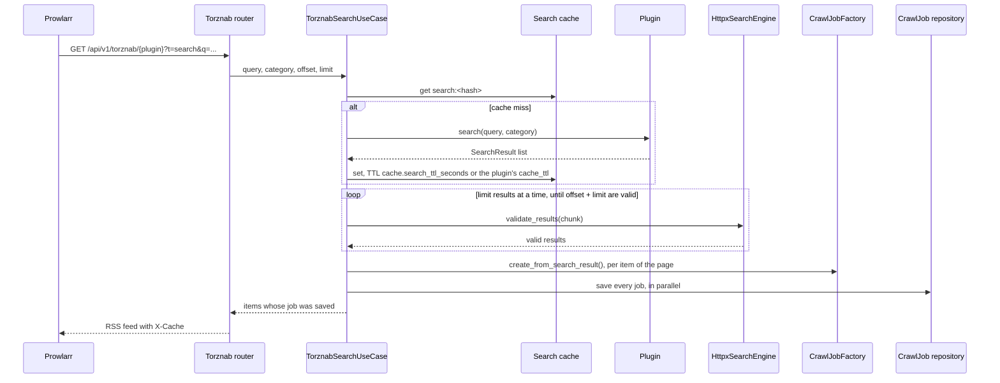
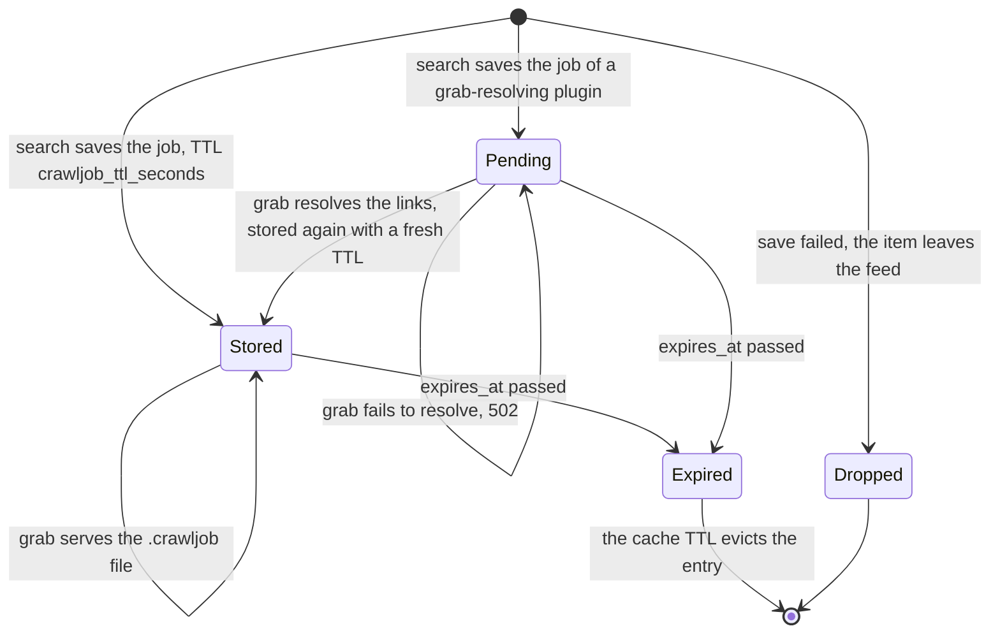

# Torznab and CrawlJobs

> **Status:** current
> **As of:** bdd3f0c4

## Purpose

Prowlarr and the Arr apps expect a Torznab indexer whose items link to a downloadable file.
Scavengarr's sites offer streaming and one-click hoster links, not torrents, so each item links to a CrawlJob: a stored bundle of the result's validated links that the download endpoint serves as a JDownloader `.crawljob` file.
This document describes how a Torznab search becomes a feed and how a CrawlJob lives from the search to the grab; the endpoints themselves are listed in the [Torznab API reference](../reference/torznab-api.md).

## How it works

### From request to feed



1. The router resolves the plugin through the registry; an unknown name answers an empty feed with 404.
1. `TorznabSearchUseCase` looks up the search cache under `search:<sha256(plugin:query:category)[:16]>`, the query lower-cased and trimmed and a missing category counted as `none`.
1. On a miss it calls `plugin.search(query, category=...)`, and the plugin runs its own search, detail and link stages ([Plugins](plugins.md#search-stages)).
1. Non-empty results are cached unvalidated, for `cache.search_ttl_seconds` or the plugin's `cache_ttl` (`0` turns the cache off).
1. Only the requested page is validated: the results go through `validate_results()` in order, `limit` at a time, until `offset + limit` valid ones exist ([Link validation](link-validation.md)).
1. A 1000-result search with `limit=100` thus checks about 300 links instead of 3000, and a later page gets the links checked before from the validator's cache.
1. `CrawlJobFactory` turns each result of the page into its own CrawlJob, and all jobs of the page are saved in parallel.
1. An item whose job could not be saved leaves the answer (`crawljob_save_failed`), since its grab would answer 404.
1. The presenter renders the page as RSS 2.0 with the Torznab attributes; each item's `<link>` and `<enclosure>` point at `/api/v1/download/{job_id}`.

A failure of the plugin search or of the validation becomes `TorznabExternalError`: 502 in `dev` and `test`, an empty feed with 200 in `prod` ([errors](../reference/torznab-api.md#errors)).
A search without `q` is Prowlarr's test and probes the site instead ([test mode](../reference/torznab-api.md#prowlarr-test-mode)).

### The CrawlJob

`CrawlJob` (`domain/entities/crawljob.py`) is a frozen dataclass with the fields of JDownloader's `CrawlJobStorable` and Scavengarr's metadata:

| Field | Default | Content |
|---|---|---|
| `job_id` | a UUID4 | The id in the download URL. |
| `text` | `""` | The links, separated by `\r\n`. |
| `package_name` | `"Scavengarr Download"` | JDownloader's display name. |
| `filename` | `None` | The release name, when set. |
| `comment` | `None` | The description. |
| `validated_urls` | `[]` | The links of the job. |
| `source_url` | `None` | The site's detail page. |
| `created_at`, `expires_at` | now, now plus the TTL | The creation and the expiry. |
| `resolve_plugin` | `None` | The plugin that resolves the links at the grab; `None` once they are final. |
| `extract_passwords` | `[]` | Archive passwords, written as a JSON array. |
| `download_password` | `None` | A password for protected links. |
| `download_folder` | `None` | A download directory. |
| `auto_start`, `enabled` | `TRUE` | JDownloader flags (`BooleanStatus`: `TRUE`, `FALSE`, `UNSET`). |
| `auto_confirm`, `forced_start`, `extract_after_download` | `UNSET` | JDownloader flags. |
| `chunks` | `0` | Parallel chunks; `0` is JDownloader's default. |
| `priority` | `DEFAULT` | `HIGHEST`, `HIGHER`, `HIGH`, `DEFAULT` or `LOWER`. |
| `deep_analyse_enabled`, `overwrite_packagizer_enabled`, `set_before_packagizer_enabled` | `False` | JDownloader options. |
| `add_offline_link` | `True` | Add a link even when it is offline. |

`CrawlJobFactory.create_from_search_result(result, *, resolve_plugin=None)` maps a `SearchResult`:

| `SearchResult` | `CrawlJob` | Note |
|---|---|---|
| `title` | `package_name` | Else `"Scavengarr Download"`. |
| `validated_links` | `validated_urls`, `text` | Else `[download_link]`. |
| `source_url` | `source_url` | |
| `release_name` | `filename` | Only when set. |
| `metadata["archive_password"]` | `extract_passwords` | A one-element list when set. |
| `description`, `size`, `source_url` | `comment` | `"desc \| Size: X \| Source: URL"`, empty parts left out; else `"Downloaded via Scavengarr"`. |

The use case passes `resolve_plugin` when the plugin implements `GrabResolvingPlugin`.
The composition root builds the factory and the repository with `ttl_seconds = cache.crawljob_ttl_seconds`, `auto_start=True` and `Priority.DEFAULT`; the last two are not settings.

A result with several validated links puts them all into one job, in the order link validation gives them (the primary link first, then the alternatives), so JDownloader has a fallback when a hoster is slow or offline.
With `validate_download_links: false` nothing is checked, and each job holds the result's `download_link` only, unless the plugin filled `validated_links` itself.

### The .crawljob file

`to_crawljob_format()` writes JDownloader's key-value format for its [FolderWatch extension](https://board.jdownloader.org/showthread.php?t=58281); `filename`, `downloadFolder`, `comment`, `extractPasswords` and `downloadPassword` appear only when set:

```text
# Generated by Scavengarr
# Job ID: a1b2c3d4-e5f6-7890-abcd-ef1234567890
# Created: 2025-01-15T12:00:00+00:00
# Expires: 2025-01-15T13:00:00+00:00

text=https://hoster1.example/file/abc
https://hoster2.example/file/def
packageName=Movie O
filename=Movie.O.2008.1080p.BluRay.x264
comment=Size: 4.2 GB | Source: https://indexer.example/movie/123
autoStart=TRUE
autoConfirm=UNSET
forcedStart=UNSET
enabled=TRUE
extractAfterDownload=UNSET
chunks=0
priority=DEFAULT
deepAnalyseEnabled=false
addOfflineLink=true
overwritePackagizerEnabled=false
setBeforePackagizerEnabled=false
```

The single-line values collapse line breaks to spaces, so a scraped title cannot add keys of its own (`downloadFolder=`); `text` is written as stored.

### Storage

`CacheCrawlJobRepository` (`infrastructure/persistence/crawljob_cache.py`) implements the `CrawlJobRepository` port (`save()`, `get()`) on the `CachePort`, diskcache or Redis as `cache.backend` selects.
It stores each job as JSON (enums by value, datetimes in ISO 8601) under `crawljob:{job_id}` with the `cache.crawljob_ttl_seconds` TTL.
An entry that does not deserialize is logged as `crawljob_deserialize_error` and treated as missing, so its grab answers 404.
In `dev` the cache is cleared at every start, so the jobs do not outlive a restart there.

### Grab-time resolution

Some sites hide their real links behind a captcha or count every unlocked link against a download quota, and resolving them for every search result would spend the quota on results nobody downloads.
Their plugins implement the optional `GrabResolvingPlugin` protocol (`domain/plugins/base.py`):

```python
async def resolve_download(self, url: str) -> list[str]: ...
```

- At the search, `TorznabSearchUseCase` stores the plugin's name in `resolve_plugin`, and `validated_urls` keep the page URLs the plugin returned.
- At the grab, `CrawlJobResolveUseCase` (`application/use_cases/crawljob_resolve.py`) calls `resolve_download()` for each URL, drops duplicates, stores the job again with the resolved links and without `resolve_plugin`, and serves it.
- A second grab of the job reuses the stored links, without a second captcha.
- No links, an unknown plugin or a plugin error raise `CrawlJobResolveError`, which the download endpoint answers with 502; the Arr app then treats the grab as failed and can try another release.
- `/download/{job_id}/info` shows the stored state and never resolves.

| Plugin | Page URL in the result | Resolution at the grab |
|---|---|---|
| `nox` | `/media/<slug>?release=<id>` | The release's online links, unlocked by one ALTCHA proof of work solved in-process (`infrastructure/captcha/altcha.py`); a refusal logs `nox_unlock_refused` with its `reason` (`hourly_limit`, `weekly_limit`). |
| `animeloads` | `/media/<slug>?release=<n>` | The media page's release tab in the browser, its image captcha solved in the page, the Click'n'Load packages decrypted (`infrastructure/plugins/clicknload.py`); one captcha per episode without an account, one per release with one. |

### A CrawlJob's life



A job expires `cache.crawljob_ttl_seconds` after the search that created it, not after the grab, and an expired job's grab answers 404.
The cache entry and `expires_at` normally end together; a job resolved at the grab is stored again with a fresh TTL, so its entry outlives `expires_at`, while the download still answers 404 after it.
A grab that answers 404 needs a new search, which creates fresh jobs.

### The Arr side

Prowlarr adds Scavengarr as one Generic Torznab indexer per plugin and syncs the indexers to Sonarr and Radarr.
Those need a Blackhole download client whose folder is JDownloader's FolderWatch directory: on a grab it fetches the `.crawljob` file and saves it there, and JDownloader downloads the links.
The setup is described in [Connect Prowlarr](../how-to/connect-prowlarr.md).

## Configuration

`cache.search_ttl_seconds`, `cache.crawljob_ttl_seconds`, `cache.backend`, `validate_download_links` and `environment` are settings of the [configuration reference](../reference/configuration.md).

## Observability

The search logs `torznab_search_completed` and `torznab_search_no_results`, an unmapped error `torznab_unhandled_error`.
The jobs log `crawljob_saved`, `crawljob_save_failed`, `crawljob_not_found`, `crawljob_expired`, `crawljob_deserialize_error`, `crawljob_downloaded`, and for a grab-time resolution `crawljob_resolved`, `crawljob_resolve_empty` and `crawljob_resolve_failed`.
Metrics and traces are described in [Observability](observability.md).

## Limits

- The caps advertise free-text search and the categories 2000, 5000 and 8000 only, the same for every plugin; IMDb and TVDB searches are not supported.
- `<pubDate>` is the time the feed was rendered, not the release date.
- A job outlives no `dev` restart, and with diskcache no container restart without a mounted cache directory.
- The info endpoint shows a grab-time job's page URLs until its first grab.

## Target

- Every Torznab result keeps its own CrawlJob with the links that passed validation, in deterministic order, as `AGENTS.md` (section 3) requires.

## References

- `src/scavengarr/application/use_cases/torznab_search.py`, `src/scavengarr/application/use_cases/crawljob_resolve.py`.
- `src/scavengarr/domain/entities/crawljob.py`, `src/scavengarr/application/factories/crawljob_factory.py`.
- `src/scavengarr/domain/ports/crawljob_repository.py`, `src/scavengarr/infrastructure/persistence/crawljob_cache.py`.
- `src/scavengarr/interfaces/api/torznab/router.py`, `src/scavengarr/interfaces/api/download/router.py`, `src/scavengarr/infrastructure/torznab/presenter.py`.
- Tests: `tests/unit/domain/test_crawljob.py`, `tests/unit/application/test_crawljob_factory.py`, `tests/unit/infrastructure/test_crawljob_cache.py`, `tests/live/test_grab_resolve_live.py` (one grab per plugin, opt-in).
