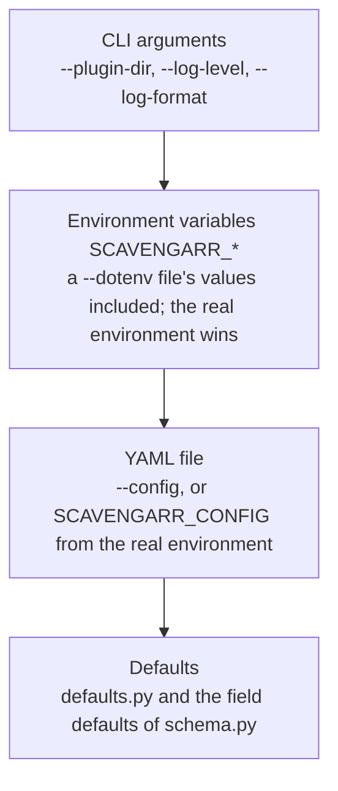

# Configuration

> **Purpose:** Every setting with its environment variable and the precedence of CLI, environment, YAML and defaults; the settings tables are generated by `scripts/generate_config_doc.py`.
> **Status:** reference
> **As of:** 86d497b5

Every setting of Scavengarr, the layers that set it and the rules the loader applies.
The settings tables are generated from the schema; the notes under them add what a description leaves out.
Running Scavengarr in a container is described in [Deploy Scavengarr](../how-to/deploy.md).

## Precedence

Each layer contributes only the values it sets explicitly; a value it leaves unset falls through to the next layer.



A higher layer wins over the lower ones for the keys it sets and leaves the other keys alone: `SCAVENGARR_LOG_LEVEL=DEBUG` overrides the log level of the YAML file and the defaults, nothing else.
A `.env` file passed with `--dotenv` is loaded into the process environment before the environment layer is read, so its values rank as environment variables, above the YAML file; it never overrides a variable the real environment already sets.
A `--dotenv` file cannot set `SCAVENGARR_CONFIG`; only the real environment can.
`HOST` and `PORT` are not part of the merged configuration: the CLI reads them itself (see [Server variables](#server-variables)).

### How the layers merge

`load_config()` in `src/scavengarr/infrastructure/config/load.py` normalizes each layer into one sectioned dictionary and merges them recursively:

1. The `.env` file of `--dotenv` is loaded into the process environment; variables already set stay.
1. The merge starts with the hard-coded defaults (`DEFAULT_CONFIG`).
1. The YAML file is merged in, when a config path is given.
1. The environment is merged in: `SCAVENGARR_<SECTION>_<KEY>` and `SCAVENGARR_<KEY>` for every setting, the flat names on top.
1. The CLI arguments are merged in.
1. Pydantic validates the result (`AppConfig`).

A base YAML file can therefore stay as it is while single values come from the environment.
`data/config.yaml` is a commented example of every YAML key.
`defaults.py` seeds the merge with a subset of the defaults; every other default is the field default of `schema.py`, and the tables below give the effective ones.

## Command line

```bash
poetry run start [OPTIONS]
```

| Flag | Type | Default | Description |
|---|---|---|---|
| `--host` | string | `HOST`, else `0.0.0.0` | The bind address. |
| `--port` | int | `PORT`, else `7979` | The bind port. |
| `--config` | path | `SCAVENGARR_CONFIG`, else none | The YAML config file. |
| `--dotenv` | path | none | A `.env` file to load. |
| `--plugin-dir` | path | none | The plugin directory. |
| `--log-level` | choice | none | `DEBUG`, `INFO`, `WARNING` or `ERROR`. |
| `--log-format` | choice | none | `json` or `console`. |

A flag without a default falls through to the lower layers.
A `--config` or `--dotenv` path that does not exist aborts the start with `FileNotFoundError`.

```bash
# Debug logging in the dev container
poetry run start --log-level DEBUG --log-format console

# A config file
poetry run start --config /app/config.yaml --log-level INFO
```

## Environment variables

Every setting can be set in the environment.
A key of a section reads `SCAVENGARR_<SECTION>_<KEY>` (`stremio.plugin_timeout_seconds` → `SCAVENGARR_STREMIO_PLUGIN_TIMEOUT_SECONDS`), a top-level key `SCAVENGARR_<KEY>`; names are case-insensitive.
The field's type parses the value: numbers as written, `true` or `false` for a bool, the plain string for a choice or a path, and JSON for a dict (`SCAVENGARR_PLUGINS_OVERRIDES='{"cineby": {"enabled": false}}'`).

Some keys also have an older flat name, listed in parentheses in the tables and in [Flat names](#flat-names).
When a flat name and the sectioned name of one key are both set to different values, the flat name wins and the startup log warns (`config_env_conflict`).
A name that starts with a section (`SCAVENGARR_STREMIO_...`) but names no key of it, such as a misspelled one, is ignored and reported (`config_unknown_env`).
Other `SCAVENGARR_*` names (plugin credentials, `SCAVENGARR_CONFIG`, the build identity) are not settings and are not reported.
Unprefixed `CACHE_*` variables are not read.

`SCAVENGARR_CONFIG` names the YAML file when `--config` is not given; a file that does not exist logs `config_file_not_found` and the defaults apply.

## Settings

<!-- config-env:start -->
<!-- Generated by scripts/generate_config_doc.py, do not edit by hand. -->

### Top level

| Variable | Type | Default | Description |
|---|---|---|---|
| `SCAVENGARR_APP_NAME` | str | `scavengarr` | Application name. |
| `SCAVENGARR_ENVIRONMENT` | `dev`, `test`, `prod` | `dev` | Runtime environment (affects defaults like log format). |
| `SCAVENGARR_TMDB_API_KEY` | str (optional) | (unset) | TMDB API key for Stremio catalog and title lookup. |
| `SCAVENGARR_VALIDATE_DOWNLOAD_LINKS` | bool | `true` | Enable download link validation (HEAD requests) |
| `SCAVENGARR_VALIDATION_MAX_CONCURRENT` | int | `20` | Max parallel link validations |
| `SCAVENGARR_VALIDATION_TIMEOUT_SECONDS` | float | `5.0` | Timeout per link validation (seconds) |

### `plugins`

| Variable | Type | Default | Description |
|---|---|---|---|
| `SCAVENGARR_PLUGINS_OVERRIDES` | JSON object | `{}` | Per-plugin setting overrides keyed by plugin name. |
| `SCAVENGARR_PLUGINS_PLUGIN_DIR` (or `SCAVENGARR_PLUGIN_DIR`) | path | `plugins` | Directory containing Python plugins. |

### `http`

| Variable | Type | Default | Description |
|---|---|---|---|
| `SCAVENGARR_HTTP_API_RATE_LIMIT_RPM` (or `SCAVENGARR_API_RATE_LIMIT_RPM`) | int | `120` | API rate limit per IP (requests/minute). 0 = unlimited. |
| `SCAVENGARR_HTTP_FOLLOW_REDIRECTS` | bool | `true` | Whether HTTP client follows redirects. |
| `SCAVENGARR_HTTP_HTTP2` | bool | `false` | Offer HTTP/2 on outgoing connections (several requests to one host share a connection). Off by default: not faster per se, measure it. |
| `SCAVENGARR_HTTP_RATE_LIMIT_ADAPTIVE` (or `SCAVENGARR_RATE_LIMIT_ADAPTIVE`) | bool | `true` | Enable AIMD adaptive rate limiting per domain. Rate increases on success, halves on 429/503. |
| `SCAVENGARR_HTTP_RATE_LIMIT_MAX_RPS` (or `SCAVENGARR_RATE_LIMIT_MAX_RPS`) | float | `50.0` | Maximum adaptive rate per domain (rps). |
| `SCAVENGARR_HTTP_RATE_LIMIT_MIN_RPS` (or `SCAVENGARR_RATE_LIMIT_MIN_RPS`) | float | `0.5` | Minimum adaptive rate per domain (rps). |
| `SCAVENGARR_HTTP_RATE_LIMIT_RPS` (or `SCAVENGARR_RATE_LIMIT_REQUESTS_PER_SECOND`) | float | `5.0` | Default per-domain rate limit (requests/second). 0 = unlimited. |
| `SCAVENGARR_HTTP_RETRY_BACKOFF_BASE` | float | `1.0` | Base delay in seconds for exponential backoff. |
| `SCAVENGARR_HTTP_RETRY_MAX_ATTEMPTS` | int | `3` | Max retry attempts on 429/503 responses. 0 = no retries. |
| `SCAVENGARR_HTTP_RETRY_MAX_BACKOFF` | float | `30.0` | Maximum backoff delay in seconds. |
| `SCAVENGARR_HTTP_TIMEOUT_RESOLVE_SECONDS` | float | `15.0` | HTTP timeout for hoster resolution requests. |
| `SCAVENGARR_HTTP_TIMEOUT_SECONDS` | float | `30.0` | Default HTTP timeout in seconds (used by scraping engine). |
| `SCAVENGARR_HTTP_USER_AGENT` | str | `Scavengarr/<version> (+https://github.com/Strob0t/Scavengarr)` | User-Agent for outgoing HTTP requests. |

### `playwright`

| Variable | Type | Default | Description |
|---|---|---|---|
| `SCAVENGARR_PLAYWRIGHT_BROWSER_FALLBACK` | bool | `true` | Let httpx plugins load Cloudflare-challenged pages through the shared browser (at most 2 pages at a time). Disable on hosts without RAM headroom for the browser. |
| `SCAVENGARR_PLAYWRIGHT_HEADLESS` | bool | `false` | Run the browser headless. Default false: headful when a display (DISPLAY, e.g. Xvfb) exists, needed to pass Cloudflare Turnstile; falls back to headless with a warning when there is no display. |
| `SCAVENGARR_PLAYWRIGHT_SOLVER_URL` | str (optional) | (unset) | Base URL of an optional Byparr/FlareSolverr sidecar (e.g. http://byparr:8191). Loads Cloudflare-challenged pages when the own browser fails, or alone when browser_fallback is false. |
| `SCAVENGARR_PLAYWRIGHT_TIMEOUT_MS` | int | `30000` | Default timeout of the Playwright plugins' pages in milliseconds: navigation and actions without an explicit one. The Cloudflare wait has its own 30 s. |

### `logging`

| Variable | Type | Default | Description |
|---|---|---|---|
| `SCAVENGARR_LOGGING_FORMAT` (or `SCAVENGARR_LOG_FORMAT`) | `json`, `console` (optional) | (unset) | Log renderer format (console/json). If unset, derived from environment. |
| `SCAVENGARR_LOGGING_LEVEL` (or `SCAVENGARR_LOG_LEVEL`) | `DEBUG`, `INFO`, `WARNING`, `ERROR` | `INFO` | Log level. |

### `cache`

| Variable | Type | Default | Description |
|---|---|---|---|
| `SCAVENGARR_CACHE_BACKEND` | `diskcache`, `redis` | `diskcache` | Cache backend: 'diskcache' (SQLite) or 'redis' |
| `SCAVENGARR_CACHE_CRAWLJOB_TTL_SECONDS` | int | `3600` | How long a grabbed result's CrawlJob stays downloadable (seconds); the grab answers 404 afterwards. |
| `SCAVENGARR_CACHE_DIR` | path | `.cache/scavengarr` | Diskcache SQLite DB path |
| `SCAVENGARR_CACHE_MAX_CONCURRENT` | int | `10` | Max parallel cache ops (semaphore limit) |
| `SCAVENGARR_CACHE_REDIS_URL` | str | `redis://localhost:6379/0` | Redis connection URL (only when backend=redis) |
| `SCAVENGARR_CACHE_SEARCH_TTL_SECONDS` | int | `900` | TTL for cached search results (seconds). 0 = disabled. |
| `SCAVENGARR_CACHE_TTL_SECONDS` | int | `3600` | Default TTL for cache entries (seconds) |

### `stremio`

| Variable | Type | Default | Description |
|---|---|---|---|
| `SCAVENGARR_STREMIO_ALLOW_HLS_TRANSCODING` | bool | `false` | Let Stremio's streaming server transcode HLS streams. Stremio Web has the server probe every stream, and an HLS source then goes through the server's converter, which re-encodes the video (on the production host too slow for 1080p). Off, the HLS proxy refuses the server's ffmpeg the stream's playlist, and Stremio Web plays it itself. |
| `SCAVENGARR_STREMIO_ANSWER_BUDGET_SECONDS` | float (optional) | (unset) | The request's answer budget, counted from the request start (a stale search-cache entry's refresh: from its own start): the request stops waiting for the search then and answers with the results known so far; plugins still running are not cut, their results reach the search cache for the next request. Unset: the plugin timeout; a value above it counts as the plugin timeout. |
| `SCAVENGARR_STREMIO_AUTO_TUNE_ALL` | bool | `true` | Auto-tune ALL concurrency parameters (plugins, Playwright, probes, validation) based on detected container/host resources via cgroups. Supersedes max_concurrent_plugins_auto. |
| `SCAVENGARR_STREMIO_DEFAULT_LANGUAGE_SCORE` | int | `100` | Score for unknown/undetected languages. |
| `SCAVENGARR_STREMIO_EXPLORATION_PROBABILITY` | float | `0.15` | Chance to include a random mid-score plugin. |
| `SCAVENGARR_STREMIO_FILE_STALL_TIMEOUT_SECONDS` | float | `10.0` | Seconds a file played through Scavengarr's proxy may send no byte once it flowed before the proxy asks its CDN again from the next byte; also the wait for a resumed answer's first byte. It must stay well under the 60 s a player's proxy waits for a byte: three attempts and their waits of 0, 1 and 2 s end within 33 s at 10 s. |
| `SCAVENGARR_STREMIO_HOSTER_SCORES` | JSON object | `{"supervideo": 5, "voe": 4, "filemoon": 3, "streamtape": 2, "doodstream": 1}` | Hoster reliability bonus (tie-breaker). |
| `SCAVENGARR_STREMIO_LANGUAGE_SCORES` | JSON object | `{"de": 1000, "de-sub": 500, "en-sub": 200, "en": 150}` | Language ranking scores (higher = preferred). |
| `SCAVENGARR_STREMIO_MAX_CONCURRENT_PLAYWRIGHT` | int | `5` | Upper bound for parallel Playwright plugin searches on the shared browser. The actual concurrency is dynamically capped at min(pw_plugin_count, this value) per request. |
| `SCAVENGARR_STREMIO_MAX_CONCURRENT_PLUGINS` | int | `5` | Max parallel plugin searches for stream resolution. |
| `SCAVENGARR_STREMIO_MAX_CONCURRENT_PLUGINS_AUTO` | bool | `true` | Auto-tune max_concurrent_plugins based on host CPU and memory. When enabled, overrides max_concurrent_plugins at startup. |
| `SCAVENGARR_STREMIO_MAX_PLUGINS_SCORED` | int | `5` | Top-N plugins when scoring is active. |
| `SCAVENGARR_STREMIO_MAX_PROBE_COUNT` | int | `50` | Max streams to resolve at stream time (top-ranked first). |
| `SCAVENGARR_STREMIO_MAX_RESULTS_PER_PLUGIN` | int | `100` | Max results per plugin in Stremio search. Limits pagination to reduce response time. Torznab uses the plugin default (1000). |
| `SCAVENGARR_STREMIO_PLUGIN_HEALTH_INTERVAL_SECONDS` | float | `1800.0` | How often every Stremio plugin's site is checked (HEAD on its domains); searches skip plugins whose site did not answer (twice, 30 s apart), and those are checked again 5 minutes later, then at doubling pauses up to this interval. 0 turns the check off. |
| `SCAVENGARR_STREMIO_PLUGIN_TIMEOUT_SECONDS` | float | `30.0` | Each plugin search, from the moment the plugin holds a concurrency slot; also the request's answer budget unless answer_budget_seconds is set. A plugin past it is cut; its earlier results stay. |
| `SCAVENGARR_STREMIO_PROBE_CONCURRENCY` | int | `10` | Max parallel hoster resolutions at stream time. |
| `SCAVENGARR_STREMIO_PROBE_STEALTH_TIMEOUT_SECONDS` | float | `15.0` | Timeout of a resolver's stream capture in the stealth browser (Patchright), in seconds: the embed page's navigation and Cloudflare challenge. The httpx plugins' Cloudflare fallback has its own budget. |
| `SCAVENGARR_STREMIO_QUALITY_MULTIPLIER` | int | `10` | Multiplier for quality value in ranking score. |
| `SCAVENGARR_STREMIO_RESOLVE_TARGET_COUNT` | int | `5` | The answer goes out once this many hosters have a resolved video stream (resolutions still running are cancelled), even while plugins still search. 0: the answer waits until the search and every resolution are done (or the deadline). |
| `SCAVENGARR_STREMIO_SCORING_ENABLED` | bool | `false` | Use scoring to limit plugin selection per request. |
| `SCAVENGARR_STREMIO_STREAM_DEADLINE_SECONDS` | float | `60.0` | Latest answer of a Stremio stream request, from the request start: resolution stops then and the answer has what is resolved. Earlier when resolve_target_count streams resolved, or when the search and every resolution are done. |
| `SCAVENGARR_STREMIO_STREAM_LINK_TTL_SECONDS` | int | `604800` | How long the links behind /play and the HLS proxy are kept (seconds, default 7 days): Stremio plays a kept stream object later (autoplay, Continue Watching), and a link whose video URL is stale resolves again. |
| `SCAVENGARR_STREMIO_TITLE_EXTRA_WORDS_PENALTY` | float | `0.35` | Score penalty when the result adds words to the reference title (a word beyond the title); a matching year makes up part of it. |
| `SCAVENGARR_STREMIO_TITLE_MATCH_THRESHOLD` | float | `0.7` | Minimum title similarity score to keep a stream result. |
| `SCAVENGARR_STREMIO_TITLE_SEQUEL_PENALTY` | float | `0.35` | Score penalty when result has sequel number that reference lacks. |
| `SCAVENGARR_STREMIO_TITLE_YEAR_BONUS` | float | `0.2` | Score bonus when result year matches reference year. |
| `SCAVENGARR_STREMIO_TITLE_YEAR_TOLERANCE_MOVIE` | int | `1` | Allowed year difference for movies (±N years). |
| `SCAVENGARR_STREMIO_TITLE_YEAR_TOLERANCE_SERIES` | int | `3` | Allowed year difference for series (±N years). |
| `SCAVENGARR_STREMIO_VERIFY_STREAMS` | bool | `true` | Check every resolved video URL before returning it (first bytes with the playback headers); error pages, HTML and broken HLS playlists are dropped instead of shown in Stremio. Off, only resolvers without a check of their own (SuperVideo) are checked. |

### `scoring`

| Variable | Type | Default | Description |
|---|---|---|---|
| `SCAVENGARR_SCORING_ENABLED` | bool | `true` | Enable background plugin scoring and probing. |
| `SCAVENGARR_SCORING_HEALTH_CONCURRENCY` | int | `5` | Max parallel health probes. |
| `SCAVENGARR_SCORING_HEALTH_HALFLIFE_DAYS` | float | `2.0` | EWMA half-life for health probes (days). |
| `SCAVENGARR_SCORING_HEALTH_INTERVAL_HOURS` | float | `24.0` | Interval between health probe cycles (hours). |
| `SCAVENGARR_SCORING_HEALTH_TIMEOUT_SECONDS` | float | `5.0` | Timeout for health probe requests (seconds). |
| `SCAVENGARR_SCORING_SCORE_TTL_DAYS` | int | `30` | TTL for persisted score snapshots (days). |
| `SCAVENGARR_SCORING_SEARCH_CONCURRENCY` | int | `3` | Max parallel search probes. |
| `SCAVENGARR_SCORING_SEARCH_HALFLIFE_WEEKS` | float | `2.0` | EWMA half-life for search probes (weeks). |
| `SCAVENGARR_SCORING_SEARCH_MAX_ITEMS` | int | `20` | Max items per mini-search probe. |
| `SCAVENGARR_SCORING_SEARCH_RUNS_PER_WEEK` | int | `2` | Number of search probe runs per week per plugin. |
| `SCAVENGARR_SCORING_SEARCH_TIMEOUT_SECONDS` | float | `10.0` | Timeout for mini-search probe requests (seconds). |
| `SCAVENGARR_SCORING_W_HEALTH` | float | `0.4` | Weight of health score in composite. |
| `SCAVENGARR_SCORING_W_SEARCH` | float | `0.6` | Weight of search score in composite. |

### `telemetry`

| Variable | Type | Default | Description |
|---|---|---|---|
| `SCAVENGARR_TELEMETRY_TRACING_ENDPOINT` | str (optional) | (unset) | OTLP/HTTP base URL (e.g. http://192.168.1.2:4318) that turns tracing on: the core's stages go there as OpenTelemetry spans (/v1/traces is appended). Off when unset. An IP needs no DNS lookup (behind a VPN container, lookups go through the VPN). |

### `watchdog`

| Variable | Type | Default | Description |
|---|---|---|---|
| `SCAVENGARR_WATCHDOG_EXIT_ON_STALL` | bool | `false` | End the process with code 3 after a stall's line and dump, so that the container's restart policy restarts it; after 3 exits within 30 min a stall is only logged. The faulthandler timer then exits too, with code 1, which the budget does not count. Off until readings of real stalls choose the limit. |
| `SCAVENGARR_WATCHDOG_STALL_SECONDS` | float | `120.0` | Seconds without an event-loop tick that make a stall: the stall monitor logs event_loop_stalled with the loop thread's stack and dumps every thread's traceback to standard error, and a faulthandler timer at twice the limit dumps them where no Python thread runs. 0 turns the monitor off. |

### Flat names

| Flat name | Variable | Sets |
|---|---|---|
| `api_rate_limit_rpm` | `SCAVENGARR_API_RATE_LIMIT_RPM` | `http.api_rate_limit_rpm` |
| `cache_backend` | `SCAVENGARR_CACHE_BACKEND` | `cache.backend` |
| `cache_dir` | `SCAVENGARR_CACHE_DIR` | `cache.dir` |
| `cache_max_concurrent` | `SCAVENGARR_CACHE_MAX_CONCURRENT` | `cache.max_concurrent` |
| `cache_redis_url` | `SCAVENGARR_CACHE_REDIS_URL` | `cache.redis_url` |
| `cache_ttl_seconds` | `SCAVENGARR_CACHE_TTL_SECONDS` | `cache.ttl_seconds` |
| `http_follow_redirects` | `SCAVENGARR_HTTP_FOLLOW_REDIRECTS` | `http.follow_redirects` |
| `http_http2` | `SCAVENGARR_HTTP_HTTP2` | `http.http2` |
| `http_retry_backoff_base` | `SCAVENGARR_HTTP_RETRY_BACKOFF_BASE` | `http.retry_backoff_base` |
| `http_retry_max_attempts` | `SCAVENGARR_HTTP_RETRY_MAX_ATTEMPTS` | `http.retry_max_attempts` |
| `http_retry_max_backoff` | `SCAVENGARR_HTTP_RETRY_MAX_BACKOFF` | `http.retry_max_backoff` |
| `http_timeout_resolve_seconds` | `SCAVENGARR_HTTP_TIMEOUT_RESOLVE_SECONDS` | `http.timeout_resolve_seconds` |
| `http_timeout_seconds` | `SCAVENGARR_HTTP_TIMEOUT_SECONDS` | `http.timeout_seconds` |
| `http_user_agent` | `SCAVENGARR_HTTP_USER_AGENT` | `http.user_agent` |
| `log_format` | `SCAVENGARR_LOG_FORMAT` | `logging.format` |
| `log_level` | `SCAVENGARR_LOG_LEVEL` | `logging.level` |
| `playwright_browser_fallback` | `SCAVENGARR_PLAYWRIGHT_BROWSER_FALLBACK` | `playwright.browser_fallback` |
| `playwright_headless` | `SCAVENGARR_PLAYWRIGHT_HEADLESS` | `playwright.headless` |
| `playwright_solver_url` | `SCAVENGARR_PLAYWRIGHT_SOLVER_URL` | `playwright.solver_url` |
| `playwright_timeout_ms` | `SCAVENGARR_PLAYWRIGHT_TIMEOUT_MS` | `playwright.timeout_ms` |
| `plugin_dir` | `SCAVENGARR_PLUGIN_DIR` | `plugins.plugin_dir` |
| `rate_limit_adaptive` | `SCAVENGARR_RATE_LIMIT_ADAPTIVE` | `http.rate_limit_adaptive` |
| `rate_limit_max_rps` | `SCAVENGARR_RATE_LIMIT_MAX_RPS` | `http.rate_limit_max_rps` |
| `rate_limit_min_rps` | `SCAVENGARR_RATE_LIMIT_MIN_RPS` | `http.rate_limit_min_rps` |
| `rate_limit_requests_per_second` | `SCAVENGARR_RATE_LIMIT_REQUESTS_PER_SECOND` | `http.rate_limit_rps` |
| `telemetry_tracing_endpoint` | `SCAVENGARR_TELEMETRY_TRACING_ENDPOINT` | `telemetry.tracing_endpoint` |

<!-- config-env:end -->

## Notes on the settings

The facts a setting's description leaves out, one line per setting:

- `plugins.overrides`: per plugin, `timeout` (httpx plugins only; a Playwright plugin ignores it and logs `plugin_timeout_override_unsupported`), `max_concurrent`, `max_results` and `enabled`; [Plugins](../current/plugins.md#discovery-and-loading) describes how the registry applies them.
- `http.timeout_seconds`: only requests that set no timeout of their own use it (TMDB lookups, for example); httpx plugins use their `_timeout` (15 s), most hoster resolvers 15 s and link checks `validation_timeout_seconds`.
- `http.timeout_resolve_seconds`: bounds one hoster resolution (the resolver's whole `resolve()`) and the registry's redirect and content-type requests.
- `http.http2`: off by default because the plugin searches used more CPU with it on the production host (h2 runs in Python) and were not faster.
- `http.user_agent`: httpx plugins and several hoster resolvers send their own browser User-Agent; a value of your own must keep a contact URL, since Wikidata answers 403 without one.
- `http.rate_limit_rps`: the starting rate per site; with `rate_limit_adaptive` it rises 10 % with each answer other than a 429, a 503 or a challenge, up to `rate_limit_max_rps`, and halves on a 429 or 503, never below `rate_limit_min_rps`; a timeout changes nothing.
- `http.rate_limit_rps`: one bucket per second-level label, so `www.example.com` and `example.org` share one.
- `http.rate_limit_rps`: link validation's checks pass the bucket and feed nothing back ([Link validation](../current/link-validation.md#concurrency)).
- `http.api_rate_limit_rpm`: not counted are the HLS proxy (`/api/v1/stremio/proxy/…`), `/api/v1/stremio/play/…` and the health endpoints (`healthz`, `readyz`, `stremio/health`); [Rate limiting](torznab-api.md#rate-limiting) describes the answer.
- `validate_download_links`: `false` passes every result unchecked, and each CrawlJob then holds the result's primary link only; see [Link validation](../current/link-validation.md).
- `validation_max_concurrent`: `stremio.auto_tune_all` overwrites it at startup ([Auto-tune](#auto-tune)).
- `playwright.headless`: headful under a display is the default because interactive Cloudflare Turnstile rejects every headless browser; headful Chromium takes 190 to 250 MiB more and Xvfb about 70 MiB, and a host without that headroom sets `true` and loses the Cloudflare-protected plugins.
- `playwright.browser_fallback`: the browser's pages start at `min(stremio.max_concurrent_playwright, 2)` and follow the page, CPU and memory waits up to `stremio.max_concurrent_playwright`; `false` leaves the Cloudflare-protected httpx plugins without results.
- `playwright.solver_url`: tried after the own browser when `browser_fallback` is on, alone when it is off; Byparr is maintained and needs no Xvfb, while FlareSolverr's own README says its captcha solvers do not work.
- `playwright.timeout_ms`: set on each browser context the Playwright base creates; the Cloudflare wait keeps its 30 s and the `networkidle` wait its 10 s.
- `stremio.language_scores`, `stremio.hoster_scores`: a dict you set replaces the default dict, so it lists every entry to keep.
- `stremio.max_concurrent_plugins`, `stremio.max_concurrent_playwright`, `stremio.probe_concurrency`: `stremio.auto_tune_all` overwrites them at startup ([Auto-tune](#auto-tune)).
- `stremio.scoring_enabled`, `stremio.max_plugins_scored`, `stremio.exploration_probability`: scored selection also needs `scoring.enabled`; [Plugins](../current/plugins.md#plugin-selection-for-a-stremio-request) describes it.
- `logging.format`: unset, `dev` and `test` render `console` and `prod` renders `json`.
- `logging.level`: below `DEBUG`, httpx and httpcore log from `WARNING` up; at `DEBUG` their request trace stays, with URLs by origin only.
- `cache.backend`: `redis` needs a database of its own, since the keys carry no prefix and a `dev` start empties the whole database of `cache.redis_url` (FLUSHDB).
- `cache.ttl_seconds`: every current cache writer sets its own TTL, so it has no effect.
- `cache.search_ttl_seconds`: a Stremio entry answers 6 h longer while a background search refreshes it.
- `cache.crawljob_ttl_seconds`: counts from the search that created the job, not from the grab.
- `cache.max_concurrent`: Redis handles more (`50`, for example); diskcache writes run one at a time regardless, since SQLite has one writer.
- `telemetry.tracing_endpoint`: unset, the tracing SDK is not loaded; Prometheus metrics (`/metrics`) need no setting, see [Observability](../current/observability.md).

## Auto-tune

With `stremio.auto_tune_all` (the default) four concurrency settings are derived from the container's or host's resources at startup, and configured values for them are overwritten:

| Setting | Formula | Min | Max |
|---|---|---|---|
| `stremio.max_concurrent_plugins` | `min(cpu * 3, mem_gb * 2)` | 2 | 30 |
| `stremio.max_concurrent_playwright` | `min(cpu, mem_gb / 0.15)` | 1 | 10 |
| `stremio.probe_concurrency` | `cpu * 4` | 4 | 100 |
| `validation_max_concurrent` | `cpu * 5` | 5 | 120 |

The caps of `probe_concurrency` and `validation_max_concurrent` sit where the synthetic benchmarks of `tests/benchmark/` gain less than 5 % more throughput.
The resources come from cgroup v2, then cgroup v1, then `os.cpu_count()` and `psutil` (not a project dependency: without it the memory reads 4 GB); see `src/scavengarr/infrastructure/resource_detector.py`.
With `auto_tune_all` off and `stremio.max_concurrent_plugins_auto` on, only `max_concurrent_plugins` is tuned, to `max(2, min(cpu, available_ram_gb * 2, 20))` (8 for the memory term without `psutil`).

The concurrency pool shares `stremio.max_concurrent_plugins` httpx slots and `stremio.max_concurrent_playwright` Playwright slots among the Stremio requests running at once: each gets `max(1, slots // active_requests)` of each kind; Torznab searches do not use it.

## Plugin credentials

Plugins that log in read their credentials from the environment only:

| Variables | Plugin |
|---|---|
| `SCAVENGARR_BOERSE_USERNAME`, `SCAVENGARR_BOERSE_PASSWORD` | `boerse` |
| `SCAVENGARR_MYBOERSE_USERNAME`, `SCAVENGARR_MYBOERSE_PASSWORD` | `myboerse` |
| `SCAVENGARR_MYGULLY_USERNAME`, `SCAVENGARR_MYGULLY_PASSWORD` | `mygully` |
| `SCAVENGARR_DATALOAD_USERNAME`, `SCAVENGARR_DATALOAD_PASSWORD` | `dataload` |
| `SCAVENGARR_ANIMELOADS_USERNAME`, `SCAVENGARR_ANIMELOADS_PASSWORD` | `animeloads` (optional) |

Logged in, animeloads unlocks a whole release with one captcha per grab; without an account it serves releases up to 13 episodes, with one captcha per episode.

## Server variables

The CLI reads these before the configuration loads; they carry no `SCAVENGARR_` prefix, and `--host` and `--port` win over them:

| Variable | Default | Description |
|---|---|---|
| `HOST` | `0.0.0.0` | The bind address. |
| `PORT` | `7979` | The bind port. |
| `FORWARDED_ALLOW_IPS` | `127.0.0.1,::1` | The addresses or networks whose `X-Forwarded-Proto` and `X-Forwarded-For` uvicorn honors. |

`HOST` and `PORT` may come from the real environment or a `--dotenv` file, the real environment first.
Why a reverse proxy needs `FORWARDED_ALLOW_IPS` is described in [Deploy Scavengarr](../how-to/deploy.md#7-put-a-reverse-proxy-in-front).

## Production through the environment

A container can carry its whole configuration in `environment:` entries instead of a mounted `config.yaml`.
These entries give the values of the image's default config (`data/config.yaml`, the file the entrypoint seeds); without a mounted file the seeded copy stays the fallback for everything not listed, and the entries win over it.
`tests/integration/test_config_loading.py` checks that both give the same values.

<!-- production-env:start -->
```yaml
    environment:
      SCAVENGARR_ENVIRONMENT: "prod"
      SCAVENGARR_TMDB_API_KEY: ""
      SCAVENGARR_VALIDATION_TIMEOUT_SECONDS: "3.0"
      SCAVENGARR_VALIDATION_MAX_CONCURRENT: "30"
      SCAVENGARR_PLUGINS_OVERRIDES: '{"cineby": {"enabled": false}}'
      SCAVENGARR_HTTP_TIMEOUT_SECONDS: "15.0"
      SCAVENGARR_HTTP_TIMEOUT_RESOLVE_SECONDS: "10.0"
      SCAVENGARR_HTTP_RATE_LIMIT_RPS: "10.0"
      SCAVENGARR_HTTP_RETRY_MAX_ATTEMPTS: "2"
      SCAVENGARR_HTTP_RETRY_BACKOFF_BASE: "0.5"
      SCAVENGARR_HTTP_RETRY_MAX_BACKOFF: "10.0"
      SCAVENGARR_PLAYWRIGHT_TIMEOUT_MS: "20000"
      SCAVENGARR_CACHE_SEARCH_TTL_SECONDS: "1800"
      SCAVENGARR_STREMIO_MAX_CONCURRENT_PLUGINS: "15"
      SCAVENGARR_STREMIO_MAX_CONCURRENT_PLAYWRIGHT: "7"
      SCAVENGARR_STREMIO_MAX_RESULTS_PER_PLUGIN: "50"
      SCAVENGARR_STREMIO_PROBE_CONCURRENCY: "20"
      SCAVENGARR_STREMIO_MAX_PROBE_COUNT: "80"
      SCAVENGARR_STREMIO_PROBE_STEALTH_TIMEOUT_SECONDS: "10.0"
```
<!-- production-env:end -->

Set the TMDB key there, and add what your host differs in, such as the Redis cache (`SCAVENGARR_CACHE_BACKEND: "redis"`, `SCAVENGARR_CACHE_REDIS_URL: "redis://redis:6379/1"`) or the Stremio timings (`SCAVENGARR_STREMIO_PLUGIN_TIMEOUT_SECONDS`, `SCAVENGARR_STREMIO_ANSWER_BUDGET_SECONDS`, `SCAVENGARR_STREMIO_STREAM_DEADLINE_SECONDS`, `SCAVENGARR_STREMIO_RESOLVE_TARGET_COUNT`; the default config keeps their defaults).
`docker-compose.yml` carries the same entries, commented.

## YAML file

Pass a YAML file with `--config` or `SCAVENGARR_CONFIG`.
It uses the sections of the tables above; a shortened example (every key: `data/config.yaml`):

```yaml
environment: "prod"
tmdb_api_key: ""                # optional; IMDb and Wikidata without it

plugins:
  plugin_dir: "/app/plugins"
  overrides:
    kinoger:
      timeout: 20.0
      max_results: 500
    sto:
      enabled: false

http:
  timeout_seconds: 15.0
  timeout_resolve_seconds: 10.0
  rate_limit_rps: 10.0

validation_timeout_seconds: 3.0
validation_max_concurrent: 30

playwright:
  headless: false               # headful under Xvfb, headless without DISPLAY
  # solver_url: http://byparr:8191

stremio:
  max_results_per_plugin: 50
  plugin_timeout_seconds: 30.0
  stream_deadline_seconds: 60.0

logging:
  level: "INFO"

cache:
  backend: "diskcache"          # or "redis" with redis_url
  dir: "/app/cache"
  search_ttl_seconds: 1800
```

The loader knows the sections `plugins`, `http`, `playwright`, `logging`, `cache`, `stremio`, `scoring`, `telemetry` and `watchdog`, and the top-level keys of the first table.
A flat name of [Flat names](#flat-names) works as a top-level YAML key too and sets its sectioned key.
Unknown keys are ignored, so a misspelled key keeps its default, and the startup log names them (`config_unknown_keys`); only the `cache` section rejects unknown keys, and the app does not start.
A key a release removed is such an unknown key: a config that still sets it starts as before.
Every setting the model accepts is read somewhere in `src/` outside the config package, or its description declares it unused; `tests/unit/infrastructure/test_config_settings_read.py` fails otherwise.

## Startup log

These lines tell which configuration a running server uses; on the production host `poetry run python scripts/prodctl.py logs --since 4h --grep config_ --width 0` reads them while the log's last 5000 lines still reach back to the start ([Operate production](../how-to/operations.md#the-logs-window)):

- `config_effective` (INFO): `config_file`, the YAML file read (`null` for none); `sources`, the layer each changed value came from (`yaml`, `env`, `cli`, or `defaults` for those of `defaults.py`); and one field per setting that differs from its default after all layers.
- `config_effective` names a field by its dotted path in the model (`stremio.max_concurrent_plugins`); the keys of `http`, `playwright` and `logging` appear under their flat names (`http_timeout_seconds`, `log_level`), and `cache.dir` as `cache.directory`.
- `config_effective` masks secrets as `***` (fields whose name contains `password`, `token`, `key` or `secret`, such as `tmdb_api_key`, and passwords in URLs) and shows only the keys of a dict (`plugins.overrides`, `stremio.language_scores`, `stremio.hoster_scores`).
- `auto_tune_complete` follows with `stremio.auto_tune_all` and replaces the four tuned values.
- `config_unknown_keys` (WARNING): the dotted YAML paths no setting accepts; keys inside a dict are not checked.
- `config_unknown_env` (WARNING): the `SCAVENGARR_<SECTION>_*` names no key of the section has.
- `config_env_conflict` (WARNING, one per pair): a flat and a sectioned name of one key with different values; `used` names the flat one, which wins, and `ignored` the other.

## Environments

`environment` (`dev`, `test` or `prod`) sets these behaviours:

| Aspect | `dev` | `test` | `prod` |
|---|---|---|---|
| Default log format | `console` | `console` | `json` |
| Cache cleared at startup | yes | no | no |
| Error text in the Torznab feed | yes | yes | no |
| Upstream (502) and internal (500) errors | their status | their status | an empty feed with 200 |
| Client errors (400, 404, 422, 503) | their status | their status | their status |

In `prod` a Torznab error answers an empty feed with 200, so Prowlarr does not mark the indexer failed for a passing problem; the log keeps the error.
In `dev` the cache is cleared at every start, with Redis the whole database of `cache.redis_url`; `dev` is the default.

## Validation rules

| Field | Rule |
|---|---|
| `http.timeout_seconds`, `http.timeout_resolve_seconds` | Greater than 0. |
| `playwright.timeout_ms` | Greater than 0. |
| `cache.ttl_seconds` | At least 0. |
| `cache.crawljob_ttl_seconds` | Greater than 0. |
| `cache` section | No unknown keys. |
| `stremio.plugin_timeout_seconds`, `stremio.stream_deadline_seconds` | Greater than 0. |
| `stremio.plugin_health_interval_seconds` | At least 0. |
| `telemetry.tracing_endpoint` | Starts with `http://` or `https://` (empty: off). |
| `environment`, `logging.level`, `logging.format`, `cache.backend` | One of the values in the tables. |
| Path fields | `~` expands to the home directory. |

An invalid configuration stops the start with Pydantic's validation error.

## The .env file

`--dotenv <file>` loads the file with `python-dotenv` (`override=False`) before the layers merge:

```bash
# .env
SCAVENGARR_ENVIRONMENT=dev
SCAVENGARR_LOG_LEVEL=DEBUG
SCAVENGARR_LOG_FORMAT=console
SCAVENGARR_CACHE_DIR=./.cache/scavengarr
SCAVENGARR_TMDB_API_KEY=your-tmdb-key
```

`HOST` and `PORT` in the file count too.

## References

- `src/scavengarr/infrastructure/config/schema.py` (the model), `src/scavengarr/infrastructure/config/load.py` (the loader), `src/scavengarr/infrastructure/config/defaults.py`.
- `src/scavengarr/interfaces/cli/__main__.py` (the CLI), `src/scavengarr/interfaces/composition.py` (auto-tune, the overrides).
- `src/scavengarr/infrastructure/resource_detector.py`, `src/scavengarr/interfaces/api/middleware.py` (the API rate limit).
- `scripts/generate_config_doc.py` (the settings tables), `data/config.yaml` (the example config).
