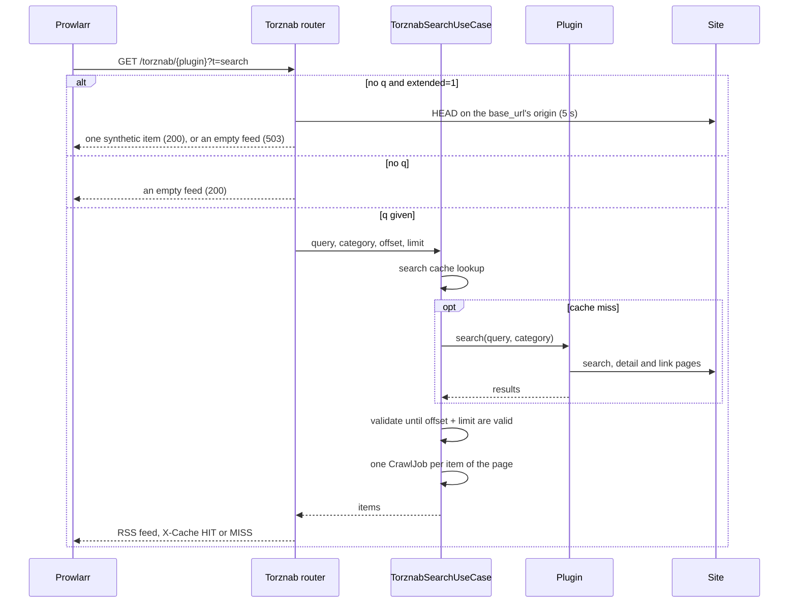

# Torznab API

> **Status:** reference
> **As of:** 4bb4aaa2

The endpoints, parameters, XML and error answers of Scavengarr's Torznab API for Prowlarr and the other Arr apps, and the download endpoints of its CrawlJobs.
How a search becomes a feed and a grab becomes a `.crawljob` file is described in [Torznab and CrawlJobs](../current/torznab-and-crawljobs.md).

## Endpoints

Every API route sits under `/api/v1`; only the Prometheus endpoint `/metrics` and FastAPI's `/docs`, `/redoc` and `/openapi.json` sit at the root.
The default base URL is `http://localhost:7979` (`PORT` or `--port`).

| Method | Path | Answer | Purpose |
|---|---|---|---|
| `GET` | `/api/v1/torznab/indexers` | JSON | The loaded plugins. |
| `GET` | `/api/v1/torznab/{plugin_name}?t=caps` | XML | A plugin's capabilities. |
| `GET` | `/api/v1/torznab/{plugin_name}?t=search&q={query}` | XML | A search, as an RSS feed. |
| `GET` | `/api/v1/torznab/{plugin_name}/health` | JSON | A plugin's reachability. |
| `GET` | `/api/v1/download/{job_id}` | file | A CrawlJob's `.crawljob` file. |
| `GET` | `/api/v1/download/{job_id}/info` | JSON | A CrawlJob's metadata. |
| `GET` | `/api/v1/healthz` | JSON | Liveness. |
| `GET` | `/api/v1/readyz` | JSON | Readiness. |
| `GET` | `/api/v1/stats/plugins` | JSON | The plugins' long-term record. |
| `GET` | `/api/v1/stats/plugin-scores` | JSON | The plugin scores. |
| `GET` | `/api/v1/stats/metrics` | JSON | The metrics as JSON. |
| `GET` | `/metrics` | text | The Prometheus metrics. |

The Stremio endpoints (`/api/v1/stremio/...`) are described in [Stremio addon](../current/stremio-addon.md), the plugin scores in [Plugins](../current/plugins.md#scores-and-probes), and the stats and metrics in [Observability](../current/observability.md).

## Search sequence



## Indexers

```http
GET /api/v1/torznab/indexers
```

The answer lists every loaded plugin by name.
A plugin disabled with `plugins.overrides.<name>.enabled: false` is gone at startup, and a file that fails to load is skipped (`plugin_load_failed`); `version` and `mode` come from the plugin's class attributes.

```json
{
  "indexers": [
    {"name": "animeloads", "version": "1.0.0", "mode": "playwright"},
    {"name": "filmpalast", "version": "1.0.0", "mode": "httpx"}
  ]
}
```

`mode` is `httpx` for a plugin on `HttpxPluginBase` and `playwright` for one on `PlaywrightPluginBase`.

## Capabilities

```http
GET /api/v1/torznab/{plugin_name}?t=caps
```

Prowlarr asks for the capabilities when an indexer is added.

```xml
<?xml version='1.0' encoding='utf-8'?>
<caps>
  <server title="scavengarr (filmpalast)" version="<version>"/>
  <limits max="100" default="100"/>
  <searching>
    <search available="yes" supportedParams="q"/>
  </searching>
  <categories>
    <category id="2000" name="Movies"/>
    <category id="5000" name="TV"/>
    <category id="8000" name="Other"/>
  </categories>
</caps>
```

| Element | Content |
|---|---|
| `<server>` | `{app_name} ({plugin})` and the package version (`infrastructure/version.py`). |
| `<limits>` | `max` and `default` of `TorznabCaps`, both 100, the search's `limit` default. |
| `<searching>` | Free-text search only (`supportedParams="q"`). |
| `<categories>` | `2000`, `5000` and `8000` for every plugin; a plugin's subcategories are not advertised. |

Movie search (`imdbid`) and TV search (`tvdbid`, `season`, `ep`) are not supported.
An unknown plugin gets an empty RSS feed with 404, not a caps document.

## Search

```http
GET /api/v1/torznab/{plugin_name}?t=search&q={query}
```

| Parameter | In | Required | Meaning |
|---|---|---|---|
| `plugin_name` | path | yes | The plugin. |
| `t` | query | yes | `search`; any value but `caps` and `search` answers 422. |
| `q` | query | no | The query; without it see [Prowlarr test mode](#prowlarr-test-mode). |
| `cat` | query | no | Category ids, comma-separated, read only with a `q`: ids of one kind give the first id, ids of several kinds give those kinds. |
| `extended` | query | no | Read only without `q`: `1` is the reachability probe. |
| `offset` | query | no | The first item to return (default `0`). |
| `limit` | query | no | The number of items (default `100`; not capped at the caps' `max`). |

`cat=5030,5040` searches 5030, as one kind; `cat=2000,5000` searches unfiltered and answers the movies and the TV results, not the rest ([the category filter](../current/torznab-and-crawljobs.md#the-category-filter)).
A non-numeric id anywhere (`cat=2000,abc`) answers an empty feed with 400.
The answer is `application/xml` with an `X-Cache` header: `HIT` when the plugin's results came from the search cache, else `MISS`.

```xml
<?xml version='1.0' encoding='utf-8'?>
<rss xmlns:torznab="http://torznab.com/schemas/2015/feed" version="2.0">
  <channel>
    <title>scavengarr (filmpalast)</title>
    <description>Scavengarr Torznab feed</description>
    <link>http://localhost:7979/</link>
    <language>en-us</language>
    <item>
      <title>Movie.O.2008.1080p.BluRay.x264</title>
      <guid isPermaLink="false">https://hoster.example/file/abc</guid>
      <link>http://localhost:7979/api/v1/download/3f2b...-uuid</link>
      <description>Movie.O.2008.1080p.BluRay.x264</description>
      <pubDate>Mon, 01 Jan 2025 12:00:00 +0000</pubDate>
      <torznab:attr name="category" value="2000"/>
      <torznab:attr name="size" value="4831838208"/>
      <torznab:attr name="seeders" value="0"/>
      <torznab:attr name="peers" value="0"/>
      <torznab:attr name="grabs" value="0"/>
      <torznab:attr name="downloadvolumefactor" value="0.0"/>
      <torznab:attr name="uploadvolumefactor" value="0.0"/>
      <torznab:attr name="minimumratio" value="0"/>
      <torznab:attr name="minimumseedtime" value="0"/>
      <enclosure url="http://localhost:7979/api/v1/download/3f2b...-uuid" length="4831838208" type="application/x-crawljob"/>
    </item>
  </channel>
</rss>
```

| Element | Content |
|---|---|
| `<title>` | `release_name`, else `title`. |
| `<guid>` | The result's primary download URL after link promotion, so Prowlarr deduplicates across indexers that point at one file. |
| `<link>` | `{base_url}api/v1/download/{job_id}`, the CrawlJob's download endpoint. |
| `<description>` | The result's description, else `title`. |
| `<pubDate>` | The time the feed was rendered, not the release date. |
| `<enclosure>` | The `<link>` URL, `length` in bytes and `type="application/x-crawljob"`. |

Only the requested page is built: the use case validates results until `offset + limit` are valid, keeps `valid[offset : offset + limit]` and creates CrawlJobs for those.
Another page of the same search reuses the search cache and the validator's link cache.

```http
GET /api/v1/torznab/filmpalast?t=search&q=iron+man&offset=100&limit=100
```

## Prowlarr test mode

A search with `extended=1` and no `q` is a reachability probe instead of a search:

1. The plugin's current `base_url` is read: its first `_domains` entry until a search has picked a working domain ([Plugin domains](../current/plugin-domains.md)); the other domains are not tried.
1. The origin (`scheme://host/`) gets a `HEAD` with a 5 s timeout, redirects followed.
1. A `HEAD` answered with 405 or 501 is repeated as a streamed `GET` with `Range: bytes=0-0`.

Any HTTP answer counts as reachable; the status is not evaluated.

| Condition | Answer | Status |
|---|---|---|
| The site answers. | A feed with one item, `{app_name} ({plugin}) - reachable`. | 200 |
| No answer (DNS, TCP, TLS, timeout). | An empty feed. | 503 |
| The plugin has no `base_url`. | An empty feed. | 422 |
| Unknown plugin. | An empty feed. | 404 |

A plugin whose first domain is down can fail the test and still find results through another domain.
Without `q` and without `extended=1` the answer is an empty feed with 200; outside `prod` its description reads `Missing query parameter 'q'`.

## Plugin health

```http
GET /api/v1/torznab/{plugin_name}/health
```

The same probe as the test mode, on the plugin's current `base_url`, as JSON:

```json
{
  "plugin": "filmpalast",
  "base_url": "https://filmpalast.to",
  "checked_url": "https://filmpalast.to/",
  "reachable": true,
  "status_code": 200,
  "error": null
}
```

`reachable` is `true` for any HTTP answer; `status_code` tells a 403 or 5xx apart.

| Status | Condition |
|---|---|
| 200 | The probe ran; read `reachable`. |
| 404 | Unknown plugin; the body has `"error": "plugin not found"`. |
| 422 | The plugin has no `base_url`. |
| 500 in `dev` and `test`, 200 in `prod` | Another registry error, named in `error`. |

## Download

```http
GET /api/v1/download/{job_id}
```

The URL of an item's `<link>`: it serves the CrawlJob's `.crawljob` file as `application/x-crawljob`.

| Header | Content |
|---|---|
| `Content-Disposition` | `attachment; filename="{package_name}_{job_id[:8]}.crawljob"; filename*=UTF-8''…`: `filename` keeps ASCII letters, digits, space, `-` and `_` and turns the rest into `_`, and `filename*` carries the real name (RFC 6266). |
| `X-CrawlJob-ID` | The CrawlJob's UUID. |
| `X-CrawlJob-Package` | The package name (JDownloader's display name), percent-encoded. |
| `X-CrawlJob-Links` | The number of links, after a grab-time resolution. |

| Status | Condition |
|---|---|
| 404 | The CrawlJob is missing or expired. |
| 502 | The grab-time resolution failed ([grab-time resolution](../current/torznab-and-crawljobs.md#grab-time-resolution)). |
| 500 | A repository or serialization failure. |

A CrawlJob expires `cache.crawljob_ttl_seconds` after the search that created it, not after the grab.
The values of the file (`packageName`, `filename`, `downloadFolder`, `comment`, `downloadPassword`) are written on one line each: line breaks from scraped titles collapse to spaces, so a site cannot add keys of its own; `text`, the links, is written as stored.

```http
GET /api/v1/download/{job_id}/info
```

The CrawlJob's metadata, for debugging; it never starts a grab-time resolution.
An expired job still answers, with `"is_expired": true`, while it is in the cache.

```json
{
  "job_id": "3f2b...-uuid",
  "package_name": "Movie O",
  "created_at": "2025-01-01T12:00:00+00:00",
  "expires_at": "2025-01-01T13:00:00+00:00",
  "is_expired": false,
  "validated_urls": [
    "https://hoster1.example/file/abc",
    "https://hoster2.example/file/def"
  ],
  "source_url": "https://filmpalast.to/stream/iron-man",
  "comment": "Size: 4.5 GB | Source: https://filmpalast.to/stream/iron-man",
  "auto_start": "TRUE",
  "priority": "DEFAULT"
}
```

| Field | Type | Content |
|---|---|---|
| `job_id` | string | The CrawlJob's UUID4. |
| `package_name` | string | JDownloader's display name. |
| `created_at`, `expires_at` | ISO 8601 | The creation and the expiry. |
| `is_expired` | boolean | Whether `now > expires_at`. |
| `validated_urls` | string[] | The links of the job. |
| `source_url` | string or null | The detail page. |
| `comment` | string or null | The description. |
| `auto_start` | string | `TRUE`, `FALSE` or `UNSET`. |
| `priority` | string | `HIGHEST`, `HIGHER`, `HIGH`, `DEFAULT` or `LOWER`. |

The info endpoint answers 404 for a missing job and 500 for a repository error.

## Application health

```http
GET /api/v1/healthz
```

200 while the process runs; it checks no plugin or site, which the [plugin health](#plugin-health) does.

```text
{"status": "ok", "version": "<version>", "commit": "<sha or unknown>", "built": "<time or unknown>", "plugins": <count>, "hosters": ["voe", "streamtape", "..."]}
```

`plugins` counts the loaded plugins (without disabled ones and files that failed to load), and `hosters` lists the hoster resolvers.

```http
GET /api/v1/readyz
```

`{"status": "ready"}` with 200 once the startup has finished while the app reaches its network.
503 otherwise: `{"status": "not_ready"}` before the startup has finished, `{"status": "not_ready", "reason": "network"}` once the cache backend's ping and the DNS resolution of a fixed public name (`example.com.`) have both failed for longer than 5 minutes.
The checks run at most once every 30 s, each within 3 s, and a request in between gets the last result; a single miss or one check failing alone keeps the 200.
With the diskcache backend the cache check needs no network, so only a deployment with Redis reports a lost network.
Every check sets the gauge `scavengarr_network_ok{check="cache"|"dns"}` ([Metrics](metrics.md)).
The image's `HEALTHCHECK` asks this endpoint, so a container without its network turns unhealthy; `healthz` stays the liveness check ([Readiness](../current/observability.md#readiness)).
Under uvicorn the port opens only after the startup and closes before the shutdown, so a starting app refuses connections.

## Rate limiting

Requests count per client IP in a sliding one-minute window, `http.api_rate_limit_rpm` (120 by default, `0` off); behind a reverse proxy the client IP needs `FORWARDED_ALLOW_IPS` ([server variables](configuration.md#server-variables)).
Not counted are the health endpoints (`/api/v1/healthz`, `/api/v1/readyz`, `/api/v1/stremio/health`) and stream playback (`/api/v1/stremio/play/…`, `/api/v1/stremio/proxy/…`).
A request over the limit gets 429 with a JSON body, on the Torznab endpoints too, and a `Retry-After: 60` header:

```json
{"error": "Rate limit exceeded", "retry_after_seconds": 60}
```

Counted answers carry `X-RateLimit-Limit` and `X-RateLimit-Remaining`.
Prowlarr with many plugin indexers sends them all from one IP; raise the limit or set it to `0` there.

## Errors

The Torznab endpoint maps the domain's exceptions to statuses, each answered as an RSS feed without items:

| Exception | `dev`, `test` | `prod` | Trigger |
|---|---|---|---|
| `TorznabBadRequest` | 400 | 400 | An invalid query, such as a non-numeric `cat` id. |
| `TorznabPluginNotFound`, `PluginNotFoundError` | 404 | 404 | An unknown plugin (caps, search, test probe). |
| `TorznabUnsupportedAction` | 422 | 422 | `t` is neither `caps` nor `search`. |
| `TorznabExternalError` | 502 | 200 | The plugin search or the link validation failed. |
| Any other exception | 500 | 200 | An unexpected internal error. |

A request without `t`, or with a non-integer `offset`, `limit` or `extended`, gets FastAPI's JSON 422 (`{"detail": [...]}`).
In `prod` the upstream and internal errors answer an empty feed with 200 and the default description, so Prowlarr does not mark the indexer failed for a passing problem:

```xml
<?xml version='1.0' encoding='utf-8'?>
<rss version="2.0">
  <channel>
    <title>scavengarr (filmpalast)</title>
    <description>Scavengarr Torznab feed</description>
    <link>http://localhost:7979/</link>
    <language>en-us</language>
  </channel>
</rss>
```

In `dev` and `test` the error message stands in the channel's `<description>` and the real status is returned.

## Torznab attributes

The feed is RSS 2.0 with the Torznab namespace `http://torznab.com/schemas/2015/feed` (prefix `torznab`), declared only when the feed has items.
Each `<item>` carries these `<torznab:attr>` elements:

| Attribute | Type | Source |
|---|---|---|
| `category` | int | `SearchResult.category` as the plugin set it (`2000`, `5000`, `5070`); `2000` without one. |
| `size` | int | The size string in bytes; `0` when unknown. |
| `seeders` | int | `SearchResult.seeders`, else `0`. |
| `peers` | int | `SearchResult.leechers`, else `0`. |
| `grabs` | int | `0`. |
| `downloadvolumefactor` | float | `0.0`. |
| `uploadvolumefactor` | float | `0.0`. |
| `minimumratio` | int | `0`. |
| `minimumseedtime` | int | `0`. |

The links are direct downloads, not torrents, so the volume factors and the seeding requirements tell Prowlarr that no seeding applies, and `type="application/x-crawljob"` marks the enclosure as a `.crawljob` file.

## References

- `src/scavengarr/interfaces/api/torznab/router.py`, `src/scavengarr/interfaces/api/download/router.py`, `src/scavengarr/interfaces/api/stats/router.py`.
- `src/scavengarr/interfaces/app.py` (`healthz`, `readyz`, the routers), `src/scavengarr/interfaces/api/middleware.py` (the rate limit).
- `src/scavengarr/infrastructure/torznab/presenter.py` (the XML), `src/scavengarr/domain/entities/torznab.py` (the entities and exceptions).
- `src/scavengarr/application/use_cases/torznab_search.py`, `src/scavengarr/application/use_cases/torznab_caps.py`, `src/scavengarr/application/use_cases/torznab_indexers.py`.
