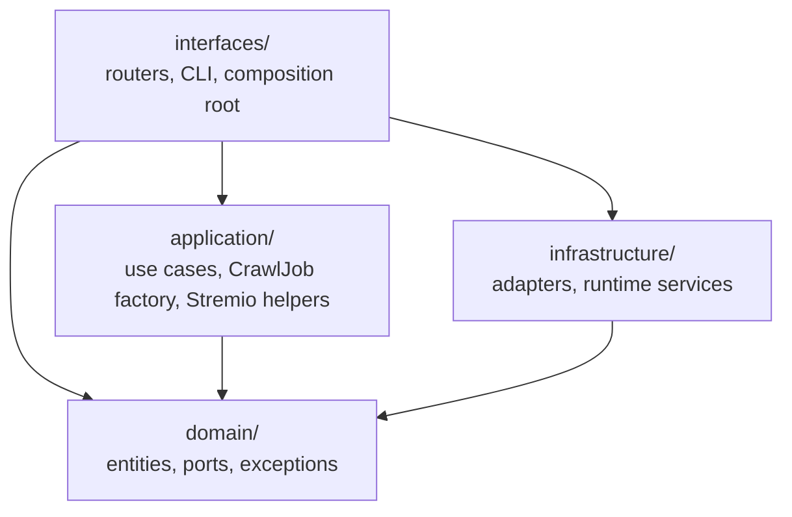

# Architecture rules

> **Purpose:** The dependency rule, the layer contracts and the invariants.
> **Status:** target
> **As of:** 86d497b5

The rules every change to `src/scavengarr/` must keep.
How the code implements them now: [`docs/current/architecture.md`](../current/architecture.md).

## Rule

### The dependency rule

Source code must depend inward only.
Each layer may import what its row allows, and nothing else:

| Layer | Holds | May import | Must not import |
|---|---|---|---|
| `domain/` | Entities, value objects, `Protocol` ports and the domain exceptions. | The standard library. | Another layer or any third-party library. |
| `application/` | Use cases, the CrawlJob factory and the Stremio search and resolution helpers. | `domain/`, the standard library and framework-free libraries (`structlog`, `unidecode`). | `infrastructure/`, `interfaces/`, frameworks and I/O libraries (`fastapi`, `httpx`, `patchright`, `diskcache`). |
| `infrastructure/` | The adapters behind the domain ports and the runtime services. | `domain/`, the standard library and libraries. | `application/` or `interfaces/`. |
| `interfaces/` | The FastAPI routers, the CLI and the composition root. | Every layer and libraries. | Nothing is excluded. |

The layer graph shows every allowed edge; an edge it does not show is forbidden:

Infrastructure must never import application.
Application and infrastructure meet only in the domain's ports and types, and in the composition root that wires them.

### Layer contracts

- `domain/` must stay framework-free and I/O-free: no network, file or cache access.
- Entities and value objects must be `@dataclass` classes, with `frozen=True` where they are immutable.
- Ports must be `Protocol` classes, never ABCs.
- A port that does no I/O must be synchronous (`PluginRegistryPort`, `TelemetryPort`, `PluginHistoryPort`); a port that does I/O or waits for a slot must be asynchronous.
- Domain exceptions must carry business meaning; the interfaces layer maps them to HTTP status codes.
- `application/` must know ports, never adapters: every dependency comes in through a constructor.
- Infrastructure behaviour that no port covers must come into the application as an injected callable or a local `Protocol` (the Stremio use case's `convert_fn`, `filter_fn`, `episode_filter_fn`, `resolve_fn`, `cached_resolution_fn` and `browser_warmup_fn`).
- `infrastructure/` must implement the domain ports.
- Plugins and hoster resolvers are infrastructure: they must import only `domain/` and `infrastructure/`.
- Plugins and hoster resolvers must not record metrics: the core records its steps through `TelemetryPort`.
- `interfaces/` must do I/O only: it parses a request, calls a use case and renders the answer; no business rule lives there.
- `interfaces/composition.py` must be the only place that builds the concrete adapters and wires them.
- Routers must read the wired objects from the app state (`cast(AppState, request.app.state)`), never build adapters themselves.

### Invariants

- Nothing may block the event loop: I/O must be asynchronous, and CPU-bound work must run in a worker thread through `asyncio.to_thread` (`run_in_executor` drops the log context).
- A stall of the event loop must be named from a thread outside it, with the loop thread's stack, and the process must end on a stall only with `watchdog.exit_on_stall` on ([0016](decisions/0016-in-process-stall-monitor.md)).
- Independent URLs (detail pages, link checks) must run in parallel with bounded concurrency.
- Link validation must try `HEAD` with redirects first and `GET` only when `HEAD` fails, with short timeouts and a semaphore.
- Stremio search results must be cached per title and shared by the requests for that title while the search runs (single-flight).
- A stale cache entry must answer while one background search at a time refreshes it (stale-while-revalidate).
- A Stremio request must answer at its answer budget with the results known by then.
- The answer budget must cut no plugin: each plugin runs to its plugin timeout, and its later results reach the cache and the next request.
- A cache entry written before every plugin finished must name the missing plugins, and one completion search must fill it.
- Resolved streams must not be cached with the search results: every request asks the hoster resolver registry, which caches the outcomes with lifetimes of their own.
- The registry's outcomes, redirects, last lookups and open circuit breakers must outlive a restart, restored before the app reports ready.
- Background searches and resolutions must end at shutdown, before the cache closes.
- The plugins' long-term record is the evidence for keeping, disabling or removing a plugin whose site died: the maintainer decides from it, no threshold does.
- A CrawlJob must carry only the links that passed validation (with `validate_download_links` on), in a deterministic order; grab-time links are stored as the plugin returns them.
- CrawlJob ids must be random UUID4s.
- The configuration precedence must be, from high to low: CLI arguments, `SCAVENGARR_*` environment variables (a `--dotenv` file's values included; the real environment wins), YAML, defaults.
- Every setting must be read in `src/` outside the config package, or its description must declare it unused (`tests/unit/infrastructure/test_config_settings_read.py`).
- A secret setting must carry `password`, `token`, `key` or `secret` in its name or have the `SecretStr` type, so the startup line `config_effective` masks it.
- Logs must be structured (`structlog`) with context fields, every HTTP request must bind `request_id`, and no log may carry a secret.
- Metric label values must come from fixed sets: no titles, ids, URLs or domains, and no URLs or titles in span attributes.

## Rationale

- I/O dominates the runtime, and the rules worth testing sit in the domain and the use cases: with ports, a use case's test replaces every adapter with a fake, and an adapter changes without touching a use case.
- Protocols type structurally: an adapter satisfies a port without inheriting from it, and any object with the right methods serves as a test double.
- Synchronous ports where no I/O happens keep the call sites simple: plugin discovery reads local files, telemetry and the plugin history count in memory.
- An adapter that imported a use case would tie the adapter's tests to the use case's wiring and allow import cycles through the ports.
- One composition root builds the whole object graph, so the start order and the shutdown order read in one function.
- The layered configuration gives defaults that run, YAML per deployment, environment variables for containers and CLI arguments per invocation, with one precedence and no surprises.

## Consequences

- Use case tests mock the ports; the mock pattern per port is in `AGENTS.md` §6.
- State that the application sets and infrastructure reads across an `await` lives in a domain port: the context variables `page_claim` (`domain/ports/browser_fetcher.py`) and `challenge_flag` (`domain/ports/plugin_history.py`).
- A rule that both the application and an adapter apply lives in the domain: `is_partial_title()` in `domain/entities/stremio.py`.
- The null objects of optional ports live in the domain too: `NO_TELEMETRY`, `NO_PLUGIN_HISTORY`, `NO_ANIME_IDS`, `NO_SERIES_META`.
- No test checks the imports: a breach of the dependency rule shows up in a review.

## Exceptions

- None inside `src/scavengarr/`: no module imports a layer its row forbids, `TYPE_CHECKING` imports included.
- `plugins/` lies outside the layers: its modules are infrastructure adapters loaded at runtime, importing `domain/` and `infrastructure/` only.
- `scripts/` and `tests/` may import any layer.

## References

- [`docs/current/architecture.md`](../current/architecture.md): the module map, the request flows, the composition and the shutdown order.
- [`docs/target/decisions/0001-dependency-rule.md`](decisions/0001-dependency-rule.md): the decision behind the rule.
- [`docs/target/decisions/0016-in-process-stall-monitor.md`](decisions/0016-in-process-stall-monitor.md): the stall monitor in the process, its exit switch off.
- `src/scavengarr/interfaces/composition.py`: the composition root.
- `AGENTS.md` §3 and §5: the agents' summary of these rules and the typing rules.
